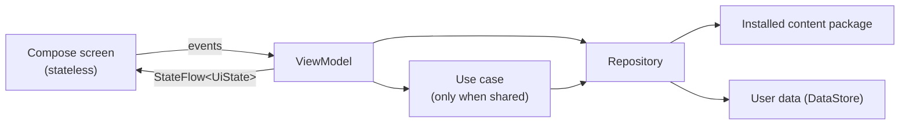
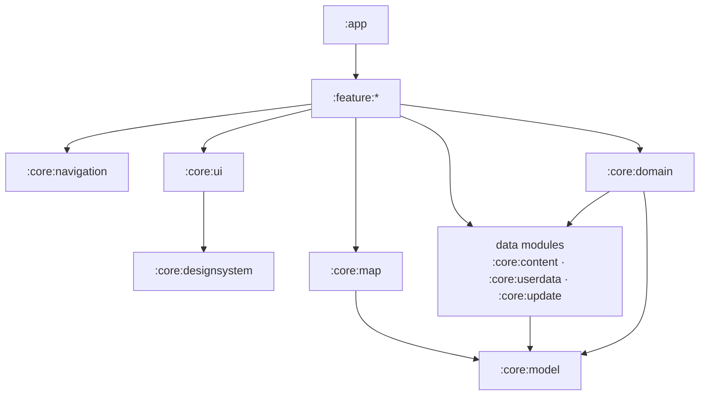

# 0003. v1 app architecture and modules

**Status:** Proposed (2026-11-13). Needs the owner's approval before the app is scaffolded.

## Context

v1 is written from scratch on the stack in [ADR 0002](0002-proposed-stack.md): Kotlin, Jetpack Compose, MapLibre Native (OpenGL), local PMTiles, Arabic labels drawn by the system. It must stay maintainable as content grows from 26 events (Taif to Badr) to the whole Seerah, and it must be easy for people and AI agents to work on without breaking each other's work.

What the architecture has to carry:

- A map that changes with time (names, landmarks, routes), restricted to the Hijaz in v1.
- An index, an event and situation reader with sourced texts, free exploration and an optional follow-along.
- Content that is a replaceable, versioned package, and user data (progress, settings, resume point) that survives every content update.
- Fully offline use; the network only for a content update the user starts.
- Phone and tablet layouts, Arabic RTL only.

## Options compared

### Overall pattern

| Option | Who uses it | Fit |
| --- | --- | --- |
| **Official layered architecture** (UI → optional domain → data), ViewModel exposing `StateFlow` UI state, unidirectional data flow | Google's [Guide to app architecture](https://developer.android.com/topic/architecture) and its reference app [Now in Android](https://github.com/android/nowinandroid) | Best documented, most hires and agents know it, works with every Jetpack library |
| Circuit (presenter + UI, compose-driven) | Slack | Clean, but a smaller ecosystem and a second pattern to learn |
| MVI frameworks (Orbit, Mavericks) | Airbnb (Mavericks), various | Adds a framework on top of what ViewModel + `StateFlow` already give |

**Choice:** the official layered architecture. The domain layer is used only where logic is shared or complex, as the guide recommends; for us that is time resolution (which name, landmark and route apply in a given year), which the map, the index and the reader all need.

### Navigation

| Option | Status | Fit |
| --- | --- | --- |
| **Navigation 3** | Stable (1.2.x); Now in Android has migrated to it | Back stack is plain state we own; Material adaptive scene strategies give list-detail on tablets |
| Navigation Compose (Nav 2) | Mature, but no longer the direction | Migration to Nav 3 is all-at-once, so starting on Nav 2 means a rewrite later |

**Choice:** Navigation 3, with Material 3 adaptive scene strategies for tablet layouts. Route keys are `@Serializable` types in one shared module.

### Dependency injection

| Option | Model | Fit |
| --- | --- | --- |
| **Hilt** | Compile-time (Dagger), Google-maintained | Official integration with ViewModel, WorkManager and tests; used by Now in Android |
| Metro | Compile-time, Kotlin compiler plugin, 1.x since 2026 | Fast and Kotlin-first, but younger and built mainly for multiplatform, which we don't need |
| Koin | Runtime service locator | Simple, but wiring errors show up at runtime, not at build time |

**Choice:** Hilt. Errors are caught when building, and it is the default the official guidance and samples use.

### Modules

| Option | Fit |
| --- | --- |
| One module with packages | Fine for a spike; boundaries are not enforced, builds slow down as it grows |
| **Feature modules + core modules** (Now in Android style) | Boundaries enforced by Gradle; parallel builds; each module small enough to understand on its own |
| Feature `api`/`impl` pairs for navigation | Useful with many teams and features; for six features it doubles the module count for little gain |

**Choice:** feature and core modules. Navigation keys live in one `core:navigation` module instead of per-feature `api` modules. We can split later if features multiply.

### Supporting libraries

| Need | Choice | Compared with | Why |
| --- | --- | --- | --- |
| Async | Kotlin coroutines and `Flow` | RxJava | Official recommendation; structured concurrency |
| Serialization (content, nav keys, user data) | kotlinx.serialization | Moshi, Gson | Kotlin-first, compile-time, no reflection; Navigation 3 keys already use it |
| User data | DataStore with a kotlinx.serialization serializer | Room, Proto DataStore | Small, typed, transactional; no protobuf toolchain; kept apart from content |
| Content update download | OkHttp inside WorkManager | Ktor client, `HttpURLConnection` | OkHttp is the Android standard (range requests, TLS); WorkManager is the official API for work that must survive the app closing |
| Content storage | Decided in ADR 0005 (content package format) | | Hidden behind `core:content`, so the choice does not affect other modules |

## Decision

### Layers and data flow



- Screens are stateless composables; a thin route composable connects each to its ViewModel.
- ViewModels expose one immutable `UiState` as `StateFlow` and take user actions as function calls.
- Repositories are the single source of truth for each data type and expose `Flow`.
- Expected failures are `sealed` results; exceptions are bugs.

### Module layout

The Android project moves from `app/` to **`android/`**, so the application module can be `:app` as in the official samples, and the folder name says what it holds. The spike moves with it (`android/spike`) until it is removed.

```text
android/
  build-logic/          convention plugins (shared Gradle setup, see ADR 0004)
  app/                  :app            application, navigation host, Hilt root, app-wide wiring
  core/
    model/              :core:model     plain Kotlin models: Phase, Event, Situation, Text, Source, Place, dates and precision
    domain/             :core:domain    time resolution and other shared rules (plain Kotlin, no Android)
    content/            :core:content   reads the installed content package; installs and activates new versions
    update/             :core:update    checks for, downloads and verifies content updates (WorkManager, OkHttp)
    userdata/           :core:userdata  progress, settings and resume point (DataStore)
    map/                :core:map       the only module that touches MapLibre: map composable, style, label images, time states, camera limits
    designsystem/       :core:designsystem  theme from the Penpot tokens, fonts, reusable components
    ui/                 :core:ui        model-aware UI pieces: Arabic dates, source citations, place-accuracy notes
    navigation/         :core:navigation  Navigation 3 route keys shared by all features
    analytics/          :core:analytics   interface only, with a no-op implementation until the analytics tool is chosen
    testing/            :core:testing   fakes and test rules
  feature/
    explore/            :feature:explore   map with the time bar and markers (the main screen)
    index/              :feature:index     phases and events
    event/              :feature:event     event and situation reader: texts, sources, explanation
    story/              :feature:story     follow-along
    settings/           :feature:settings  content updates, about
  benchmarks/           :benchmarks     startup and map benchmarks, Baseline Profile generation
```

Feedback gets its own feature module once its fields and delivery are decided (an open decision).

### Dependency rules



- Features never depend on other features; they navigate through keys in `core:navigation`.
- Only `core:map` depends on MapLibre. Screens describe what the map shows (places, routes, selected year, focus area) and `core:map` draws it.
- `core:model` and `core:domain` are plain Kotlin with no Android dependency, so the time rules are tested on the JVM.
- Content and user data never share storage. User data refers to content only by stable IDs, and copes with an ID that a content update removed.
- Nothing is hard-coded that belongs to content: the Hijaz bounds, zoom levels, place names and time states come from the content package.

### Packages and identifiers

- Kotlin packages under `app.seerah.<module>` (for example `app.seerah.core.map`).
- Application ID: `app.seerah` for development. The final ID is fixed at the first Play Store upload and cannot change after it; to be confirmed by the owner before then.
- Minimum Android version: **8.0 (API 26)**, as in the spike. All three test devices are far above it; the final value is the owner's call before the beta.
- Single activity, edge-to-edge, Compose only (no XML layouts or fragments).

## Consequences

- The structure is set up front: about 18 modules before the first screen. Convention plugins (ADR 0004) keep each module's build file to a few lines.
- Time rules live in one place (`core:domain`) and are tested without a device.
- MapLibre can be upgraded, or replaced, by changing one module.
- Agents and contributors can work on one feature without touching others; Gradle rejects a dependency that breaks the rules.
- Moving `app/` to `android/` touches the CI workflow, `.gitignore` and the docs; done in the scaffolding change.
- Follow-up decisions: ADR 0004 (build and quality tooling), ADR 0005 (content package format).

## References

- [Guide to app architecture](https://developer.android.com/topic/architecture) and [architecture recommendations](https://developer.android.com/topic/architecture/recommendations), Android Developers.
- [Now in Android](https://github.com/android/nowinandroid) and its [build-logic](https://github.com/android/nowinandroid/blob/main/build-logic/README.md), Google.
- [Jetpack Navigation 3 is stable](https://developer.android.com/blog/posts/jetpack-navigation-3-is-stable), [Navigation 3 releases](https://developer.android.com/jetpack/androidx/releases/navigation3) and the [Material list-detail recipe](https://developer.android.com/guide/navigation/navigation-3/recipes/material-listdetail).
- [Nav3 spotlight week](https://developer.android.com/blog/posts/learn-about-our-newest-jetpack-navigation-library-with-the-nav3-spotlight-week) (Now in Android migrated to Navigation 3).
- [Metro](https://zacsweers.github.io/metro/1.0.0/quickstart/), Zac Sweers.
