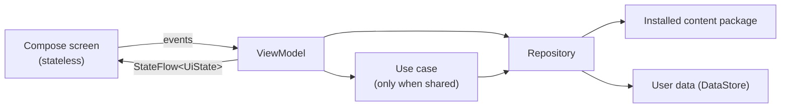
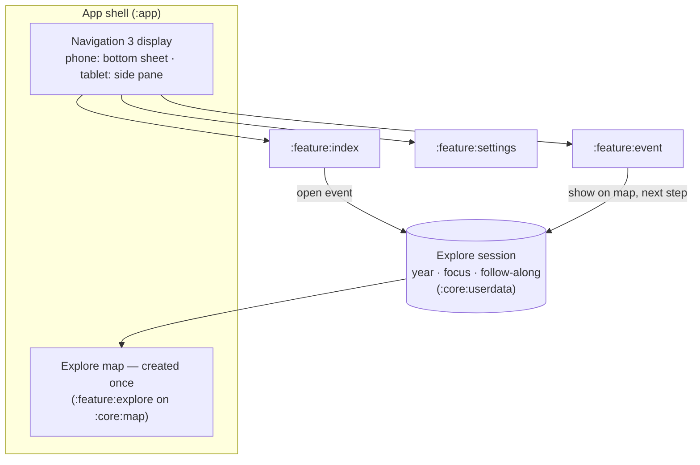
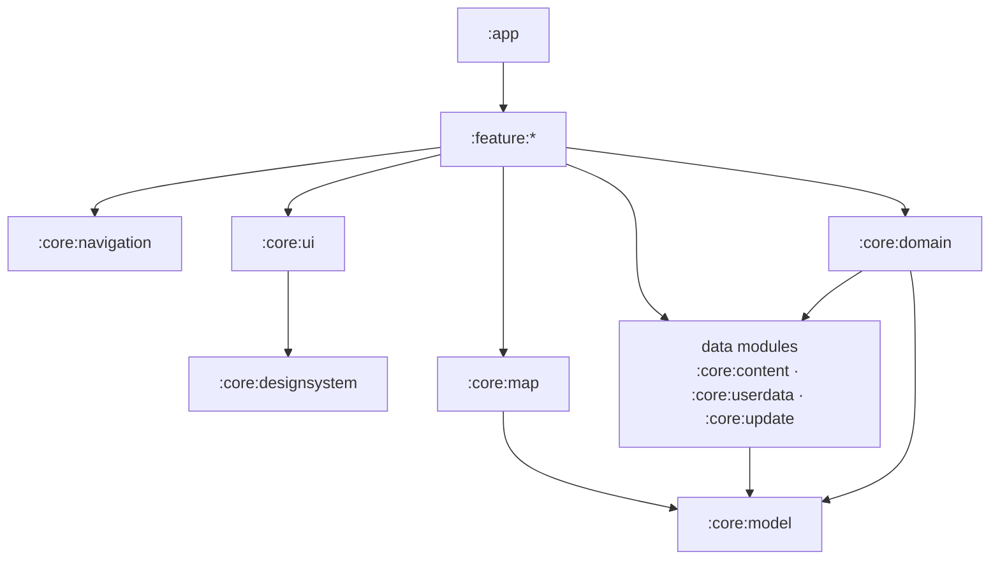

# 0003. v1 app architecture and modules

**Status:** Accepted by the owner on 2026-11-13, after a second review. Includes the owner's agreement to the `android/` folder, API 26 as the minimum, and `app.seerah` as the development application ID.

## Context

v1 is written from scratch on the stack in [ADR 0002](0002-proposed-stack.md): Kotlin, Jetpack Compose, MapLibre Native (OpenGL), local PMTiles, Arabic labels drawn by the system. It must stay maintainable as content grows from 26 events (Taif to Badr) to the whole Seerah, and it must be easy for people and AI agents to work on without breaking each other's work.

What the architecture has to carry:

- A map that changes with time (names, landmarks, routes), restricted to the Arabian Peninsula in v1 (widened from the Hijaz by the owner on 2026-11-13), and that stays on screen while the user reads.
- An index, an event and situation reader with sourced texts, free exploration and an optional follow-along.
- Content that is a replaceable, versioned package, and user data (progress, settings, resume point) that survives every content update.
- Fully offline use; the network only for a content update the user starts.
- Phone and tablet layouts, Arabic RTL only, whatever the device language.

## Options compared

### Overall pattern

| Option | Who uses it | Fit |
| --- | --- | --- |
| **Official layered architecture** (UI → optional domain → data), ViewModel exposing `StateFlow` UI state, unidirectional data flow | Google's [Guide to app architecture](https://developer.android.com/topic/architecture) and its reference app [Now in Android](https://github.com/android/nowinandroid) | Best documented, most developers and agents know it, works with every Jetpack library |
| Circuit (presenter + UI, Compose-driven) | Slack | Clean, but a smaller ecosystem and a second pattern to learn |
| MVI frameworks (Orbit, Mavericks) | Airbnb (Mavericks), others | Adds a framework on top of what ViewModel + `StateFlow` already give |

**Choice:** the official layered architecture. The domain layer is used only where logic is shared or complex, as the guide recommends: for us, time resolution (which name, landmark and route apply in a given year) and the follow-along rules.

### Screen structure: a map that stays

| Option | Who does it | Fit |
| --- | --- | --- |
| **One long-lived map, with content in panels over it** (bottom sheet on phones, side pane on tablets) | Google Maps and most map-first apps | The map is created once; camera, loaded tiles and label images are kept while the user reads |
| Each screen a full destination, the map recreated when the user returns | Typical list/detail apps | Recreating the map costs time and memory: the spike measured 3.5 s to a first full map on the low-end phone, and the camera position is lost |

**Choice:** one map in the app shell, under a Navigation 3 display that shows the index, the event reader and settings as panels. Phones use a bottom-sheet scene; tablets use a side pane (Material 3 adaptive). Screens change the map by updating a shared explore session (selected year, focused place or event, follow-along step), not by talking to the map.

### Navigation

| Option | Status | Fit |
| --- | --- | --- |
| **Navigation 3** | Stable (1.2.x); Now in Android has migrated to it | The back stack is plain state we own; scene strategies give the bottom sheet and the tablet side pane over the map |
| Navigation Compose (Nav 2) | Mature, no longer the direction | Moving to Nav 3 later is all-at-once, so starting on Nav 2 means a rewrite |

**Choice:** Navigation 3. Route keys are `@Serializable` types in one shared module. Navigation 3 does not put route arguments in `SavedStateHandle`, so ViewModels receive their key through Hilt assisted injection.

### Dependency injection

| Option | Model | Fit |
| --- | --- | --- |
| **Hilt** | Compile-time (Dagger), Google-maintained | Official integration with ViewModel, WorkManager and tests; used by Now in Android |
| Metro | Compile-time, Kotlin compiler plugin, 1.x since 2026 | Fast and Kotlin-first, but younger and built mainly for multiplatform, which we don't need |
| Koin | Runtime service locator | Simple, but wiring errors show up at runtime, not at build time |

**Choice:** Hilt. Wiring errors fail the build, and it is what the official guidance and samples use.

### Map integration

| Option | Status | Fit |
| --- | --- | --- |
| **Our own thin wrapper** over MapLibre Native Android in `core:map` | MapLibre Native is stable | Full control of what the spike proved: label bitmaps registered as style images, per-feature layers, opacity animation, camera limits |
| [maplibre-compose](https://github.com/maplibre/maplibre-compose) | Official MapLibre project, beta (0.19), minor releases may break the API, built for multiplatform | Declarative and promising, but not yet stable, and support for our label-image approach is unproven |

**Choice:** our own wrapper with a declarative interface, so screens never see MapLibre types. Re-evaluate maplibre-compose when it reaches 1.0; the interface keeps a switch contained to one module.

### Content update download

| Option | Who uses it | Fit |
| --- | --- | --- |
| **User-initiated data transfer job** (JobScheduler, Android 14+) | Google Maps offline downloads: about 10% better download reliability after moving to it | Made for long downloads the user starts; outside app-standby quotas; shows system progress |
| WorkManager with a foreground service | Common default | Works on all versions, but `dataSync` foreground services are time-limited from Android 15 |

**Choice:** the user-initiated job on Android 14 and later, WorkManager with a foreground notification on Android 8–13, behind one interface in `core:update`. Both paths get device coverage: the Oppo A55 (Android 13) and the Galaxy A54 (Android 16). Range resume, integrity and signature checks, and one-step activation are the same on both paths (details in ADR 0005).

### Modules

| Option | Fit |
| --- | --- |
| One module with packages | Fine for a spike; boundaries are not enforced, builds slow down as it grows |
| **Feature modules + core modules** (Now in Android style) | Boundaries enforced by a build check; parallel builds; each module small enough to understand alone |
| Feature `api`/`impl` pairs | Useful with many teams; for four features it doubles the module count for little gain |

**Choice:** feature and core modules, with navigation keys in one `core:navigation` module instead of per-feature `api` modules. A module is created when its first real code lands, not before, so there are no empty modules.

### Supporting libraries

| Need | Choice | Compared with | Why |
| --- | --- | --- | --- |
| Async | Kotlin coroutines and `Flow` | RxJava | Official recommendation; structured concurrency |
| Serialization (content, route keys, user data) | kotlinx.serialization | Moshi, Gson | Kotlin-first, compile-time, no reflection; Navigation 3 keys use it |
| User data | DataStore with a kotlinx.serialization serializer | Room, Proto DataStore | Small, typed, transactional; no protobuf toolchain; kept apart from content |
| Download client | OkHttp | Ktor client, `HttpURLConnection` | The Android standard for range requests and TLS |
| Content storage | Decided in ADR 0005 | | Hidden behind `core:content` |

## Decision

### Layers and data flow



- Screens are stateless composables; a thin route composable connects each to its ViewModel.
- ViewModels expose one immutable `UiState` as `StateFlow` and take user actions as function calls.
- Repositories are the single source of truth for each data type and expose `Flow`.
- Expected failures are `sealed` results; exceptions are bugs.

### App shell



The explore session is persisted, so a relaunch restores the last place and time and offers to resume the follow-along, as the requirements ask.

### Module layout

```text
android/
  build-logic/          convention plugins (ADR 0004)
  app/                  :app                application, app shell, navigation host, Hilt root
  core/
    model/              :core:model         plain Kotlin models: Phase, Event, Situation, Text, Source, Place, dates and precision
    domain/             :core:domain        time resolution and follow-along rules (plain Kotlin, no Android)
    content/            :core:content       reads the installed content package; installs and activates new versions
    update/             :core:update        checks for, downloads and verifies content updates
    userdata/           :core:userdata      progress, settings and the explore session (DataStore)
    map/                :core:map           the only module that touches MapLibre: map composable, style, label images, time states, camera limits
    designsystem/       :core:designsystem  theme from the Penpot tokens, fonts, reusable components (no app models)
    ui/                 :core:ui            model-aware UI pieces: Arabic dates, source citations, place-accuracy notes
    navigation/         :core:navigation    Navigation 3 route keys shared by all features
    testing/            :core:testing       fakes and test rules
  feature/
    explore/            :feature:explore    the map layer: markers, time bar, follow-along controls
    index/              :feature:index      phases and events
    event/              :feature:event      event and situation reader: texts, sources, explanation
    settings/           :feature:settings   content updates, about, open-source notices
```

Created later, when their work starts: `:core:analytics` (once the analytics tool is chosen), a feedback feature (once its fields and delivery are decided), and `:benchmarks` (startup and map benchmarks, Baseline Profiles) once the first screen exists.

The follow-along is a mode of exploring, not a screen: its rules live in `core:domain`, its state in the explore session, and its controls in `feature:explore` and `feature:event`.

### Dependency rules



- Features never depend on other features; they navigate through keys in `core:navigation` and share state through the explore session.
- Only `core:map` depends on MapLibre.
- `core:model` and `core:domain` are plain Kotlin with no Android dependency, so the time rules are tested on the JVM.
- Content and user data never share storage. User data refers to content only by stable IDs, and copes with an ID that a content update removed.
- Nothing that belongs to content is hard-coded: the map bounds, zoom levels, place names and time states come from the content package.
- These rules are checked by the build (ADR 0004), not left to review.

### Platform and identity

- **SDK levels:** minimum API 26 (Android 8.0). Compile and target the latest stable level, API 37 (Android 17, stable since June 2026); Google Play requires at least API 36 for new apps.
- **Large screens:** no orientation lock. Android 16 and later ignore orientation and resizability limits on tablets, and API 37 removes the opt-out, so every screen works in portrait and landscape and at any window size.
- **16 KB memory pages:** required by Google Play for app updates from February 2027. MapLibre Native has been built for it since 11.5; the build checks the alignment of every native library (ADR 0004).
- **Edge-to-edge and predictive back** throughout, as the current target level requires.
- **Arabic and RTL always:** the app declares Arabic as its only locale and lays out right-to-left even on a device set to another language. Digits are formatted by our own formatter, so Arabic-Indic digits don't depend on the device region.
- **Backup:** content packages are excluded from Android backup (they can be downloaded again). Whether user data is backed up follows the open decision on backup and restore; the backup rules are written explicitly either way.
- **Accessibility:** everything reachable on the map is also reachable through the index, with TalkBack labels, because map markers cannot be fully accessible.
- **Identifiers:** Kotlin packages under `app.seerah.<module>`. Application ID `app.seerah` for development; the final ID is fixed by the owner before the first Play Store upload, since it cannot change afterwards.
- Single activity, Compose only (no XML layouts or fragments).

## Consequences

- About 15 modules at the start, each with a build file of a few lines thanks to the convention plugins.
- The map is created once per launch: no reload when the user moves between the index, the reader and the map.
- Time rules and follow-along rules live in one place and are tested without a device.
- MapLibre can be upgraded, or replaced by maplibre-compose, by changing one module.
- Two download paths to maintain (API 34+ and older), in one module with shared verification.
- Moving `app/` to `android/` touches the CI workflow, `.gitignore` and the docs; done in the scaffolding change.
- Follow-up decisions: ADR 0004 (build and quality tooling); ADR 0005 (content authoring and package format, compatibility and signing); ADR 0006 (where content updates are hosted); ADR 0007 (the v1 map data pipeline for the Hijaz).

## References

- [Guide to app architecture](https://developer.android.com/topic/architecture) and [architecture recommendations](https://developer.android.com/topic/architecture/recommendations), Android Developers.
- [Now in Android](https://github.com/android/nowinandroid) and its [build-logic](https://github.com/android/nowinandroid/blob/main/build-logic/README.md), Google.
- [Navigation 3 is stable](https://developer.android.com/blog/posts/jetpack-navigation-3-is-stable), [releases](https://developer.android.com/jetpack/androidx/releases/navigation3), the [bottom sheet recipe](https://developer.android.com/guide/navigation/navigation-3/recipes/bottomsheet) and the [Material list-detail recipe](https://developer.android.com/guide/navigation/navigation-3/recipes/material-listdetail).
- [Nav3 spotlight week](https://developer.android.com/blog/posts/learn-about-our-newest-jetpack-navigation-library-with-the-nav3-spotlight-week) (Now in Android migrated to Navigation 3).
- [Google Maps improved download reliability with user-initiated data transfer](https://android-developers.googleblog.com/2024/09/google-maps-improved-download-reliability-user-initiated-data-transfer-api.html) and [Android 15 behaviour changes](https://developer.android.com/about/versions/15/behavior-changes-15) (`dataSync` time limit).
- [maplibre-compose](https://github.com/maplibre/maplibre-compose) and the [MapLibre newsletter, September 2026](https://maplibre.org/news/2026-10-01-maplibre-newsletter-september-2026/).
- [Orientation and resizability changes in Android 16](https://android-developers.googleblog.com/2025/01/orientation-and-resizability-changes-in-android-16.html), [16 KB page sizes](https://developer.android.com/guide/practices/page-sizes), [Google Play target API requirements](https://support.google.com/googleplay/android-developer/answer/11926878).
- [Metro](https://zacsweers.github.io/metro/1.0.0/quickstart/), Zac Sweers.
