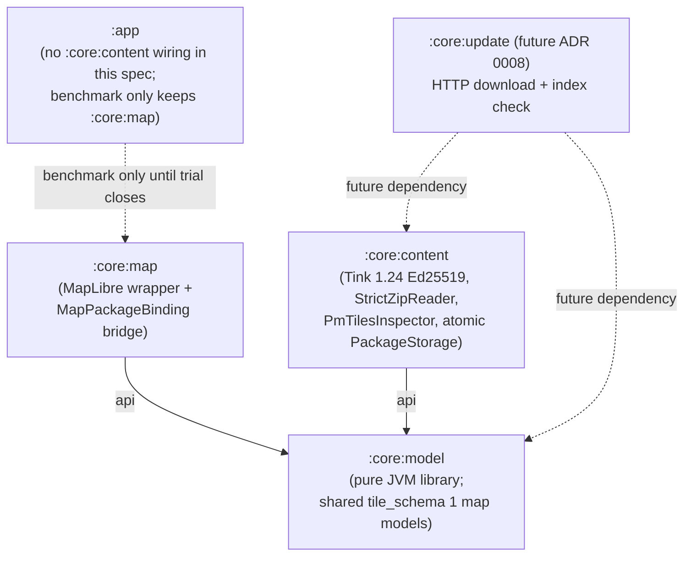

<!--
SPDX-FileCopyrightText: 2026 Mohamed Farag
SPDX-License-Identifier: Apache-2.0
-->

# v1 Android package verification, storage and tile_schema 1 map spec

- **Author:** MohdFarag
- **Status:** Proposed — revised after [Elephant-Goldfish Model (EGM) review](egm-review-v1-android-package-and-map/consolidated_review_report.md); awaiting owner approval of D1, D2, and D5 (`D3` moved to an internal technical decision; `D4` deferred)
- **Date:** 2026-11-28

## Overview

This specification defines Android's v1 package verification, atomic storage lifecycle, and `tile_schema: 1` map-loading bridge implementing [ADR 0003](../adr/0003-v1-architecture-and-modules.md), [ADR 0004](../adr/0004-build-and-quality-tooling.md), [ADR 0007](../adr/0007-content-formats-compatibility-and-signing.md), [ADR 0008](../adr/0008-update-hosting-and-index.md) (key-compromise version-floor reset), and [ADR 0009](../adr/0009-map-data-pipeline.md) (reading `data/map.json` and `tile_schema: 1`). On the device side, it pairs directly with the host-side build and signing pipeline specified in [`v1-map-pipeline-spec.md`](v1-map-pipeline-spec.md) and [`tools/packages/`](../../tools/packages/README.md).

The specification delivers four coordinated pieces across `build-logic`, `:core:model`, `:core:content`, and `:core:map`:

1. **`:core:model` (pure Java Virtual Machine module via `seerah.jvm.library`)**: seven immutable, framework-free models describing `tile_schema: 1` map metadata (`GeoBounds`, `ReliefEncoding`, `BaseSourceMetadata`, `ReliefSourceMetadata`, `MapSourcesMetadata`, `MapCredit`, `MapMetadata`). Package and storage types stay inside `:core:content` so `:core:model` never leaks packaging internals.
2. **`:core:content` (Android library with Google Tink `1.24.0` and `kotlinx-serialization-json`)**: strict trusted keyring loading (`trusted_package_keys.json`), isolated single-key Ed25519 `NO_PREFIX` verify-before-parse signature checking (raw 64-byte signatures without a 5-byte Tink header), strict `FileChannel` ZIP container validation and streaming extraction, pure-Kotlin PMTiles v3 binary/directory/metadata validation, `data/map.json` validation, `StatFs` free-space gating with filesystem block-slack accounting, atomic `v<version>-g<gen>/` plus `active.json` activation under a single shared `Mutex`, crash/orphan recovery, and key-compromise version-floor reset.
3. **`:core:map` `tile_schema: 1` bridge**: maps a verified `MapMetadata` and extracted `data/` directory into `CameraLimits`, `MapFiles`, `MapStyleSpec`, and `styleCValueRamp`, leaving [`android/app/src/benchmark/`](../../android/app/src/benchmark/) (`app.seerah.trial`), [`MapStyleSpec.kt`](../../android/core/map/src/main/kotlin/app/seerah/map/MapStyleSpec.kt), and [`StyleJson.kt`](../../android/core/map/src/main/kotlin/app/seerah/map/StyleJson.kt) untouched until the Oppo A55 and Huawei MatePad 11.5 trial measurements finish.
4. **Cross-language verification & release guards**: deterministic golden `.zip` test fixtures produced by [`tools/packages/`](../../tools/packages/README.md) with byte-equality continuous integration (CI) drift checks, pure-JVM vs. Robolectric unit tests, `:core:content` release-key tests paired with a Python CI release guard (`tools/android/check_trusted_keys.py`), and an R8 Full Mode shrunk runtime smoke gate before completing Phase 3.

---

## Owner Decisions (Awaiting Approval)

These three design choices (`D1`, `D2`, and `D5`) sit within accepted Architecture Decision Records (ADRs) and await Mohamed's sign-off before Phase 1 starts.

| ID | Topic | Recommended option | Alternative | Why |
| --- | --- | --- | --- | --- |
| **D1** | Module placement of Tink verification & installer ([ADR 0003](../adr/0003-v1-architecture-and-modules.md)) | **Put verification, strict ZIP extraction, PMTiles/map validation, and atomic storage in `:core:content` now; defer `:core:update` until ADR 0008 networking/index work.** Record a narrow amendment in ADR 0003 (lines 143–144, which originally assigned signature checking and update handling to `:core:update`) stating `:core:update` will depend on `:core:content` and reuse `Ed25519Verifier` and `PackageInstaller`. | Create `:core:update` now alongside `:core:content`, or add a new `:core:packages` module. | [DependencyRules.kt](../../android/build-logic/convention/src/main/kotlin/app/seerah/buildlogic/DependencyRules.kt) keeps `:core:domain -> :core:content` strictly isolated from networking libraries (`OkHttp`, WorkManager) in `:core:update`; putting verify-before-install inside `:core:content` guarantees no unverified install entrypoint exists in `release`. |
| **D2** | Trusted public keys storage & pre-ceremony state in `release` | **Store `{"keys": []}` in `android/core/content/src/main/res/raw/trusted_package_keys.json` as an Android-only pre-ceremony placeholder.** Empty `keys` puts `:core:content` in fail-closed `KeyRingState.Unconfigured` (`PackageFailure.KeyRingNotConfigured`). Once the offline key ceremony runs per [`signing-runbook.md`](../signing-runbook.md), embed `1..2` public keys wrapped in `{"keys": [...]}`. Guard against accidental test keys with both `TrustedKeysGuardTest` and a Python release guard script (`tools/android/check_trusted_keys.py`) in CI. Note: Python `tools/packages` `signing.py` `verify` requires `1..2` keys and rejects empty `[]`. | Hard-code 32-byte key literals in Kotlin, or block Android work until the offline key ceremony runs. | Gives one canonical `{"keys": [...]}` format once keys are minted, avoids drifting copies, lets verification and CI run cleanly before real signing keys are minted, and ensures release builds fail closed if real keys are not embedded yet. |
| **D5** | Handling non-empty `reconstructed_areas` in `data/map.json` before disclosure UI exists | **Fail closed across all build types (`PackageFailure.UnsupportedReconstructedAreas(count)`) whenever `reconstructed_areas` is non-empty**, decoded as an untyped `JsonArray` without defining a premature `ReconstructedArea` model. Still ignore unknown optional JSON fields, additive vector layers (`valley`), and additive archives (`relief-detail.pmtiles`). Note: this also rejects non-empty `reconstructed_areas` in `test` builds until disclosure UI lands (stricter than [ADR 0009](../adr/0009-map-data-pipeline.md) decision 11's `stable`-only gate). | Parse and ignore `reconstructed_areas`, relying solely on publishing discipline and `min_app_version`. | Enforces ADR 0009 decision 11 directly in the client without guessing any schema fields prohibited by [`open-decisions.md`](../open-decisions.md). Easily extended when the reconstruction schema and disclosure UI receive their own spec. |

### Dispositions of Former `D3` and `D4` After EGM Review

To preserve ID continuity with [`consolidated_review_report.md`](egm-review-v1-android-package-and-map/consolidated_review_report.md):

- **Former `D3` (Active package pointer persistence):** Moved out of Owner Decisions into Section 7's internal technical comparison table ([ADR 0003](../adr/0003-v1-architecture-and-modules.md) already scopes Jetpack DataStore to `:core:userdata`, and [ADR 0007](../adr/0007-content-formats-compatibility-and-signing.md) leaves the atomic storage mechanism to implementation).
- **Former `D4` (Wiring startup cleanup into `:app` `SeerahApplication`):** **Deferred** until `:core:update` or first-launch onboarding connects a real caller to `PackageInstaller`. Under Android Gradle Plugin (AGP) R8 Full Mode (`isMinifyEnabled = true`), calling only `cleanupOrphanedFiles()` leaves Tink and `PackageInstaller` unreachable and stripped anyway; `:app` lacks `kotlinx-coroutines-core` in its `main` configuration; and `benchmark` (`initWith(release)`) shares `SeerahApplication`, so launching background disk I/O during `onCreate()` would interfere with pending Oppo A55 and Huawei MatePad 11.5 trial open-time measurements.

---

## Explicit Non-Goals (Respecting `docs/open-decisions.md`)

To comply strictly with [`docs/open-decisions.md`](../open-decisions.md) and [`AGENTS.md`](../../AGENTS.md):

1. **No HTTP networking or update-index polling:** No OkHttp, no `INTERNET` permission, no `index.json` parser, and no WorkManager download jobs (`:core:update` belongs to its own spec under [ADR 0008](../adr/0008-update-hosting-and-index.md)).
2. **No first-launch bundling vs. download choice:** `PackageInstaller` accepts any locally readable `.zip` `File`, whether unpacked later from an asset pack or fetched to a download cache file.
3. **No Room database or historical entity parsing:** Importing [`content/schema/content.schema.json`](../../content/schema/content.schema.json) JSON files into Room entities belongs to the content-database spec. In this phase, verified `content` packages undergo cryptographic verification, strict ZIP validation, SHA-256 checking, extraction into `data/`, and local retention of `package.zip` per [ADR 0007](../adr/0007-content-formats-compatibility-and-signing.md) decision 7.
4. **No hard-coded open map parameters:** Never hard-code final Arabian Peninsula bounds, camera `min_zoom`/`max_zoom`, regional max zoom (`11` vs. `12`), chosen encoding (`terrarium-value` vs. `painted-rgba`), or style `reliefFade` (`11.5..13.5` vs. `13.5..15.5`). All map parameters come dynamically from `data/map.json`, and visual theme choices (`MapColours`, `ZoomRange`) are caller inputs to `:core:map`.
5. **No historical reconstruction schema or disclosure UI:** `reconstructed_areas` remains an empty array in pre-disclosure map builds per [ADR 0009](../adr/0009-map-data-pipeline.md) decision 11 and `D5`, with zero Kotlin model fields invented for its future items.
6. **No removal of `app.seerah.trial`:** [`android/app/src/benchmark/`](../../android/app/src/benchmark/), `enforceMapOnlyInBenchmark()`, and [`check_no_trial_code.py`](../../tools/android/check_no_trial_code.py) stay untouched until Oppo A55 and Huawei MatePad 11.5 complete the map trial.

---

## Verified Codebase & External Facts

The baseline facts below were verified directly from repository source files and Maven Central before revising this spec (runtime Gradle, Dependency Analysis Gradle Plugin `buildHealth`, R8 Full Mode, and device checks remain execution gates for Phases 1–3):

1. **Current Android toolchain ([`libs.versions.toml`](../../android/gradle/libs.versions.toml), [`android/build-logic/`](../../android/build-logic/), [`android/build.gradle.kts`](../../android/build.gradle.kts)):**
   - AGP (Android Gradle Plugin) `9.5.3` (built-in Kotlin for Android modules), Kotlin `2.4.21`, KSP (Kotlin Symbol Processing) `2.3.14`, `compileSdk 37.2`, `targetSdk 37`, `minSdk 26`, Java 17 bytecode running on JDK 21.
   - Quality gates: `allWarningsAsErrors = true` on Kotlin, Android Lint `warningsAsErrors = true`, Spotless `8.11.0` (`ktlint 1.8.0` + `composeRules 0.6.8`), DAGP (Dependency Analysis Gradle Plugin `3.20.4`, applied per module with `onAny { severity("fail") }`), `modules-graph-assert` (`2.9.1`), Licensee (`1.14.1`, permitting strictly `Apache-2.0`, `MIT`, `BSD-2-Clause`, `BSD-3-Clause`).
   - Current included modules in [`android/settings.gradle.kts`](../../android/settings.gradle.kts): `:app`, `:core:map`.
2. **Verified new Maven dependencies & licences (checked against Maven Central POMs; all `Apache-2.0`, compatible with Licensee and Java 17 bytecode):**
   - `com.google.crypto.tink:tink-android:1.24.0` — shades protobuf-lite internally; runtime transitive dependencies in its POM are `androidx.annotation:annotation-jvm:1.8.2`, `com.google.code.findbugs:jsr305:3.0.2`, `com.google.code.gson:gson:2.13.2`, `com.google.errorprone:error_prone_annotations:2.41.0` (zero Guava dependency). Pure-Java Ed25519 supports both Android API 26+ and plain host JVM tests.
   - `org.jetbrains.kotlinx:kotlinx-serialization-json:1.13.0` + Gradle plugin `org.jetbrains.kotlin.plugin.serialization` (`2.4.21`) (`Apache-2.0`; verify during Phase 2 whether DAGP `buildHealth` also requires `kotlinx-serialization-core` declared directly or added cleanly).
   - Gradle plugin `org.jetbrains.kotlin.jvm` (`2.4.21`) for pure JVM modules (`:core:model`).
   - `org.jetbrains.kotlinx:kotlinx-coroutines-test:1.11.0` (`Apache-2.0`, test-only) and `androidx.test:core` (version checked at catalog addition) alongside existing `libs.robolectric` and `libs.androidx.test.ext.junit`.
   - Note on DAGP `bundle("hilt")` in [`android/build.gradle.kts`](../../android/build.gradle.kts): existing Hilt modules only depend on `@HiltAndroidApp`; adding `@Singleton` / `@Inject` (`javax.inject.Inject`) in `:core:content` must be checked against `./gradlew buildHealth` in Phase 2 (adding `javax.inject:javax.inject` to `bundle("hilt")` or declaring it if DAGP flags it).
3. **Verified Google Tink `1.24.0` Ed25519 `NO_PREFIX` API (`tink-java` `v1.24.0`):**
   - RFC 8032 (Ed25519 pure EdDSA standard) raw 32-byte public keys and raw 64-byte `NO_PREFIX` signatures (without Tink's 5-byte key-ID prefix) match Python `cryptography`'s `Ed25519PrivateKey.sign()`.
   - Key construction: `Ed25519PublicKey.create(Ed25519Parameters.Variant.NO_PREFIX, Bytes.copyFrom(rawBytes), null)` (`com.google.crypto.tink.util.Bytes`, annotated `@AccessesPartialKey`; caller opts in with `@OptIn(AccessesPartialKey::class)`).
   - Primitive creation without global mutable registry: `KeysetHandle.newBuilder().addEntry(KeysetHandle.importKey(ed25519PublicKey).withFixedId(1).makePrimary()).build().getPrimitive(SignatureConfig2026.get(), PublicKeyVerify::class.java)`. (`SignatureConfig2026` is `public final` in `com.google.crypto.tink.signature`; `SignatureConfigurationV0` is package-private.)
   - Multi-key trap documented in [`v1-map-pipeline-spec.md`](v1-map-pipeline-spec.md): calling `getPrimitive()` on a multi-key `NO_PREFIX` `KeysetHandle` wraps keys inside `PublicKeyVerifyWrapper`, whose `verify(sig, data)` returns `Unit` without identifying which key verified. Each trusted key (`1..2` keys) therefore **must** live in its own single-key `KeysetHandle`.
4. **Backup exclusion already configured ([`backup_rules.xml`](../../android/app/src/main/res/xml/backup_rules.xml), [`data_extraction_rules.xml`](../../android/app/src/main/res/xml/data_extraction_rules.xml)):**
   - Both `<full-backup-content>` (Android 11 and below) and `<cloud-backup>` / `<device-transfer>` (Android 12+) already exclude `<exclude domain="file" path="content/" />`, matching `<filesDir>/content/`.
5. **Module graph & release guards ([`DependencyRules.kt`](../../android/build-logic/convention/src/main/kotlin/app/seerah/buildlogic/DependencyRules.kt)):**
   - `configureModuleGraphRules()` allows `:app -> :(core|feature):.*` and `:core:.* -> :core:.*`, while blocking `:core:model -X> :.*` and `:core:(model|domain) -X> :core:(map|designsystem|ui|navigation|update)`.
   - `enforceMapOnlyInBenchmark()` keeps `:core:map` limited to `benchmark` / `testBenchmark` / `androidTestBenchmark` in `:app` until the map trial finishes; `:core:content` depends only on `:core:model`, never `:core:map` or MapLibre.
   - [`check_no_trial_code.py`](../../tools/android/check_no_trial_code.py) already runs independently in `.github/workflows/android.yml` on the built `app-release.apk`.
6. **`:core:map` existing state ([`StyleJson.kt`](../../android/core/map/src/main/kotlin/app/seerah/map/StyleJson.kt), [`MapStyleSpec.kt`](../../android/core/map/src/main/kotlin/app/seerah/map/MapStyleSpec.kt), [`MapFiles.kt`](../../android/core/map/src/main/kotlin/app/seerah/map/MapFiles.kt), [`SeerahMap.kt`](../../android/core/map/src/main/kotlin/app/seerah/map/SeerahMap.kt), [`Views.kt`](../../android/app/src/benchmark/kotlin/app/seerah/trial/Views.kt), [`StyleJsonTest.kt`](../../android/core/map/src/test/kotlin/app/seerah/map/StyleJsonTest.kt)):**
   - `SeerahMap` wires `setPrefetchZoomDelta(0)` and `onTrimMemory -> MapView.onLowMemory()`.
   - `StyleJson.kt` keeps `internal const val RELIEF_TILE_SIZE = 256`, matching `map.schema.json`'s `"tile_size": { "const": 256 }`. Neither `MapStyleSpec.kt` nor `StyleJson.kt` needs modification.
   - `MapFiles(val relief: File, val base: File)` puts `relief` first and `base` second — callers must use named arguments to avoid swapping files.
   - `Views.kt` defines Style C's stepped `color-relief` ramp (`42->0x00`, `43->0x33`, `127->0x33`, `128->0x66`, `212->0x66`, `213->0x99`); `:core:map` adds `styleCValueRamp(inkArgb)` cleanly without altering `benchmark` or duplicating `benchmark` code prematurely.
7. **Exact Python `tools/packages/` wire contract ([`signing.py`](../../tools/packages/src/seerah_packages/signing.py), [`archive.py`](../../tools/packages/src/seerah_packages/archive.py)):**
   - `signing.py` accepts `1..2` trusted Ed25519 `NO_PREFIX` public keys (`key_id` matching `^[a-z0-9][a-z0-9-]{0,63}$`, canonical padded Base64 32-byte `public_key_base64`, optional 64-char lowercase hex `public_key_hex`, strict key-object fields).
   - `archive.py` produces deterministic single-disk non-ZIP64 archives (`<= 2_147_483_647` bytes) with empty archive comments, strictly contiguous entries starting at byte `0` (`[manifest.json, manifest.sig, lexicographically sorted data/*]`), immediately followed by CD (Central Directory) and a 22-byte EOCD (End of Central Directory) at `totalSize - 22`. `manifest.json` (`<= 1 MiB` for `map`, `<= 4 MiB` for `content`) and `manifest.sig` (`64` bytes) always use `ZIP_STORED`; `data/*` uses `ZIP_STORED` for `map` and `ZIP_STORED` or `ZIP_DEFLATED` for `content`.
   - PMTiles v3 uses a fixed 127-byte little-endian header (`"PMTiles"` + `0x03`, section `(offset, length)` uint64 pairs for `root_directory`, `metadata`, `leaf_directory`, `tile_data`, counts `addressed_tiles_count`, `tile_entries_count`, `tile_contents_count`, uint8 flags, and signed `int32` bounds in `e7` = `degrees * 10^7`). Seerah's accepted compression values are `1` (`NONE`) and `2` (`GZIP`), and accepted tile types are `1` (`MVT`, Mapbox Vector Tile), `2` (`PNG`), and `4` (`WEBP`).

---

## Architecture & Module Layout



*(Future `:core:update`, added in its own specification when ADR 0008 download/index code starts, will depend on `:core:content` and `:core:model`, reusing `Ed25519Verifier` and `PackageInstaller` without exposing any unsigned install path.)*

### Build & Planned File Changes

*Exact internal filenames inside `:core:content` below are illustrative; public contracts are pinned in Sections 1–2 and Section 8.*

```text
android/
  settings.gradle.kts                     Phase 1: include(":core:model")
                                          Phase 2: include(":core:content")
  build.gradle.kts                        Add alias(libs.plugins.kotlin.jvm) apply false
                                          Add alias(libs.plugins.kotlin.serialization) apply false
                                          Verify bundle("hilt") (e.g. javax.inject:javax.inject) via buildHealth
  gradle/libs.versions.toml               Add kotlin-jvm, kotlin-serialization, seerah-jvm-library plugins;
                                          tink-android 1.24.0, kotlinx-serialization-json 1.13.0,
                                          kotlinx-coroutines-test 1.11.0, androidx-test-core
  build-logic/convention/
    build.gradle.kts                      Register seerah.jvm.library plugin
    src/main/kotlin/
      JvmLibraryConventionPlugin.kt       Applies org.jetbrains.kotlin.jvm, app.cash.licensee,
                                          com.autonomousapps.dependency-analysis; configures
                                          KotlinJvmProjectExtension (JVM_17, allWarningsAsErrors = true)
                                          and JavaPluginExtension (VERSION_17) — NOT AndroidCommon;
                                          calls enforceMapLibreBoundary() + configureLicences()
  core/
    model/
      build.gradle.kts                    seerah.jvm.library only (plain Kotlin data classes, zero plugins/JSON libs)
      README.md
      src/main/kotlin/app/seerah/model/
        MapMetadata.kt                    GeoBounds, ReliefEncoding, BaseSourceMetadata, ReliefSourceMetadata,
                                          MapSourcesMetadata, MapCredit, MapMetadata
      src/test/kotlin/app/seerah/model/
        MapMetadataTest.kt
    content/
      build.gradle.kts                    seerah.android.library + seerah.hilt + kotlin-serialization;
                                          defaultConfig { consumerProguardFiles("consumer-rules.pro") };
                                          api(project(":core:model")), api(libs.kotlinx.coroutines.core),
                                          implementation(libs.tink.android, kotlinx.serialization.json,
                                          androidx.core.ktx), testImplementation(coroutines.test,
                                          robolectric, androidx.test.core, junit4, kotlin.test, androidx.test.ext.junit)
      consumer-rules.pro                  ErrorProne compile-only -dontwarn + minimal verified Tink/serialization rules
      README.md
      src/main/res/raw/
        trusted_package_keys.json         {"keys": []} before key ceremony (never any test key)
      src/main/kotlin/app/seerah/content/
        PackageModels.kt                  PackageKind, PackageFileEntry, PackageManifest, InstalledPackageInfo
        PackageResult.kt                  PackageResult, PackageFailure (7 UI cases), InvalidPackageCause
        PackageContracts.kt               Public interfaces & states: TrustedPublicKey, KeyRingState, VerifyOutcome,
                                          Ed25519Verifier, InstalledPackageState, PackageStorage,
                                          PackageStorageMaintenance, PackageInstaller, AvailableSpaceProvider,
                                          AppVersionCodeProvider, PackageStorageLogger
        (illustrative internal classes)   TrustedKeyRingLoader, IsolatedTinkEd25519Verifier, StrictZipReader,
                                          PackageManifestParser, MapMetadataParser, PmTilesInspector,
                                          FileChannelStorage / DefaultPackageStorage, DefaultPackageInstaller,
                                          di/ContentModule.kt
      src/test/
        resources/fixtures/               Python-generated golden signed ZIPs + RFC 8032 public key JSON
        kotlin/app/seerah/content/        Pure-JVM unit tests + Robolectric ContentAndroidBindingsTest
                                          (including TrustedKeysGuardTest checking res/raw/trusted_package_keys)
    map/
      build.gradle.kts                    api(project(":core:model")); testImplementation(libs.robolectric, libs.androidx.test.core) if imported
      src/main/kotlin/app/seerah/map/
        MapPackageBinding.kt              toCameraLimits(), resolveMapFiles(dataDir, metadata),
                                          toStyleSpec(), styleCValueRamp(inkArgb)
      src/test/kotlin/app/seerah/map/
        MapPackageBindingTest.kt          Plain JVM tests for binding, path containment, ramp masking
        MapPackageStyleJsonTest.kt        Robolectric test wiring MapMetadata -> toStyleSpec() -> styleJson()
```

*(Note: `:app/build.gradle.kts` and `SeerahApplication.kt` remain completely untouched in this specification.)*

### Pure-JVM Serialization Boundary (`:core:model`)

| Option | For | Against |
| --- | --- | --- |
| **Plain Kotlin data classes in `:core:model`; internal `@Serializable` wire Data Transfer Objects (DTOs) inside `:core:content`** | Keeps `:core:model` free of `kotlinx-serialization` compiler/runtime dependencies; prevents wire field names (`snake_case`) from leaking into public domain/UI types; keeps the DAGP dependency graph minimal | Small DTO-to-model mapper inside `:core:content` |
| Apply `kotlin.plugin.serialization` directly to `:core:model` | Zero DTO mapper | Couples `:core:model` (`:core:domain`, `:core:map`, feature modules) to JSON wire representation |

**Choice:** Plain immutable Kotlin data classes in `:core:model` (with `seerah.jvm.library` only), and internal `@Serializable` DTOs strictly inside `:core:content`.

---

## Detailed Design Specifications

### 1. Shared Map Metadata Models (`:core:model`, package `app.seerah.model`)

`:core:model` exposes only the 7 shared map types needed across `:core:content`, `:core:map`, and future domain/UI modules:

```kotlin
package app.seerah.model

private const val MAX_WEBMERCATOR_LAT = 85.0511287798066

data class GeoBounds(
    val west: Double,
    val south: Double,
    val east: Double,
    val north: Double,
) {
    init {
        require(west.isFinite() && south.isFinite() && east.isFinite() && north.isFinite())
        require(west in -180.0..180.0 && east in -180.0..180.0 && west < east)
        require(
            south in -MAX_WEBMERCATOR_LAT..MAX_WEBMERCATOR_LAT &&
                north in -MAX_WEBMERCATOR_LAT..MAX_WEBMERCATOR_LAT &&
                south < north,
        )
    }
}

enum class ReliefEncoding(val wireName: String, val tileFormat: String) {
    TERRARIUM_VALUE("terrarium-value", "png"),
    PAINTED_RGBA("painted-rgba", "webp"),
}

data class BaseSourceMetadata(
    val file: String,
    val layers: Set<String>,
    val minZoom: Int,
    val maxZoom: Int,
) {
    init {
        require(file.isNotBlank())
        require("land" in layers && "coast" in layers && layers.all { it.isNotBlank() })
        require(minZoom == 0 && maxZoom in 6..12)
    }
}

data class ReliefSourceMetadata(
    val file: String,
    val encoding: ReliefEncoding,
    val tileFormat: String,
    val minZoom: Int,
    val maxZoom: Int,
) {
    init {
        require(file.isNotBlank())
        require(tileFormat == encoding.tileFormat)
        require(minZoom == 0 && maxZoom in 6..12)
    }
}

data class MapSourcesMetadata(
    val base: BaseSourceMetadata,
    val relief: ReliefSourceMetadata,
)

data class MapCredit(
    val id: String,
    val source: String,
    val attribution: String,
    val liability: String? = null,
) {
    init {
        require(id.isNotBlank() && source.isNotBlank() && attribution.isNotBlank())
        require(liability == null || liability.isNotBlank())
    }
}

data class MapMetadata(
    val tileSchema: Int,
    val cameraBounds: GeoBounds,
    val dataExtent: GeoBounds,
    val minZoom: Double,
    val maxZoom: Double,
    val sources: MapSourcesMetadata,
    val credits: List<MapCredit>,
) {
    init {
        require(tileSchema == 1)
        require(minZoom.isFinite() && maxZoom.isFinite() && 0.0 <= minZoom && minZoom < maxZoom && maxZoom <= 22.0)
        require(credits.size >= 2)
    }
}
```

- **Constructor safety contract:** `:core:content`'s `MapMetadataParser` **must** pre-validate every JSON constraint (bounds, tolerances, zoom ranges, distinct non-blank layers, credit fields, `tile_size == 256`) **before** instantiating `:core:model` data classes, returning `PackageResult.Failure` cleanly so untrusted package input never triggers `IllegalArgumentException`.

---

### 2. `:core:content` Public API Contract, Package Models, & Sealed Failures

Package metadata models, verification results, and storage APIs live in `app.seerah.content`:

#### Package Metadata Models (`app.seerah.content`)

```kotlin
enum class PackageKind(val wireName: String) {
    CONTENT("content"),
    MAP("map"),
}

data class PackageFileEntry(
    val path: String,
    val sizeBytes: Long,
    val sha256Hex: String,
) {
    init {
        require(path.isNotBlank() && sizeBytes in 0L..2_147_483_647L && sha256Hex.length == 64)
    }
}

data class PackageManifest(
    val kind: PackageKind,
    val version: Int,
    val minAppVersion: Int,
    val keyId: String,
    val sourceCommit: String,
    val createdUtc: String,
    val toolCommit: String? = null,
    val image: String? = null,
    val files: List<PackageFileEntry>,
)

data class InstalledPackageInfo(
    val kind: PackageKind,
    val version: Int,
    val generation: Long,
    val keyId: String,
    val publicKeySha256: String,
    val rootDirPath: String,
    val dataDirPath: String,
    val retainedArchivePath: String?,
)
```

*(Dropping an eager `manifest: PackageManifest` field from `InstalledPackageInfo` avoids parsing up to `4 MiB` JSON manifests on cold start just to expose version, active paths, and key binding.)*

#### Collapsed UI-Actionable Failure Hierarchy (`app.seerah.content`)

```kotlin
sealed interface PackageResult<out T> {
    data class Success<out T>(val value: T) : PackageResult<T>
    data class Failure(val reason: PackageFailure) : PackageResult<Nothing>
}

enum class InvalidPackageCause {
    INVALID_KEY_RING,
    INVALID_CONTAINER,
    INVALID_SIGNATURE,
    UNTRUSTED_KEY_ID,
    INVALID_MANIFEST,
    UNEXPECTED_KIND,
    PAYLOAD_INTEGRITY,
    INVALID_MAP_METADATA,
    INVALID_PMTILES,
}

sealed interface PackageFailure {
    data object KeyRingNotConfigured : PackageFailure
    data class AppUpdateRequired(val minAppVersion: Int, val currentAppVersion: Int) : PackageFailure
    data class DowngradeOrSameVersion(val installedVersion: Int, val candidateVersion: Int) : PackageFailure
    data class UnsupportedReconstructedAreas(val count: Int) : PackageFailure
    data class InsufficientStorage(val requiredBytes: Long, val availableBytes: Long) : PackageFailure
    data class InvalidPackage(val cause: InvalidPackageCause, val detail: String) : PackageFailure
    data class IoFailure(val detail: String) : PackageFailure
}
```

Collapsing verification/format errors into `InvalidPackage(cause, detail)` keeps downstream `when (failure)` branches in UI and `:core:update` concise (`7` actionable user states) while tests and logs still verify exact `InvalidPackageCause` causes.

#### Public Interfaces & States (`app.seerah.content`)

```kotlin
class TrustedPublicKey(
    val keyId: String,
    rawPublicKeyBytes: ByteArray,
    val publicKeySha256: String,
) {
    private val keyBytes: ByteArray = rawPublicKeyBytes.copyOf()
    fun copyBytes(): ByteArray = keyBytes.copyOf()
}

sealed interface KeyRingState {
    data object Unconfigured : KeyRingState
    data class Configured(val keys: List<TrustedPublicKey>) : KeyRingState
    data class Invalid(val detail: String) : KeyRingState
}

sealed interface VerifyOutcome {
    data class Verified(val verifiedKeyId: String, val verifiedPublicKeySha256: String) : VerifyOutcome
    data class Failed(val failure: PackageFailure) : VerifyOutcome
}

interface Ed25519Verifier {
    fun verify(rawSignature: ByteArray, rawManifestBytes: ByteArray): VerifyOutcome
}

sealed interface InstalledPackageState {
    data object Loading : InstalledPackageState
    data object NotInstalled : InstalledPackageState
    data class Installed(val info: InstalledPackageInfo) : InstalledPackageState
}

interface PackageStorage {
    fun observeInstalled(kind: PackageKind): StateFlow<InstalledPackageState>
    suspend fun currentInstalled(kind: PackageKind): InstalledPackageInfo?
    suspend fun readActiveMapMetadata(info: InstalledPackageInfo): PackageResult<MapMetadata>
}

interface PackageStorageMaintenance {
    suspend fun cleanupOrphanedFiles(): PackageResult<Unit>
}

interface PackageInstaller {
    suspend fun install(archiveFile: File, expectedKind: PackageKind? = null): PackageResult<InstalledPackageInfo>
}

interface AvailableSpaceProvider {
    fun availableBytes(directory: File): Long
}

interface AppVersionCodeProvider {
    suspend fun currentVersionCode(): Long
}

interface PackageStorageLogger {
    fun warn(tag: String, message: String, throwable: Throwable? = null)
}
```

- **Zero synchronous DI I/O (StrictMode safety):** All Hilt `@Provides` / `@Singleton` constructors in `ContentModule` perform zero disk, `AssetManager`/`Resources`, `PackageManager`, or `StatFs` I/O on construction. `TrustedKeyRing` loads lazily inside a `@Synchronized` / coroutine helper when first verified (`Ed25519Verifier` accepts `() -> KeyRingState`), and `PackageStorage` initializes `observeInstalled(kind)` at `InstalledPackageState.Loading`, hydrating asynchronously under its shared `Mutex` on `Dispatchers.IO`.
- **`AppVersionCodeProvider` API-level safety (`minSdk = 26`, `compileSdk = 37.2`):** Production implementation queries `PackageManager` on `Dispatchers.IO` using `if (Build.VERSION.SDK_INT >= Build.VERSION_CODES.TIRAMISU) getPackageInfo(packageName, PackageManager.PackageInfoFlags.of(0L)) else @Suppress("DEPRECATION") getPackageInfo(packageName, 0)` paired with `PackageInfoCompat.getLongVersionCode(info)` (`androidx.core.content.pm`), avoiding both Android Lint `NewApi` and `allWarningsAsErrors = true` deprecation errors.
- **No `Time` DI binding:** Device wall clocks are untrusted ([ADR 0008](../adr/0008-update-hosting-and-index.md)); `ContentModule` exposes no `Time` binding.

---

### 3. Trusted Keyring & Isolated Single-Key Tink Verifier

#### Options Compared (Tink API in `tink-android:1.24.0`)

| Option | For | Against |
| --- | --- | --- |
| **`Ed25519PublicKey.create(NO_PREFIX, ...)` -> per-key `KeysetHandle` -> `getPrimitive(SignatureConfig2026.get(), PublicKeyVerify::class.java)`** | Official non-`subtle`, non-global-registry Tink `1.24.0` API; avoids `SignatureConfig.register()` global mutable state races; strictly isolates each key to prove `key_id` binding | Slightly larger R8 keep surface across `SignatureConfig2026` unless unused algorithms shrink cleanly (checked in Phase 2/3 R8 smoke gate) |
| `com.google.crypto.tink.subtle.Ed25519Verify.create(...)` | Minimal binary footprint | Lives under Tink's `subtle` package, which Tink docs discourage calling directly |

**Choice:** Per-key `KeysetHandle` + `SignatureConfig2026.get()`, with minimal R8 keep rules checked at compile and shrunk runtime in Phase 2/3.

#### Invariants & Contract

1. **Strict single-shape public key JSON (`res/raw/trusted_package_keys.json`):**
   - Android parses **only** the wrapped root object `{"keys": [ ... ]}` using a dedicated strict `Json { ignoreUnknownKeys = false; isLenient = false; coerceInputValues = false }` instance, accepting neither root lists `[...]`, bare key objects `{...}`, sibling root properties alongside `"keys"`, unknown entry keys, nor explicit `"public_key_hex": null`.
   - `{"keys": []}` returns `KeyRingState.Unconfigured` (valid pre-key-ceremony placeholder in Android `main` resources; `verify()` returns `PackageFailure.KeyRingNotConfigured`).
   - Non-empty keysets require `1..2` entries (`MAX_TRUSTED_KEYS = 2`, per [ADR 0007](../adr/0007-content-formats-compatibility-and-signing.md) decision 9):
     - `key_id` matches `^[a-z0-9][a-z0-9-]{0,63}$`.
     - `algorithm == "Ed25519"` and `tink_variant == "NO_PREFIX"`.
     - `public_key_base64` decodes via `java.util.Base64.getDecoder()` to **32 bytes**, and canonical `Base64.getEncoder().encodeToString(decoded)` equals `public_key_base64` (pure-JVM API 26+ compatible, zero `android.util.Base64` stubs in unit tests).
     - Optional `public_key_hex`, when non-null, matches `^[0-9a-f]{64}$` and decodes to the exact same 32 bytes.
     - Duplicate `key_id` or duplicate 32-byte raw public keys reject as `KeyRingState.Invalid`.
   - Tink key construction (`Ed25519PublicKey.create` / `KeysetHandle` / `getPrimitive`) wraps `GeneralSecurityException` and `IllegalArgumentException` into `KeyRingState.Invalid(...)`, never crashing the caller.
2. **Isolated single-key verification & strict verify-before-parse:**
   - Lazily constructs one isolated `VerifiedSlot(keyId, publicKeySha256, PublicKeyVerify)` per key in `KeyRingState.Configured`.
   - `Ed25519Verifier.verify(rawSignature, rawManifestBytes)`:
     1. Inspect lazy `KeyRingState`: return `VerifyOutcome.Failed(KeyRingNotConfigured)` for `Unconfigured`, `VerifyOutcome.Failed(InvalidPackage(INVALID_KEY_RING, detail))` for `Invalid`.
     2. Check `rawSignature.size == 64` before calling Tink.
     3. Verify sequentially across slots `1..2`; catch `GeneralSecurityException` per slot and continue to slot 2 if present.
     4. Return `VerifyOutcome.Verified(slot.keyId, slot.publicKeySha256)` on the first verifying slot, or `VerifyOutcome.Failed(InvalidPackage(INVALID_SIGNATURE, ...))` if all fail.
   - **Critical ordering invariant:** No UTF-8 `String` decoding or `Json` parser may inspect `rawManifestBytes` until `VerifyOutcome.Verified` is returned. Immediately after strict UTF-8 decoding (`CharsetDecoder` with `CodingErrorAction.REPORT`) and JSON parsing, require `manifest.keyId == outcome.verifiedKeyId`, else fail with `InvalidPackage(UNTRUSTED_KEY_ID, ...)` before reading any payload file or altering disk storage.

---

### 4. Strict `FileChannel` ZIP Reader & Streaming Extractor

#### Options Compared (Android ZIP Reader on API 26–37)

| Option | For | Against |
| --- | --- | --- |
| **Custom `FileChannel` LFH/CD/EOCD validator + bounded `Inflater(nowrap = true)` for `ZIP_DEFLATED`** | Inspects raw EOCD (End of Central Directory), CD (Central Directory), LFH (Local File Header), encryption/data-descriptor/reserved flags, Unix `S_IFMT` mode bits, DOS directory flags, exact LFH-vs-CD agreement, raw ASCII entry byte match, and byte-contiguous layout matching [`archive.py`](../../tools/packages/src/seerah_packages/archive.py); avoids `java.util.zip.ZipFile` `libziparchive` quirks | ~250 lines of careful little-endian parsing code, covered extensively by attack unit tests |
| `java.util.zip.ZipFile` / `ZipInputStream` | Built-in | Hides `flag_bits`, `external_attr`, LFH/CD mismatches, LFH/CD extra fields, and duplicate-entry shadowing |

**Choice:** Strict `FileChannel` ZIP container validator & extractor mirroring [`archive.py`](../../tools/packages/src/seerah_packages/archive.py).

#### Anti-TOCTOU Input Handling & Exact Container Rules

1. **Zero-TOCTOU (Time-of-Check to Time-of-Use) read pinning:**
   - Do **not** re-open `archiveFile` by path between verification and extraction.
   - If `expectedKind == PackageKind.CONTENT`: first verify `archiveFile.length() in 22..MAX_RELEASE_FILE_BYTES`, then stream-copy it into `stagingDir/package.zip` (`force(true)`) **before** ZIP validation, and open one read-only `FileChannel` on `stagingDir/package.zip` for verification and extraction.
   - If `expectedKind == PackageKind.MAP` or `null`: open one pinned read-only `FileChannel` on `archiveFile` across EOCD/CD/LFH checks, `manifest.sig`/`manifest.json` verification, and payload extraction. If `expectedKind == null` resolves to `manifest.kind == PackageKind.CONTENT`, copy the pinned `FileChannel` bytes from offset `0` into `stagingDir/package.zip` (`force(true)`), re-verify ZIP structure + exact `manifest.json`/`manifest.sig` byte equality against `stagingDir/package.zip`, and extract `data/*` directly from that pinned local copy.
2. **Archive & EOCD bounds:**
   - Reject `totalSize < 22L` or `totalSize > 2_147_483_647L` (`MAX_RELEASE_FILE_BYTES`).
   - Read last 22 bytes (`totalSize - 22`): require `PK\x05\x06`, `disk == 0`, `cdDisk == 0`, `diskEntries == totalEntries`, `commentLen == 0`.
   - Reject ZIP64 sentinels explicitly (`totalEntries == 0xFFFF`, `cdSize == 0xFFFF_FFFFL`, `cdOffset == 0xFFFF_FFFFL`).
   - Enforce `totalEntries in 3..65_534` (aligned with `archive.py` and `4 MiB` content manifests), `cdSize <= 8_388_608L` (`8 MiB`), and unsigned `cdOffset + cdSize == totalSize - 22`.
3. **Central Directory & Local File Header cross-check (every entry):**
   - Walk CD headers (`PK\x01\x02`), failing unless exact buffer exhaustion reaches `cdSize`.
   - Reject if:
     - `diskNumberStart != 0`
     - `flagBits` contains any unsupported bit: only bits outside `~0x0806` are allowed (`0x01` encrypted, `0x08` data descriptor, `0x20`, `0x40`, `0x2000`, etc. rejected; `0x0006` compression-level hints allowed only when `method == 8` `DEFLATED`, never on `STORED`, and `0x0800` UTF-8 bit allowed since entry names are strict printable ASCII)
     - Non-zero extra field length or comment length in **either** CD or LFH
     - `externalAttr & 0x10 != 0` (DOS directory bit) or Unix `(externalAttr ushr 16) and 0xF000` outside `{0x0000, 0x8000}` (`S_IFREG`; blocks symlinks, FIFOs, sockets, device nodes)
     - `method` outside `{0, 8}` (`STORED`, `DEFLATED`); `STORED` must have `compressedSize == uncompressedSize`
     - Sentinel `0xFFFF_FFFFL` in `compressedSize`, `uncompressedSize`, or `localHeaderOffset`, or `uncompressedSize > 2_147_483_647L`
     - Invalid entry path or duplicate entry name (using raw byte validation first: every filename byte `in 0x20..0x7E`, rejecting `String(..., UTF_8)` replacement-character masking, rejecting `\`, leading/trailing `/`, `//`, and `""` / `"."` / `".."` segments, and enforcing `manifest.json`, `manifest.sig`, or `^data/[A-Za-z0-9._-]+(?:/[A-Za-z0-9._-]+)*$`)
   - Require entries `[0, 1]` to be `manifest.json` (`STORED`) and `manifest.sig` (`STORED`).
   - Cross-check every LFH (`PK\x03\x04`) against CD on `flags`, `method`, `crc32`, `compressedSize`, `uncompressedSize`, raw `fileNameBytes` equality, and `extraLen == 0`.
   - Enforce **strict contiguous byte layout**: entry `0` LFH starts at byte `0`, each entry `i` starts immediately after entry `i - 1`'s compressed data, and the final entry ends at exact `cdOffset`.
4. **Verify-before-parse manifest & signature read:**
   - Check `manifest.sig` has `uncompressedSize == 64`; read 64 bytes and validate its unsigned `CRC32 and 0xFFFF_FFFFL` against header CRC-32.
   - Check `manifest.json` has `1 <= uncompressedSize <= preParseLimit` (`1_048_576` if `expectedKind == MAP`, else `4_194_304`); read exact bytes and validate its unsigned `CRC32` against header CRC-32.
   - Verify Ed25519 signature over raw `manifest.json` bytes **before** UTF-8 decoding or JSON parsing.
5. **Post-parse completeness & hardened streaming extraction:**
   - Enforce `manifest.json` size `<= 1_048_576` for `MAP`, exact ordered ZIP entry list `== ["manifest.json", "manifest.sig"] + manifest.files.map { it.path }`, and lexicographically sorted, unique, prefix-free `data/*` paths.
   - **Android additive `data/*` rule for `MAP`:** `manifestPaths` must contain `{"data/base.pmtiles", "data/map.json", "data/relief.pmtiles"}`, and **every** `data/*` entry in a `MAP` package must use `STORED`. Additive `STORED` entries (such as future `data/relief-detail.pmtiles` per [ADR 0009](../adr/0009-map-data-pipeline.md) decision 10) are extracted and verified identically via manifest SHA-256 and CRC-32.
   - Wrap each entry's `[dataOffset, dataOffset + compressedSize)` read in a **non-closing bounded slice `InputStream`** so the shared `FileChannel` stays pinned across the install; check `coroutineContext.ensureActive()` in every chunk iteration (`256 KiB` copy buffer).
   - For `STORED`: verify exact `manifestEntry.sizeBytes`, unsigned `CRC32`, and lowercase 64-hex `SHA-256`.
   - For `DEFLATED` (`CONTENT` only): wrap slice in `Inflater(true)` + `InflaterInputStream`, calling `inflater.end()` in `try { ... } finally`. Count decompressed bytes strictly, attempt a **1-byte probe read after `manifestEntry.sizeBytes` (including when `sizeBytes == 0`)** to detect trailing unauthenticated payload or zip bombs, require `inflater.finished() && inflater.bytesRead == compressedSize` after reaching EOF, verify unsigned `CRC32` + `SHA-256`, and map `ZipException`, `DataFormatException`, or `EOFException` cleanly to `InvalidPackage(PAYLOAD_INTEGRITY, ...)`.
   - Write each verified payload under canonical-contained `stagingDir/data/*`, write verified `manifest.json` and `manifest.sig` into `stagingDir/`, `force(true)` extracted files, and `fsync` created staging subdirectories before Step 11.

---

### 5. Manifest Validation, Compatibility, & Key-Compromise Reset

1. **Strict JSON configuration (`kotlinx.serialization`):**
   `Json { ignoreUnknownKeys = true; explicitNulls = false; isLenient = false; allowSpecialFloatingPointValues = false; coerceInputValues = false }` (forward-compatible with unknown optional future fields per [ADR 0008](../adr/0008-update-hosting-and-index.md) decision 4).
2. **Manifest validation checks (matching [`archive.py`](../../tools/packages/src/seerah_packages/archive.py) & [`manifest.schema.json`](../../content/schema/manifest.schema.json)):**
   - Parse into raw `JsonObject` first to catch forbidden explicit nulls where `explicitNulls = false` would otherwise bypass schema checks, then decode `ManifestDto`:
   - `kind`: `"content"` or `"map"`, matching `expectedKind` if provided (`InvalidPackage(UNEXPECTED_KIND, ...)`).
   - `version`: integer in `1..1_000_000`.
   - `min_app_version`: integer `>= 1`; enforce `currentAppVersionProvider.currentVersionCode() >= minAppVersion`, else `PackageFailure.AppUpdateRequired`.
   - `key_id`: matches `^[a-z0-9][a-z0-9-]{0,63}$` and equals `verifiedKeyId`.
   - `source_commit`: 40-char or 64-char lowercase hex (`^(?:[0-9a-f]{40}|[0-9a-f]{64})$`).
   - `created`: enforce BOTH `^\d{4}-\d{2}-\d{2}T\d{2}:\d{2}:\d{2}Z$` regex AND strict calendar resolution (`DateTimeFormatter.ofPattern("uuuu-MM-dd'T'HH:mm:ss'Z'").withResolverStyle(ResolverStyle.STRICT)` with `ZoneOffset.UTC`), rejecting fractional seconds (`.123Z`) or non-4-digit years.
   - If `kind == MAP`: require non-null `tool_commit` (40/64 lowercase hex) and require `image` unconditionally matching `^sha256:[0-9a-f]{64}$` (no `allowLocalProvenance` escape hatch exists in Android runtime code).
   - If `kind == CONTENT`: inspect raw `JsonObject` keys and reject if `"tool_commit" in obj || "image" in obj`, preventing `"tool_commit": null` from bypassing `manifest.schema.json`.
   - `files`: non-empty, `size in 0..2_147_483_647`, `sha256` matches `^[0-9a-f]{64}$`.
3. **Version monotonicity, key rotation, & compromise floor reset ([`signing-runbook.md`](../signing-runbook.md#5-key-compromise-recovery-emergency-revocation--floor-reset), ADR 0008 Consequences):**
   Let `installed: ActivePointer?` be the currently active record (`version`, `generation`, `keyId`, `publicKeySha256`, `activeDir`) for `manifest.kind`:
   - **Rule A — Installed package's signing key is NO LONGER in current trusted keyring** (`active.keyId` + `active.publicKeySha256` pair does **not** match any entry in `TrustedKeyRing`):
     - Binding both `key_id` AND `public_key_sha256` ensures accidental `key_id` reuse after a key replacement still triggers reset.
     - **Offline continuity:** Previously installed files stay readable offline until the replacement install commits (users never lose access when an app update retires or revokes an old key).
     - **Version floor reset:** Ignore `installed.version` completely; accept any verified candidate (`candidate.version in 1..1_000_000`) signed by a currently trusted key, even if `candidate.version <= installed.version`.
     - **Collision-free directory naming (`v<version>-g<gen>`):** Because `generation` strictly increases across installs (Section 7), replacing compromised `v5-g1` with clean `version = 5` writes cleanly to `v5-g2` and swaps `active.json` atomically before deleting `v5-g1`.
   - **Rule B — Installed package's `(key_id, public_key_sha256)` is STILL in current trusted keyring:**
     - Require `candidate.version > installed.version`; else return `PackageFailure.DowngradeOrSameVersion(installed.version, candidate.version)`.
   - **Rule C — No package installed for `kind`:** Accept any valid `candidate.version in 1..1_000_000` (`v<version>-g<nextGen>`).

---

### 6. Pure-Kotlin `data/map.json` & `PmTilesInspector` (`:core:content`)

Executed strictly **after** signature verification, ZIP container checks, and SHA-256 payload extraction succeed into `stagingDir`:

1. **`data/map.json` checks (matching [`map.schema.json`](../../map-data/schema/map.schema.json) + ADR 0009 decision 10):**
   - Exact file size `<= 1_048_576` bytes (`1 MiB`), strict UTF-8 decode, strict JSON decode (`ignoreUnknownKeys = true`, `allowSpecialFloatingPointValues = false`) permitting additive keys (e.g., future `sources.relief-detail`).
   - `tile_schema`: JSON integer `1` (`InvalidPackage(INVALID_MAP_METADATA, ...)` otherwise).
   - `camera_bounds` & `data_extent`: finite numbers, `-180.0 <= west < east <= 180.0`, `-85.0511287798066 <= south < north <= 85.0511287798066`, `data_extent` covers `camera_bounds` within `1e-9` degree tolerance.
   - `min_zoom` & `max_zoom`: finite, `0.0 <= min_zoom < max_zoom <= 22.0`.
   - `sources.base`: `file == "base.pmtiles"`, `min_zoom == 0`, `max_zoom in 6..12`, `layers` decoded as `List<String>` containing distinct non-blank items including `"land"` and `"coast"` (additive layers such as `"valley"` tolerated cleanly).
   - `sources.relief`: `file == "relief.pmtiles"`, `min_zoom == 0`, `max_zoom in 6..12`, `tile_size == 256`, `encoding` + `tile_format` pair in `{("terrarium-value", "png"), ("painted-rgba", "webp")}`.
   - `credits`: at least 2 entries, unique non-blank `id` (`^[a-z0-9]+(-[a-z0-9]+)*$`), non-blank `source` and `attribution`; inspect raw `JsonObject` per credit so explicit `"liability": null` is rejected while omitted `"liability"` is allowed and non-null `"liability"` must be non-blank; require `"copernicus-worlddem-30"` (with non-blank `liability`) and `"natural-earth"`.
   - `reconstructed_areas`: decode via raw `JsonObject["reconstructed_areas"]`: must be a `JsonArray` (else `InvalidPackage(INVALID_MAP_METADATA, ...)`); if `array.isNotEmpty()`, fail closed with **`PackageFailure.UnsupportedReconstructedAreas(array.size)`** (`D5`).
2. **Hardened pure-Kotlin `PmTilesInspector` (native MapLibre C++ `mmap` safety without build-provenance coupling):**
   - Inspect extracted `data/base.pmtiles`, `data/relief.pmtiles`, and basic safety on any additive `data/*.pmtiles` via read-only `FileChannel`:
   - **127-byte header checks (all uint8 fields masked `and 0xFF`):**
     - Magic `"PMTiles"`, version `0x03`, `fileSize >= 127`.
     - Valid overflow-safe section ranges `[offset, offset + length)` inside `[127, fileSize]` whenever non-empty (`root_offset >= 127`, `1 <= root_length <= 1_048_576`, `metadata_offset >= 127`, `1 <= metadata_length <= 1_048_576`; `leaf_directory_offset >= 127` and `tile_data_offset >= 127` when length `> 0`; all non-empty sections pairwise non-overlapping).
     - Positive counts (`addressed_tiles_count > 0L`, `tile_entries_count > 0L`, `tile_contents_count > 0L`) and `min_zoom == 0`.
   - **Binary directory & LEB128 varint checks (`root_directory` + reachable `leaf_directory` entries):**
     - Decompress `root_directory` (if `internal_compression == 2`, cap strictly at `<= 1_048_576` decompressed bytes; reject gzip bomb at byte `1_048_577`).
     - Validate canonical LEB128 varint decoding (`<= 10` bytes per varint, zero overflow), bounded `num_entries`, strictly monotonic non-overflowing `tile_id` deltas, exact byte consumption (`cursor == directoryBytes.size`), and valid `(offset, length)` slices (`run_length > 0` points within `tile_data`, `run_length == 0` points within `leaf_directory`, leaf depth `<= 1`). Validate every referenced `leaf_directory` slice under the same canonical varint rules and a bounded total directory budget (`<= 16 MiB` aggregate decompressed leaves) before MapLibre C++ ever memory-maps the file.
   - **Bounded JSON metadata checks:**
     - Decompress `metadata` (`internal_compression` `1` raw or `2` GZIP) enforcing strict cap `MAX_PMTILES_METADATA_BYTES = 1_048_576` (failing at `1_048_577` bytes). Map `GZIPInputStream` `ZipException`, `EOFException`, and `IOException` to `InvalidPackage(INVALID_PMTILES, ...)`.
     - Strict UTF-8 + `Json.parseToJsonElement` as `JsonObject`:
       - Unconditionally reject `"trial"`, `"variant"`, or `"mode"` keys ([`map-trial-build.md` Goal 9](map-trial-build.md#goals) parity, applied to `base.pmtiles`, `relief.pmtiles`, and any additive `data/*.pmtiles`).
       - On `base.pmtiles` and `relief.pmtiles`, require `"tile_schema"` to be a JSON numeric integer `1` (`elem is JsonPrimitive && !elem.isString && elem.intOrNull == 1`).
       - **Drop host build-provenance coupling:** Do **not** require `name == "seerah-map"`, `fingerprint`, `tool_commit`, `data_commit`, or `image` inside Android's `PmTilesInspector` — signed packages were already verified by `archive.py` before signing, and avoiding host pipeline strings preserves [ADR 0009](../adr/0009-map-data-pipeline.md) decision 10 forward compatibility.
   - **Payload consistency with `data/map.json`:**
     - `base.pmtiles`: `tileType == MVT (1)`, `tileCompression == GZIP (2)`, `header.maxZoom == map.sources.base.maxZoom`, `"vector_layers"` JSON array IDs contain every layer listed in `map.sources.base.layers`.
     - `relief.pmtiles`: `tileCompression == NONE (1)`, `header.maxZoom == map.sources.relief.maxZoom`, `tileType == PNG (2)` for `terrarium-value` or `WEBP (4)` for `painted-rgba`, metadata `"encoding"` string equals `map.sources.relief.encoding.wireName`, binary header satisfies `min_lon_e7 < max_lon_e7` and `min_lat_e7 < max_lat_e7`, and `(lon/lat e7 / 1e7)` matches `map.data_extent` within `1e-4` degrees.

---

### 7. Storage Layout, `active.json`, Free-Space Gate, Atomic Switch, & Crash Recovery

#### Options Compared (Active Pointer Persistence — Former `D3`)

| Option | For | Against |
| --- | --- | --- |
| **Atomic JSON pointer file (`active.json`) inside `<filesDir>/content/<kind>/`** | `files/content/` is already excluded from Android backup and device transfer ([`backup_rules.xml`](../../android/app/src/main/res/xml/backup_rules.xml), [`data_extraction_rules.xml`](../../android/app/src/main/res/xml/data_extraction_rules.xml)); keeps pointer and `v<ver>-g<gen>/` folders under one backup-excluded root so restore can never desync them; obeys ADR 0003 keeping DataStore in `:core:userdata` | Manual `.tmp` + `force(true)` + `ATOMIC_MOVE` + dir `fsync` helper (~30 lines) |
| Jetpack DataStore inside `:core:content` | Built-in serialization loop | Stores files under `files/datastore/` (separate backup-exclusion rule needed) and conflicts with ADR 0003 module roles |

**Choice:** Atomic `active.json` inside `<filesDir>/content/<kind>/`.

#### Directory Layout & `active.json` Schema

```text
<filesDir>/content/
  content/
    active.json                   { "schema": 1, "version": 1, "generation": 1, "key_id": "...", "public_key_sha256": "...", "active_dir": "v1-g1" }
    v1-g1/                        Extracted verified content version
      manifest.json
      manifest.sig
      package.zip                 Retained verified content archive (ADR 0007 decision 7)
      data/...
  map/
    active.json                   { "schema": 1, "version": 1, "generation": 1, "key_id": "...", "public_key_sha256": "...", "active_dir": "v1-g1" }
    v1-g1/                        Extracted verified map version
      manifest.json
      manifest.sig
      data/
        base.pmtiles
        map.json
        relief.pmtiles            (no retained .zip for map per ADR 0009 decision 8 amendment)
  staging/
    <kind>-v<version>-g<gen>-<uuid>/
```

- Exact `active.json` invariants (`schema == 1`, `version in 1..1_000_000`, `generation >= 1L`, `key_id` valid format, `public_key_sha256` 64 lowercase hex digits, `active_dir` matches `^v[1-9][0-9]*-g[1-9][0-9]*$` and resolves canonically directly inside `<kind>/`).
- **Cold-start hydration & self-check contract:**
  - Validate `active.json`, verify `<active_dir>`, `<active_dir>/manifest.json`, and `<active_dir>/manifest.sig` exist (plus `data/map.json` and referenced PMTiles files for `MAP`; `package.zip` for `CONTENT`), and parse `InstalledPackageInfo` directly from `active.json` + directory paths.
  - Cold-start hydration **never** re-verifies `manifest.sig` against `TrustedKeyRing` (preserving Rule A offline continuity after an app update retires or revokes an old key) and **never** hashes gigabyte PMTiles files on launch.
  - On corrupt or dangling `active.json`, delete `active.json` safely, warn via `PackageStorageLogger`, and transition to `InstalledPackageState.NotInstalled` (so cleanup can purge leftover inactive directories cleanly on the next run).
- **Monotonic generation calculation:** Always compute `nextGen = maxOf(active?.generation ?: 0L, highestExistingGen) + 1L` across all existing `v<v>-g<g>` directories inside `<kind>/` (so orphaned higher-generation directories left after a crash can never collide).

#### Free-Space Pre-Flight Gate (`StatFs`) & Block Slack

1. Ensure `contentRootDir.mkdirs()` succeeds (or fall back to `context.filesDir`) off the main thread **before** calling `StatFs(dir.path)` (since `StatFs` throws `IllegalArgumentException` on non-existent directories); map any `StatFs` `IllegalArgumentException` cleanly to `PackageFailure.IoFailure`.
2. Account for `4_096`-byte EXT4/F2FS block slack per extracted file:
   `fun alignedBytes(sizeBytes: Long): Long = ((sizeBytes + 4_095L) ushr 12) shl 12`.
3. Compute `requiredBytes = manifest.files.sumOf { alignedBytes(it.sizeBytes) } + alignedBytes(rawManifestBytes.size.toLong()) + 4_096L + retainedZipBytes + SAFETY_MARGIN_BYTES` (`SAFETY_MARGIN_BYTES = 32L * 1024L * 1024L`, covering `active.json.tmp` and directory metadata headroom). Return `PackageFailure.InsufficientStorage(requiredBytes, availableBytes)` immediately if `availableBytes < requiredBytes`.
4. During extraction, `stagingDir/package.zip` copy, or `active.json.tmp` writes, inspect `IOException` causes for `ErrnoException` with `errno == OsConstants.ENOSPC` (API 26+) and map them to `PackageFailure.InsufficientStorage` rather than `IoFailure`.
5. Pre-download update space helpers (`estimateDownloadAndInstallRequiredBytes`) remain deferred to the future `:core:update` specification, where download-cache partition vs. `filesDir` semantics are defined.

#### Shared Storage `Mutex`, Atomic Install Protocol, & Recovery

One `@Singleton` `PackageStorage` owns the **single shared `Mutex`** guarding `install()`, `cleanupOrphanedFiles()`, `currentInstalled()`, and cold-start hydration so background cleanup can never race mid-install:

1. Acquire `storageMutex`, hydrate from disk if needed, and load lazy `KeyRingState` (`KeyRingNotConfigured` / `InvalidPackage` aborts early).
2. Inspect active pointer for target `kind` and compute `nextGen = maxOf(active?.generation ?: 0L, highestExistingGen) + 1L`.
3. Copy `CONTENT` archive (or pin `FileChannel` for `MAP`), validate ZIP strictly, verify Ed25519 signature over raw `manifest.json` bytes **before** parsing JSON, validate manifest + `minAppVersion` + Rule A/B floor, and run the `StatFs` free-space gate.
4. Extract and SHA-256/CRC-32 verify all entries into `stagingDir`, run deep `map.json` + `PmTilesInspector` + `D5` checks for `MAP`, write `manifest.json`/`manifest.sig`, `force(true)` extracted files, and `fsync` created staging subdirectories.
5. Track `var movedFinalDir: File? = null` inside `withContext(NonCancellable)`:
   - Defensive collision sweep of any non-active matching directory, move `stagingDir` to `finalVersionDir` via `Files.move(..., ATOMIC_MOVE)`, set `movedFinalDir = finalVersionDir`, and `fsyncDir(kindDir)`.
   - Write `active.json.tmp` with `force(true)`, `Files.move(activeTmp, activeFile, ATOMIC_MOVE, REPLACE_EXISTING)`, and `fsyncDir(kindDir)`. Mark pointer swap committed (`movedFinalDir = null`).
   - Update `StateFlow<InstalledPackageState>` for `manifest.kind` to `Installed(newInfo)`.
   - If any failure or cancellation occurs inside `NonCancellable` **before** `active.json` swaps, delete `movedFinalDir` and `active.json.tmp` immediately so 1+ GiB half-moved directories cannot leak on disk.
6. After switching `StateFlow`, perform best-effort deletion of `oldActiveDir` (noting UI callers observe `Installed` and reload MapLibre style onto `vNew`; any transient file lock or failure deleting `oldActiveDir` logs a warning and is swept cleanly on the next `cleanupOrphanedFiles()`).
7. Clean `stagingDir` in `finally` with `NonCancellable`. Note for Phase 3 device verification ([`AGENTS.md`](../../AGENTS.md) Definition of Done #3): verify `FileChannel.open(dirPath, READ).force(true)` behavior empirically on real Android ART/FUSE/F2FS storage alongside device tests.

---

### 8. `:core:map` `tile_schema: 1` Bridge (`MapPackageBinding.kt`)

[`MapStyleSpec.kt`](../../android/core/map/src/main/kotlin/app/seerah/map/MapStyleSpec.kt) and [`StyleJson.kt`](../../android/core/map/src/main/kotlin/app/seerah/map/StyleJson.kt) remain unchanged (`RELIEF_TILE_SIZE = 256` stays internal inside `StyleJson.kt`), keeping `benchmark` callers (`Views.kt`, `StyleJsonTest.kt`) untouched. `:core:map` adds one pure helper file `MapPackageBinding.kt` (package `app.seerah.map`):

- `fun MapMetadata.toCameraLimits(): CameraLimits`: maps `cameraBounds.{west,south,east,north}` and `minZoom`/`maxZoom` from verified `data/map.json`.
- `fun resolveMapFiles(dataDir: File, metadata: MapMetadata): MapFiles`: resolves `metadata.sources.relief.file` and `metadata.sources.base.file` against `dataDir` without referencing `:core:content`, enforcing canonical path containment (`target.canonicalFile.toPath().startsWith(dataDir.canonicalFile.toPath())`) and constructing `MapFiles(relief = reliefFile, base = baseFile)` with explicit named arguments. (`:core:content`'s `PackageStorage.readActiveMapMetadata` already returns `PackageFailure.IoFailure` or `InvalidPackage` if files are missing on disk.)
- `fun styleCValueRamp(inkArgb: Int): List<RampStep>`: computes Style C's 6-stop elevation alpha ramp using masked RGB `val rgb = inkArgb and 0x00FFFFFF` combined as `(alpha shl 24) or rgb` across elevation stops `42->0x00`, `43->0x33`, `127->0x33`, `128->0x66`, `212->0x66`, `213->0x99` (preventing opaque `ink` alpha `0xFF` from swallowing ramp alpha).
- `fun MapMetadata.toStyleSpec(colours: MapColours, reliefFade: ZoomRange, valueRamp: List<RampStep> = styleCValueRamp(colours.ink)): MapStyleSpec`: switches exhaustively on `sources.relief.encoding`:
  - `ReliefEncoding.TERRARIUM_VALUE` -> `ReliefSource.Value(sources.relief.maxZoom, valueRamp)`
  - `ReliefEncoding.PAINTED_RGBA` -> `ReliefSource.Painted(sources.relief.maxZoom)`

---

## Cross-Language Verification, Golden Fixtures & Release Guards

Per [ADR 0007](../adr/0007-content-formats-compatibility-and-signing.md) Consequences (*"One test signs a manifest with the Python tool and verifies it with the Kotlin code, so both sides agree on the bytes"*):

### Deterministic Golden Fixture Strategy (Zero Private Keys in Git)

- Create pinned generator script `tools/packages/scripts/generate_android_test_fixtures.py` using fixed inputs (`created = "2026-01-01T00:00:00Z"`, `image = "sha256:0000000000000000000000000000000000000000000000000000000000000000"`, 40-char zero commits) and **RFC 8032 Section 7.1 Test 1** (public key JSON committed strictly under `android/core/content/src/test/resources/fixtures/trusted-keys.json`, **never** in `src/main/`, and private seed kept transient in Python code without ever writing PEM files to git):
  - `valid-map-v1.zip`: valid `tile_schema: 1` `data/map.json`, valid synthetic PMTiles v3 (`base.pmtiles` with MVT/GZIP, valid `root_directory`, `vector_layers: [land, coast]`; `relief.pmtiles` with PNG/NONE `terrarium-value`, valid `root_directory`, matching `data_extent`).
  - `valid-content-v1.zip`: tiny `ZIP_DEFLATED` `data/index.json` content package.
  - `trial-rejected-map-v1.zip`: constructed inside the script via `archive._make_zip_info` / `ZipFile` + `signing.sign_bytes` (because `pack_map_staging` and `build_package` refuse `"trial": true` at staging time), embedding valid signature + `"trial": true` in `base.pmtiles` metadata.
- Total fixture size stays `< 64 KiB` (`check-added-large-files` clean, `Apache-2.0` under [`REUSE.toml`](../../REUSE.toml)).
- Add a `tools/packages/tests/` pytest test that verifies `valid-map-v1.zip` & `valid-content-v1.zip` via `verify_package`, confirms `trial-rejected-map-v1.zip` fails Goal 9 in Python, and checks **byte-for-byte equality** between freshly run `generate_android_test_fixtures.py` output in `tmp_path` and committed fixtures (eliminating Python-to-Kotlin drift).

### Test Matrix & JVM vs. Robolectric Split (`./gradlew check`)

1. **Pure-JVM unit tests (fast, zero Android runtime overhead):**
   - `:core:model`: `MapMetadataTest` (`init` bounds/zoom/credit/schema invariants).
   - `:core:map`: `MapPackageBindingTest` (bounds, zooms, canonical containment rejecting `../`, named-argument `MapFiles`, `styleCValueRamp` masked RGB alpha stops).
   - `:core:content`:
     - `Ed25519VerifierTest`: RFC 8032 Test 1 & Test 2 vectors, dual-key rotation, cross-`key_id` `UNTRUSTED_KEY_ID`, verify-before-parse spy (`parseInvocationCount == 0` on bad signature even with invalid UTF-8/JSON), `{"keys": []}` `Unconfigured`, malformed/duplicate/null/3-key `InvalidKeyRing`.
     - `StrictZipReaderTest`: archive comment, trailing bytes, gap bytes, swapped `[manifest.sig, manifest.json]`, unmanifested entries, encryption/data-descriptor/unsupported `flagBits`, CD `diskNumberStart != 0`, LFH/CD extra fields & mismatches, raw ASCII name tampering, symlink/FIFO/DOS-dir `externalAttr`, path traversal/`..`/`//`, ZIP64 `0xFFFF`/`0xFFFF_FFFFL` sentinels, trailing DEFLATE junk & 0-byte DEFLATED zip-bomb probe, uncaught `ZipException`/`DataFormatException` mapping, corrupt CRC-32 on `manifest.json`/`manifest.sig`, `ZIP_DEFLATED` refused in `MAP`.
     - `ManifestAndMapValidatorTest`: `MapMetadataParser` + `PmTilesInspector` + `PackageManifestParser` checks (including raw `JsonObject` `"tool_commit": null` / `"liability": null` rejection, `created` fractional seconds/calendar check, `sources.{base,relief}.max_zoom` `6..12`, unique `credit.id` and `layers`, `reconstructed_areas` non-empty array -> `UnsupportedReconstructedAreas`, corrupt LEB128/over-10-byte varints/overlapping PMTiles sections/`> 1 MiB` gzip directory/metadata bombs, `trial-rejected-map-v1.zip`, unknown field & `valley`/`relief-detail.pmtiles` tolerance, absence of host provenance checks in `PmTilesInspector`).
     - `PackageStorageAndInstallerTest` (fakes for `AvailableSpaceProvider`, `AppVersionCodeProvider`, `PackageStorageLogger`, synthetic coroutine scheduler): free-space `ENOSPC` / `StatFs` missing-dir fallback / 4 KiB block slack, `AppUpdateRequired`, `DowngradeOrSameVersion`, Rule A compromise floor reset (including same-version `v5-g1 -> v5-g2` and reused-`key_id` different-key-bytes reset, keeping `v5-g1` readable before swap), pre-step-11 cancellation/staging cleanup, post-step-11 `movedFinalDir` `NonCancellable` rollback, crash-recovery matrices before/after `active.json` move, cold-start hydration ignoring current keyring state after key retirement, shared `Mutex` serialization between concurrent `cleanupOrphanedFiles()` and `install()`.
2. **Robolectric tests (`testImplementation(libs.robolectric)` + `testImplementation(libs.androidx.test.core)`):**
   - `:core:map`: `MapPackageStyleJsonTest` (`@RunWith(AndroidJUnit4::class)`, converting golden `MapMetadata` -> `toStyleSpec()` -> `styleJson()`, needed because `StyleJson.kt` uses Android `org.json`).
   - `:core:content`: `ContentAndroidBindingsTest` (`@RunWith(AndroidJUnit4::class)`, exercising real Android `Resources.openRawResource(R.raw.trusted_package_keys)`, `TrustedKeysGuardTest` rejecting RFC 8032 vectors and `test*`/`rfc8032*`/`dev*`/`debug*` prefixes without assuming `keys` is permanently empty, real Robolectric `StatFs`, `AndroidLogger`, and `PackageInfoCompat.getLongVersionCode`).
3. **Release CI guards & R8 verification gates:**
   - **Python release key guard (`tools/android/check_trusted_keys.py`):** Invoked in `.github/workflows/android.yml` alongside [`check_no_trial_code.py`](../../tools/android/check_no_trial_code.py) because AGP disables `release` host unit tests by default. Fails CI if any `android/**/src/*/res/raw/trusted_package_keys.json` (except `test`/`androidTest`) or `res/raw/trusted_package_keys.json` inside `app-release.apk` (once linked) contains RFC 8032 keys or `test`/`dev`/`debug` `key_id` prefixes.
   - **R8 Full Mode Tink + Serialization gate:** Inspect `tink-android:1.24.0`'s bundled `proguard.txt` and `kotlinx-serialization-core` rules during Phase 2 to author minimal `consumer-rules.pro`, verify `./gradlew check buildHealth assembleRelease assembleBenchmark`, and execute a shrunk R8 smoke test (minified instrumented test or device verification) exercising `TrustedKeyRingLoader` + `IsolatedTinkEd25519Verifier` + `PackageManifestParser` before declaring Phase 3 done.

---

## Phased Implementation Roadmap (Starts After Owner Approves D1, D2, D5)

| Phase | Scope | Exit Gate |
| --- | --- | --- |
| **Phase 1: `:core:model`, `seerah.jvm.library`, & `:core:map` bridge** | `JvmLibraryConventionPlugin`, root `build.gradle.kts`, `libs.versions.toml`, `android/settings.gradle.kts` (`include(":core:model")`), `:core:model` (`7` classes), `:core:map` `api(project(":core:model"))` + `MapPackageBinding.kt` + JVM/Robolectric tests, `android/core/model/README.md` | `./gradlew spotlessCheck check buildHealth assembleRelease assembleBenchmark` passes; existing `Views.kt` and `StyleJsonTest.kt` pass unchanged |
| **Phase 2: `:core:content` verification core & Python fixtures** | `android/settings.gradle.kts` (`include(":core:content")`), `tink-android:1.24.0` + `kotlinx-serialization-json:1.13.0`, inspect Tink `proguard.txt` + `bundle("hilt")`, `TrustedKeyRingLoader`, `IsolatedTinkEd25519Verifier`, `StrictZipReader`, `PackageManifestParser`, `MapMetadataParser`, `PmTilesInspector`, `tools/packages/scripts/generate_android_test_fixtures.py` + pytest drift test | All RFC 8032, verify-before-parse, ZIP attack, zip-bomb, PMTiles/LEB128/Goal-9, additive tolerance, pytest fixture-drift, and Gradle JVM tests pass; `buildHealth` passes |
| **Phase 3: `:core:content` atomic storage, Hilt, release guards & docs** | `PackageStorage` (shared `Mutex`, `active.json`, `StatFs` + 4 KiB slack, `NonCancellable` atomic swap, Rule A/B/C), `PackageInstaller`, `ContentModule`, `res/raw/trusted_package_keys.json`, `consumer-rules.pro`, `ContentAndroidBindingsTest`, `tools/android/check_trusted_keys.py` in CI, R8 shrunk verification & Android device `fsyncDir` check, plus docs updates (`docs/adr/0003`, `docs/signing-runbook.md`, `android/README.md`, `android/core/content/README.md`, `android/core/map/README.md`, `docs/README.md`, `docs/roadmap.md`, `docs/open-decisions.md`, `CHANGELOG.md`) | Full `./gradlew spotlessCheck check buildHealth assembleRelease assembleBenchmark`, shrunk R8 smoke test, device/emulator verification (`AGENTS.md` DoD #3), `check_no_trial_code.py`, `check_trusted_keys.py`, `check_page_alignment.py`, `pre-commit run --all-files`, and `python3 tools/validate_content.py` pass cleanly |

*(Documentation scope notes: app Gradle libraries verified by Licensee—such as `tink-android` and `kotlinx-serialization-json`—are intentionally excluded from [`THIRD_PARTY_NOTICES.md`](../../THIRD_PARTY_NOTICES.md#third-party-notices) and surfaced through Licensee / the in-app open-source notices screen; synthetic golden ZIP fixtures carry `Apache-2.0` under [`REUSE.toml`](../../REUSE.toml) and are documented in `android/core/content/README.md`.)*

---

## Known Risks & Mitigations

| Risk | Consequence | Mitigation |
| --- | --- | --- |
| **AGP 9 R8 Full Mode strips or warns on `tink-android:1.24.0` or `kotlinx.serialization`** | Shrunk app builds fail signature checks or crash at runtime | Inspect `tink-android:1.24.0` bundled `proguard.txt` in Phase 2, keep minimal `consumer-rules.pro` directives, and run an R8-shrunk verification smoke test executing Tink + serialization before closing Phase 3 |
| **Tink `1.24.0` transitive or `bundle("hilt")` (`javax.inject`) fails `buildHealth` or Licensee** | Build gate rejects compilation in Phase 2 | Tink POM dependencies already checked (`Apache-2.0`, zero Guava); run `./gradlew check buildHealth` immediately upon adding `:core:content` and update `bundle("hilt")` if DAGP flags `javax.inject` |
| **Android ART / FUSE / F2FS directory `fsyncDir` throws `IOException` or behaves differently from JVM Linux** | Atomic swap fails on certain Android OEM filesystems | Test `FileChannel.open(dirPath, StandardOpenOption.READ).force(true)` on a real Android device/emulator in Phase 3 (`AGENTS.md` DoD #3) before completing storage work |
| **Key ceremony omitted before first shipping beta APK** | Shipped client stays in `KeyRingState.Unconfigured` (`KeyRingNotConfigured`) and rejects real packages | Keep explicit checklist reminders in `CHANGELOG.md`, `docs/open-decisions.md`, and `docs/signing-runbook.md`, plus `tools/android/check_trusted_keys.py` guarding against shipping test keys |
| **PMTiles metadata or directory gzip bomb inside a test/compromised archive** | Memory exhaustion or native `libmaplibre.so` crash | Validate 127-byte header non-overlap, canonical LEB128 varints, `<= 1_048_576` gzip metadata/root caps, and `<= 16 MiB` total leaf budget in Kotlin before exposing `data/` to `:core:map` |
