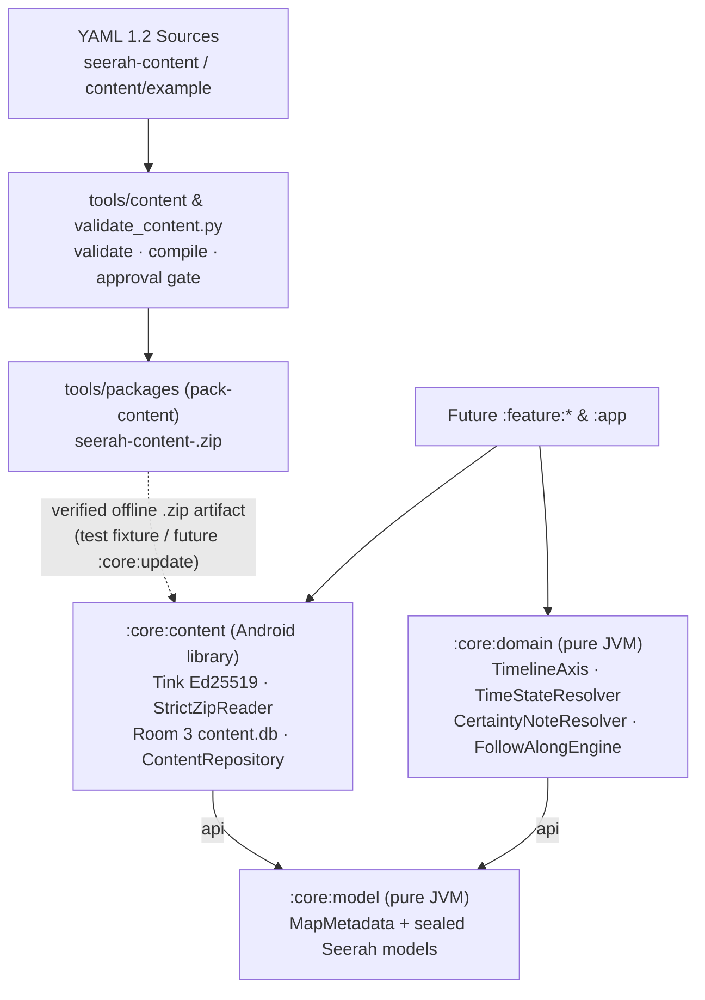

<!--
SPDX-FileCopyrightText: 2026 Mohamed Farag
SPDX-License-Identifier: Apache-2.0
-->

# v1 Content Pipeline, Room Database and Domain Rules Spec

- **Author:** MohdFarag
- **Status:** Revised after [Elephant-Goldfish Model (EGM) review](egm-review-v1-content-pipeline-and-domain/consolidated_review_report.md) — the owner approved `D1` and `D3` on 2026-11-28
- **Date:** 2026-11-28

## Overview

This specification defines v1's end-to-end **content authoring pipeline, disposable Room 3 database, and pure-Java Virtual Machine (JVM) domain engine** implementing [ADR 0002](../adr/0002-proposed-stack.md) (Room content storage, time logic in the app), [ADR 0003](../adr/0003-v1-architecture-and-modules.md) (modules and dependencies), [ADR 0004](../adr/0004-build-and-quality-tooling.md) (build tooling, quality checks, licences), [ADR 0005](../adr/0005-content-model-exploration-and-story.md) and [`exploration-and-story.md`](exploration-and-story.md) (exploration and story layers), and [ADR 0007](../adr/0007-content-formats-compatibility-and-signing.md) (YAML authoring, normalized JSON package, disposable Room import, release approval gate).

It pairs directly with the host packaging core in [`tools/packages/`](../../tools/packages/README.md) and the Android verification and atomic storage stack defined in [`v1-android-package-and-map-spec.md`](v1-android-package-and-map-spec.md) (`:core:model`, `:core:content`). It delivers four coordinated parts across Python tooling, `:core:model`, `:core:content`, and `:core:domain`:

1. **YAML 1.2 authoring schemas, validator, compiler, and `pack-content` (`content/schema/`, `tools/`):** Migrates [`content/example/`](../../content/example/content.yaml) from legacy JSON to modular YAML (`content.yaml`, `world/`, `years/`, `texts/`, `stories/`), upgrades [`validate_content.py`](../../tools/validate_content.py) into a unified validator/compiler backed by `tools/content/`, adds `pack-content` and `content` payload schema checks to [`tools/packages/`](../../tools/packages/README.md), and enforces every ADR 0005 and ADR 0007 rule.
2. **`:core:model` pure-JVM Seerah models ([`JvmLibraryConventionPlugin`](../../android/build-logic/convention/src/main/kotlin/JvmLibraryConventionPlugin.kt) `seerah.jvm.library`):** Extends `:core:model` with immutable, serialization-free Kotlin sealed types and records covering the canonical Hijri (`AH`, `هـ`) / pre-Hijra (`BH`, `ق.هـ`, no year zero) timeline, places and their historical states, areas, routes, phases, events, situations, sourced texts, and complete-snapshot story steps (each step carries its full map/panel state rather than deltas).
3. **`:core:content` disposable Room 3 database, streaming ZIP import, and `ContentRepository`:** Imports verified `content` packages directly from `package.zip` into a generation-scoped `content.db` (`androidx.room3` `3.0.3` with `AndroidSQLiteDriver` and `JournalMode.TRUNCATE`) inside `<filesDir>/content/content/v<ver>-g<gen>/` (the `content/` storage root plus `PackageKind.CONTENT`'s `"content"` folder, version `v<ver>` and monotonic generation `g<gen>`), coordinates safe handle leases across generation switches, automatically rebuilds `content.db` from retained `package.zip` if missing, corrupt, or bumped in Room schema version, and exposes tear-free corpus streams via `ContentRepository`.
4. **`:core:domain` pure-JVM time resolution & follow-along engine (`seerah.jvm.library`):** Implements `TimelineAxis` (continuous Hijri/pre-Hijra timeline, end-of-year and sourced-month views where sources state a month, empty-year prev/next navigation), `TimeStateResolver` (`always` vs. `in-context` visibility, non-piling year markers showing only the selected year, unknown/off-map location suppression, chronological place/area lookup), `CertaintyNoteResolver` (automatic typed certainty notes), `FollowAlongEngine` (manual navigation, suspension on exploration time change, bookmark preservation), and `ResolvedMapSnapshot` unification.

---

## Approved Owner Decisions (`D1`, `D3`)

The owner approved both recommended options on 2026-11-28. Phase 1 implements D1. Phase 2 implements D3, including the ADR 0003 update. Former `D2` and `D4` are internal engineering and milestone choices moved below for traceability with the [consolidated EGM review report](egm-review-v1-content-pipeline-and-domain/consolidated_review_report.md).

| ID | Topic | Approved option | Alternative | Why |
| --- | --- | --- | --- | --- |
| **D1** | `seerah-content` YAML cutover & temporary lazy JSON fallback | **Migrate `content/example/` to YAML in Phase 1 while keeping an auto-detected legacy JSON fallback (with a deprecation notice and strict lazy imports) in `tools/validate_content.py` until the private `seerah-content` repo migrates.** Supply a repeatable conversion script and workflow update snippet for `seerah-content`, then retire the JSON fallback once `seerah-content` is converted. | Drop JSON support immediately in `tools/validate_content.py`, or delay YAML compiler work until `seerah-content` converts first. | `../seerah-content/.github/workflows/validate.yml` checks out `al-seerah/seerah` at `main`, installs **only** `jsonschema==4.26.0`, and runs `python3 seerah/tools/validate_content.py content` on `index/phases.json`. Lazy-importing `ruamel.yaml` / `seerah_content` only when `content.yaml` is present keeps `seerah-content` CI green without forcing an all-at-once lockstep cutover. |
| **D3** | Pure-JVM `:core:domain` module boundary vs. [ADR 0003](../adr/0003-v1-architecture-and-modules.md) | **Keep `:core:domain` strictly pure JVM (`seerah.jvm.library`) depending only on `:core:model`**, keep `ContentRepository` inside `:core:content`, enforce `:core:domain -X> :core:(content\|userdata)` in [`DependencyRules.kt`](../../android/build-logic/convention/src/main/kotlin/app/seerah/buildlogic/DependencyRules.kt), and update [ADR 0003](../adr/0003-v1-architecture-and-modules.md) lines `172`, `178`, and `182` to match. | Turn `:core:domain` into an Android library so it can depend on `:core:content`, or add reverse repository interfaces across modules. | Gradle forbids a pure-JVM plugin (`seerah.jvm.library`) from depending on an Android library (`:core:content`). Keeping `:core:domain -> :core:model` pure JVM preserves ADR 0003's core rule (*"`core:model` and `core:domain` are plain Kotlin with no Android dependency"*) and keeps `:core:domain` isolated from Room, Tink, and Android APIs. |

### Dispositions of Former `D2` and `D4` After EGM Review

- **Former `D2` (Room `3.0.3` vs. `2.8.5`):** Treated as an internal technical library choice within accepted [ADR 0002](../adr/0002-proposed-stack.md) and [ADR 0004](../adr/0004-build-and-quality-tooling.md). Section 4 documents the comparison and adopts Room `3.0.3` with `AndroidSQLiteDriver` (retaining Room `2.8.5` only as a Phase 3 fallback if AGP `9.5.3` / KSP `2.3.14` / DAGP `3.20.4` hits an unresolvable blocker).
- **Former `D4` (Debug-only unsigned preview loader, [ADR 0007](../adr/0007-content-formats-compatibility-and-signing.md) decision 10):** Treated as milestone scoping (`AGENTS.md` Definition of Done #1) and listed under Explicit Non-Goals below. When the preview loader lands alongside `:feature:explore` and `:app`, it will include an accompanying release-build CI guard matching [`check_no_trial_code.py`](../../tools/android/check_no_trial_code.py) and [`check_trusted_keys.py`](../../tools/android/check_trusted_keys.py).

---

## Explicit Non-Goals (Respecting `docs/open-decisions.md`)

1. **No fixed event-category taxonomy ([`open-decisions.md`](../open-decisions.md)):** Model only ADR 0005's 7 decided `EventKind` values plus optional freeform `tags: List<String>`. Never hard-code UI filter categories.
2. **No Gregorian conversion or computed `prophethood_year`:** Reject `"gregorian"` completely in the new `content-source.schema.json` and `content-package.schema.json` schemas (`canonical Hijri / pre-Hijra only` until Gregorian conversion is decided). Never compute `prophethood_year` from formulas; accept it only as an explicit reviewed integer on `"pre-hijra"` or undated prophethood items.
3. **No real Seerah content in this public repository ([ADR 0006](../adr/0006-open-source-code-and-closed-content.md)):** Never copy or reference real Seerah titles, dates, coordinates, routes, or narrations from `../seerah-content/`. All examples, `content/example/`, and test fixtures use clearly fictional synthetic Arabic/ASCII names and neutral coordinates inside the Masirah Island synthetic window (`20.50–20.75° N, 58.80–59.05° E`, matching [`map-data/README.md`](../../map-data/README.md#L26)).
4. **No story-mode UI details or fixed zoom numbers:** Model camera targets using ADR 0005's symbolic `ShotSize` (`WIDE`, `MEDIUM`, `CLOSE`) and `CameraTransition`. Defer screen-fitting zoom calculations, sheet layout, arrow animations, and rendering styles until `:core:map` overlays and `:feature:explore` are specified.
5. **No debug unsigned preview loader (former `D4`):** Keep `:core:content` signed-only across debug and release builds until `:feature:explore` / `:app` shell exists to render scenes.
6. **No first-launch bundling vs. download decision:** The ZIP-to-Room importer accepts any locally readable verified `content` archive regardless of delivery source.
7. **No `:core:update`, `:core:userdata`, `:core:ui`, or `:app` changes:** Zero HTTP networking, zero DataStore `ExploreSession` yet (pure state machine in `:core:domain`), zero Compose UI or hardcoded Arabic UI strings, and [`android/app/src/benchmark/`](../../android/app/src/benchmark/) remains untouched.

---

## Verified Codebase & External Facts

1. **Android toolchain & quality gates ([`libs.versions.toml`](../../android/gradle/libs.versions.toml), [`android/settings.gradle.kts`](../../android/settings.gradle.kts), [`android/build.gradle.kts`](../../android/build.gradle.kts), [`DependencyRules.kt`](../../android/build-logic/convention/src/main/kotlin/app/seerah/buildlogic/DependencyRules.kt), [`HiltConventionPlugin.kt`](../../android/build-logic/convention/src/main/kotlin/HiltConventionPlugin.kt)):**
   - AGP `9.5.3`, Kotlin `2.4.21`, KSP `2.3.14` (applied automatically by `seerah.hilt`), `compileSdk 37.2`, `targetSdk 37`, `minSdk 26` (Android 8.0 ships SQLite `3.18.0`), Java `17` bytecode built on JDK `21`, Hilt `2.60.1`, Coroutines `1.11.0`, `kotlinx-serialization-json` `1.13.0`, Tink `1.24.0`, MapLibre `13.7.1`, Robolectric `4.18.1`.
   - Quality gates: Kotlin `allWarningsAsErrors = true`, Lint `warningsAsErrors = true`, Spotless `8.11.0` (`ktlint 1.8.0` + `composeRules 0.6.8`), Dependency Analysis Gradle Plugin (DAGP) `3.20.4` (`onAny { severity("fail") }`), `modules-graph-assert` (`assertModuleGraph`, `2.9.1`), Licensee `1.14.1` (`Apache-2.0`, `MIT`, `BSD-2-Clause`, `BSD-3-Clause`), release APK guards (`check_page_alignment.py`, `check_no_trial_code.py`, `check_trusted_keys.py`).
   - Current included modules: `:app`, `:core:content`, `:core:map`, `:core:model`.
   - **`DependencyRules.kt` update required:** Line `36` currently blocks `:core:(model|domain) -X> :core:(map|designsystem|ui|navigation|update)`; Phase 2 adds `:core:content` and `:core:userdata` to `:core:domain`'s restricted list.
2. **Room 3 & SQLite artifacts verified on Google Maven (`dl.google.com/dl/android/maven2`, `Apache-2.0`):**
   - `androidx.room3:room3-runtime:3.0.3` / `room3-runtime-android:3.0.3`, `androidx.room3:room3-common:3.0.3`, `androidx.room3:room3-compiler:3.0.3`, `androidx.room3:room3-testing:3.0.3`, Gradle plugin `androidx.room3:room3-gradle-plugin:3.0.3`.
   - `androidx.sqlite:sqlite:2.7.1`, `androidx.sqlite:sqlite-framework-android:2.7.1` (`AndroidSQLiteDriver`, zero extra `.so` libraries), and optional `androidx.sqlite:sqlite-bundled:2.7.1` (must stay strictly in `testImplementation` if needed on host JVM).
   - **Critical SQLite `minSdk = 26` rule:** Android 8.0 ships SQLite `3.18.0`. SQL `ON CONFLICT DO UPDATE` (`@Upsert`) requires SQLite `3.24+`. DAOs in `:core:content` MUST use `@Insert` only (never `@Upsert`, `RETURNING`, `STRICT`, or `json_extract`).
3. **Existing `:core:content` storage & manifest checks ([`DefaultPackageStorage.kt`](../../android/core/content/src/main/kotlin/app/seerah/content/DefaultPackageStorage.kt), [`DefaultPackageInstaller.kt`](../../android/core/content/src/main/kotlin/app/seerah/content/DefaultPackageInstaller.kt), [`ActivePointerStore.kt`](../../android/core/content/src/main/kotlin/app/seerah/content/ActivePointerStore.kt), [`StrictZipReader.kt`](../../android/core/content/src/main/kotlin/app/seerah/content/StrictZipReader.kt), [`PackageManifestParser.kt`](../../android/core/content/src/main/kotlin/app/seerah/content/PackageManifestParser.kt)):**
   - `DefaultPackageStorage` holds one `storageMutex`, starts `stateFlows[kind]` at `InstalledPackageState.Loading` (`hydrated = false`), and currently hydrates lazily inside `currentInstalled()`, `cleanupOrphanedFiles()`, and `install()`, NOT inside `observeInstalled()`.
   - `DefaultPackageInstaller` already retains `package.zip` in `stagingDir/package.zip` for `PackageKind.CONTENT` (sometimes copied early before `checkAvailableSpace` when `expectedKind == PackageKind.CONTENT`) and currently deletes `oldActiveDir` immediately inside `installLocked()` while holding `storageMutex` — both must be updated cleanly as specified in Section 4.
   - [`backup_rules.xml`](../../android/app/src/main/res/xml/backup_rules.xml) and [`data_extraction_rules.xml`](../../android/app/src/main/res/xml/data_extraction_rules.xml) already exclude `<exclude domain="file" path="content/" />`.
4. **Python & CI environment ([`strict_yaml.py`](../../tools/map/src/seerah_map/strict_yaml.py), [`archive.py`](../../tools/packages/src/seerah_packages/archive.py), [`requirements-dev.txt`](../../requirements-dev.txt), [`.pre-commit-config.yaml`](../../.pre-commit-config.yaml), [`ci.yml`](../../.github/workflows/ci.yml), [`generate_android_test_fixtures.py`](../../tools/packages/scripts/generate_android_test_fixtures.py)):**
   - `tools/map` pins `ruamel.yaml==0.19.1` and runs via `PYTHONPATH=/src/tools/map/src` in Docker (`tools/map/run.py`, `map.yml`).
   - `.pre-commit-config.yaml` hook `validate-content` currently matches `^(content/|tools/validate_content\.py)` and installs only `jsonschema==4.26.0`.
   - `generate_android_test_fixtures.py` pins `FIXTURE_SOURCE_COMMIT = "a" * 40` and RFC 8032 Section 7.1 Test 1 public key JSON (`trusted-keys.json`).
   - `archive.py` `verify_package(..., expected_kind="content")` is currently tested against stub content zips (`data/ok.json`, `data/item.json`, `data/content.db`) in [`test_archive_and_cli.py`](../../tools/packages/tests/test_archive_and_cli.py).

---

## Architecture & Module Layout



*(By `D3`, `:core:domain` uses `seerah.jvm.library`, declares `api(project(":core:model"))`, and is explicitly forbidden from depending on `:core:content` or `:core:userdata` in `DependencyRules.kt`.)*

### Planned File Layout

```text
content/
  README.md                               Update YAML layout, authoring rules, and CLI docs (Phase 1)
  schema/
    content-source.schema.json            JSON Schema for YAML 1.2 authoring files
    content-package.schema.json           Strict producer schema for compiled data/*.json (content_schema: 1)
    content.schema.json                   Retained temporarily under D1 until seerah-content cuts over to YAML
  example/                                Synthetic draft YAML 1.2 example (content.yaml, world/, years/, texts/, stories/)

tools/
  README.md                               Document tools/content/ and upgraded validate_content.py (Phase 1)
  validate_content.py                     Unified CLI (lazy YAML import under D1; --compile, --require-approved, --strict-warnings)
  content/
    pyproject.toml / requirements*.txt / README.md
    src/seerah_content/
      strict_yaml.py                      Safe YAML 1.2 loader + alias/bomb/non-str-key/float/multi-doc rejection
      models.py / loader.py               Source discovery, schema check, filename-to-ID parity, state compilation
      checks.py                           All ADR 0005 & ADR 0007 integrity & one-change-per-step checks
      compiler.py                         Deterministic 8-file normalized JSON emitter (content_schema: 1)
      migrate_legacy.py                   One-off helper converting legacy index/phases.json + events/*.json -> YAML 1.2 tree
    tests/                                Full pytest suite for strict YAML, rules, warnings, review gate, migration
  packages/
    requirements.in / requirements.txt    Add ruamel.yaml==0.19.1 (regenerated with hashes)
    src/seerah_packages/
      cli.py / archive.py                 Add `pack-content` subcommand + `content-package.schema.json` verification
    scripts/generate_android_test_fixtures.py
                                          Build valid-content-v1.zip from self-contained in-script approved corpus (FIXTURE_SOURCE_COMMIT)
    tests/                                Migrate stub content zips in test_archive_and_cli.py & verify valid-content-v1.zip drift

.github/
  dependabot.yml                          Track /tools/content requirements
  workflows/ci.yml                        Add pytest for tools/content/tests; add tools/content/src to packages PYTHONPATH

.pre-commit-config.yaml & requirements-dev.txt
                                          Add ruamel.yaml==0.19.1 & pytest==9.2.0; trigger validate-content on tools/content/

android/
  settings.gradle.kts                     Phase 2: include(":core:domain")
  build.gradle.kts                        Phase 3: alias(libs.plugins.room3) apply false; verify DAGP bundle / buildHealth
  gradle/libs.versions.toml               Phase 3: room3 (3.0.3), sqlite (2.7.1), plugins.room3
  build-logic/convention/src/main/kotlin/app/seerah/buildlogic/DependencyRules.kt
                                          Phase 2: add :core:domain -X> :core:(content|userdata)
  core/
    model/
      src/main/kotlin/app/seerah/model/   TimelineModels, GeoModels, TextModels, EventModels, StoryModels, ContentMetadata
      src/test/kotlin/app/seerah/model/   Pure-JVM invariant tests
    domain/
      build.gradle.kts                    seerah.jvm.library + api(project(":core:model"))
      README.md
      src/main/kotlin/app/seerah/domain/  TimelineAxis, TimeStateResolver, CertaintyNoteResolver, FollowAlongEngine, ResolvedMapSnapshot
      src/test/kotlin/app/seerah/domain/  Pure-JVM behavior tests
    content/
      build.gradle.kts                    Add libs.plugins.room3 (KSP already applied via seerah.hilt), room3 { schemaDirectory(...) },
                                          androidx.room3:room3-{runtime,common,compiler}, androidx.sqlite:sqlite (and testImplementation sqlite-bundled)
      schemas/                            Checked-in exported Room 3 schema JSON (verified cleanly with pre-commit JSON hooks)
      r8-smoke-keep.pro                   Keep ContentRepository / Room smoke test entrypoints under R8 test builds
      src/main/kotlin/app/seerah/content/
        PackageResult.kt                  Add InvalidPackageCause.INVALID_CONTENT_PAYLOAD
        ContentPackageParser.kt           Strict kotlinx-serialization DTO codecs, DAG cycle checks, model constructors
        ContentDatabaseImporter.kt        Pure internal interface + Room 3 staging ZIP -> content.db streaming importer
        ContentDatabaseManager.kt         Pin + lease-counted ActiveDbHandle manager + disposable ZIP -> DB rebuild
        ContentRepository.kt              ContentState, EventDetail, StorySummary, ContentCorpusSnapshot, Flow API
        DefaultContentRepository.kt       flatMapLatest + atomic corpus snapshot / lazy EventDetail & Story loaders
        db/                               9 flat indexed Room 3 @Entity classes, DAOs (@Insert-only), TypeConverters, SeerahContentDatabase
        (updated) DefaultPackageInstaller.kt, DefaultPackageStorage.kt, ContentModule.kt
      src/test/                           Pure-JVM parser & fake-importer installer tests; Robolectric Room 3 lifecycle & rebuild tests
      src/androidTest/                    Unminified & R8 Full Mode Galaxy A54 import + query + schema-rebuild smoke tests
```

---

## Detailed Design Specifications

### 1. Source Authoring Format (YAML 1.2) & `content-source.schema.json`

#### Authoring Directory Layout

```text
<content-root>/
  content.yaml              content_schema: 1, content_version, phases[]
  world/
    sources.yaml            canonical SourceWork catalogue referenced by source_work_id
    areas.yaml              baseline regions (name, label_point, optional closed polygon_ring, off_map)
    places.yaml             baseline places existing from period start (Baseline state)
  years/
    <ordered-slug>.yaml     dated buckets (calendar + year) holding new_places, place_changes, area_changes, events
    undated.yaml            optional single file (no calendar/year) holding events with precision: unknown
  texts/
    <event-id>.yaml         texts (with YAML `|` block scalars) belonging to event `<event-id>` (filename stem MUST equal event_id)
  stories/
    <story-id>.yaml         optional story scripts (filename stem MUST equal id)
```

#### Strict YAML 1.2 Rules (`tools/content/src/seerah_content/strict_yaml.py`)

Hardened YAML 1.2 parser keeping [`tools/map/src/seerah_map/strict_yaml.py`](../../tools/map/src/seerah_map/strict_yaml.py)'s standalone Docker portability intact while tightening input safety for multi-author content files:

- `YAML(typ="safe", pure=True)`, `yaml.version = (1, 2)`, `yaml.allow_duplicate_keys = False`, removing `tag:yaml.org,2002:timestamp` so unquoted numbers and dates stay exact strings/integers.
- Override composer (`SafeComposer` subclass or event pre-scan) to **forbid all anchors (`&`), aliases (`*`), and non-standard `!tags`** (blocking billion-laughs expansion bombs and cyclic YAML graphs).
- Parse with `load_all` requiring **exactly 1 document** (reject empty files and multi-document `---` streams).
- Recursively validate all decoded mappings have **`str` keys only** (rejecting `1: ...`, `true: ...`, `null: ...`) and reject `NaN` / `Infinity` floats, raising `ContentSourceError(path, message)`.

#### Complete Normative YAML Source Schemas (Neutral Masirah Island Synthetic Example)

Every field name below matches `content-source.schema.json` verbatim. Real coordinates of historical sites never appear in examples or test fixtures (`20.50–20.75° N, 58.80–59.05° E` Masirah Island only):

1. **`content.yaml`:**
   - `content_schema`: integer `1` (required)
   - `content_version`: SemVer/identifier string (required, non-blank)
   - `phases[]`: required non-empty list of `{ id, order (int >= 1, unique), title, skippable (bool, default false), note? (author-only, stripped on compile) }`.

2. **`world/sources.yaml`:**
   - `sources[]`: `{ id, kind ("quran" | "hadith" | "seerah-book" | "atlas" | "shamail" | "commentary"), work (string), edition? (string), url? (https URI), review ("title-approved" | "draft" | "in-review" | "approved") }`.

3. **`world/areas.yaml`:**
   - `areas[]`: `{ id, name (string), label_point: { lat, lon }?, polygon_ring?: [{ lat, lon }, ...] (if set: >= 4 vertices, first == last), off_map (bool, default false), review }`. Initial state starts cleanly as `Baseline` (`exists: true`). If `off_map == true`, `label_point` and `polygon_ring` are optional.

4. **`world/places.yaml`:**
   - `places[]`: `{ id, kind ("settlement" | "mountain" | "valley" | "well" | "house" | "mosque" | "cave" | "port" | "other"), name (string), accuracy ("exact" | "general" | "unknown"), coordinates?: { lat, lon } (forbidden when accuracy == "unknown" or off_map == true without coords; required when on-map and accuracy in {"exact", "general"}), off_map (bool, default false), visibility ("always" | "in-context"), prominence (1 | 2 | 3), review }`. Baseline places begin with initial state `(Baseline, name, exists = true, kindOverride = null)`.

5. **`years/<ordered-slug>.yaml` (`calendar` + `year`) and optional `years/undated.yaml`:**
   - Dated files declare `calendar ("pre-hijra" | "hijri")`, `year (int >= 1)`, and optional `new_places[]`, `place_changes[]`, `area_changes[]`, `events[]`. Duplicate `(calendar, year)` across two files is an error; a year file with only `new_places` / `place_changes` / `area_changes` and empty `events: []` is valid.
   - `years/undated.yaml` omits `calendar`/`year` and permits ONLY `events[]` whose `date.precision == "unknown"`.
   - `new_places[]`: `{ id, kind, name, accuracy, coordinates?, off_map?, visibility, prominence, from: StateTimeSpec, review }` where `StateTimeSpec` is `{ precision: "year" | "month" | "day", month?, day? }` (inheriting file `calendar` and `year` cleanly!).
   - `place_changes[]`: `{ place_id, from: StateTimeSpec, name? (defaults to prior name if omitted), exists? (bool, defaults to prior exists), kind_override? (defaults to null / carries forward), review }` — allowing same-year state entries ordered cleanly via explicit list position!
   - `area_changes[]`: `{ area_id, from: StateTimeSpec, name?, exists?, review }`.
   - `events[]`: `{ id, phase_id, parent_id? (must exist, no cycles), order (int >= 1), kind ("call" | "opposition" | "pledge" | "migration" | "founding" | "legislation" | "expedition"), depth ("deep" | "medium" | "brief"), expedition_role? ("prophet-led" | "dispatched"; allowed ONLY when kind == "expedition", forbidden on other kinds), title, date: DateSpec, where: EventWhereSpec, visibility ("always" | "in-context"), prominence (1..3), lead_in?, outcome?, situations?: SituationSpec[], event_text_ids?: id[], related?: [{ target_event_id, type ("cause-of" | "result-of" | "continues") }], route?: RouteSpec, tags?: string[], note? (stripped), preliminary_date_note? (stripped), review }`.
   - `DateSpec`: `{ calendar? (if set must equal enclosing year file's calendar; required if inside undated.yaml ONLY when prophethood_year != null where calendar must be "pre-hijra", else omitted on unknown dates), year?, month?, day?, precision ("year" | "month" | "day" | "unknown"), prophethood_year? (int >= 1, pre-hijra or unknown prophethood only), approximate (bool, default false), note? (scholarly dispute note preserved as date_note!) }`.
   - `EventWhereSpec`: discriminated `kind`:
     - `{ kind: "single_place", place_id, accuracy ("exact" | "general") }`
     - `{ kind: "multi_place", place_ids: [id, ...], accuracy ("exact" | "general") }`
     - `{ kind: "area", area_id, accuracy ("general") }`
     - `{ kind: "route", accuracy ("exact" | "general") }` (refers to this event's `route`)
     - `{ kind: "unknown" }` (`accuracy` fixed to `"unknown"`, zero place/area IDs)
   - `SituationSpec`: `{ id, order (int >= 1, unique per event), title, place?: { accuracy ("exact" | "general" | "unknown"), place_id? }, text_ids: id[] }`.
   - `RouteSpec` (authored inside its owning event per ADR 0005, assigned unique `id`): `{ id, stations: id[] (size >= 2), documented (bool), coordinates?: [{ lat, lon }, ...] (>= 2 pairs iff documented == true; forbidden otherwise), station_waypoint_indices?: int[] (length == stations.size, non-decreasing inside 0 until coordinates.size; required when documented == true), accuracy_note? (required iff documented == true), distance_km? (number > 0), distance_basis? ("source" | "estimate"; required iff distance_km != null), days? (int >= 1) }`.

6. **`texts/<event-id>.yaml`:**
   - Optional for `draft` events without texts; required for `approved` events. `event_id` MUST match filename stem (`<event-id>.yaml`).
   - `texts[]`: `{ id, kind ("quran" | "hadith" | "athar" | "seerah-narration" | "editorial"), body (block scalar string), source?: CitationSpec (required on non-editorial; forbidden or optional null on "editorial"), excerpt_of? (text_id; forbidden on "editorial"), explanation?, explanation_source?: CitationSpec (requires non-blank explanation), review }`.
   - `CitationSpec`: `{ source_work_id, locator (string), url? }`.

7. **`stories/<story-id>.yaml`:**
   - `id` MUST match filename stem `<story-id>.yaml`, `title`, `review`.
   - `chapters[]`: `{ id, phase_id?, order (>= 1), title, scenes[] }`.
   - `scenes[]`: `{ id, event_id? (nullable for overview/intro scenes), order (>= 1), title, steps[] }`.
   - `steps[]` (complete snapshot per step):
     - `id`, `order` (`>= 1`, unique per scene)
     - `camera`: `{ mode: "frame", targets: TargetRef[] (>= 1), shot: "wide" | "medium" | "close", transition: "auto" | "cut" | "fly" | "pan" }` OR `{ mode: "follow", route_id, from_station_index (int >= 0), to_station_index (int >= from_station_index), shot?, transition? }`
     - `time`: `{ mode: "at", calendar, year, month?, day?, precision }` OR `{ mode: "time_lapse", from: TimelineSpec, to: TimelineSpec }`
     - `highlight?`: `TargetRef[]` (`"place:<id>" | "area:<id>" | "event:<id>" | "route:<id>"`)
     - `focus_mode?`: `bool` (default `false`)
     - `reveal?`: `TargetRef[]` (places/events revealed during this step)
     - `draw_route?`: `{ route_id, from_station_index, to_station_index }`
     - `show_movement?`: `{ from_place_id, to_place_id, route_id? }`
     - `show_area?`: `area_id?`
     - `panel`: `{ title_card (bool), text_ids?: id[], linking_sentence? (reviewed editorial text, non-blank if set), explore_here? (bool, default false) }`
     - `review_notes?`: `{ accept_multi_change?: string }`

```yaml
# Example content/example/years/01-bh-02.yaml (synthetic Masirah Island placeholder)
calendar: pre-hijra
year: 2
new_places:
  - id: example-port
    kind: port
    name: "مثال: ميناء افتراضي"
    accuracy: exact
    coordinates: { lat: 20.620, lon: 58.910 }
    visibility: always
    prominence: 2
    from: { precision: year }
    review: draft
events:
  - id: example-first-event
    phase_id: example-phase-1
    order: 1
    kind: migration
    depth: deep
    title: "مثال: حدث تجريبي"
    date: { calendar: pre-hijra, year: 2, prophethood_year: 10, precision: year }
    where: { kind: single_place, place_id: example-port, accuracy: exact }
    visibility: always
    prominence: 1
    related:
      - { target_event_id: example-second-event, type: continues }
    review: draft
```

#### `seerah-content` Transition Plan (`D1`)

1. Phase 1 lands `tools/content/`, `content/schema/content-source.schema.json`, `content/schema/content-package.schema.json`, `tools/content/src/seerah_content/migrate_legacy.py`, migrates `content/example/` to YAML (`review: draft` preserving `AGENTS.md`), and updates `tools/validate_content.py` so:
   - If `content.yaml` exists (and `index/phases.json` does **not**), `tools/validate_content.py` imports `seerah_content` lazily and validates YAML.
   - If ONLY `index/phases.json` exists, it runs legacy JSON validation using only `jsonschema` (zero `ruamel.yaml` import!) and prints `warning: legacy phases.json format is deprecated; migrate to YAML 1.2`.
   - If BOTH exist or NEITHER exists, it exits with code `1` and an explicit error.
2. Owner updates `../seerah-content/.github/workflows/validate.yml` to install `ruamel.yaml==0.19.1` alongside `jsonschema==4.26.0` and converts `seerah-content` using `migrate_legacy.py` cleanly without CI downtime.
3. Once `seerah-content` is on YAML, remove the JSON fallback and `content/schema/content.schema.json` in a small cleanup commit.

---

### 2. Compiled Package Format (`content_schema: 1`), Compiler Rules & `pack-content`

#### Compiled Package Layout (`seerah-content-<version>.zip`)

`manifest.json` (`<= 4 MiB`, `ZIP_STORED`) and `manifest.sig` (`64` bytes, `ZIP_STORED`) are written first; payload JSON files under `data/` use `ZIP_DEFLATED` (`compress_type=zipfile.ZIP_DEFLATED`), serialized deterministically via `json.dumps(..., indent=2, sort_keys=True, ensure_ascii=False) + "\n"`:

1. `data/meta.json`: `content_schema` (`1`), `content_version`, `min_timeline_point` (`null` if zero dated entities, else earliest `(calendar, year)`), `max_timeline_point`, `phases[]` ordered by `(order, id)`.
2. `data/sources.json`: `sources[]` ordered by `id`.
3. `data/places.json`: `places[]` ordered by `id`; each `states[]` preserves resolved cumulative states (`StateStart` baseline `-1` then dated points sorted by `(continuous_year, precision_rank, month ?: 0, day ?: 0, seq_order)` where `YEAR = 0, MONTH = 1, DAY = 2`).
4. `data/areas.json`: `areas[]` ordered by `id`; closed `[lon, lat][]` or `{lat, lon}[]` standardized cleanly to `{"lat": ..., "lon": ...}` matching `GeoPoint`.
5. `data/routes.json`: `routes[]` ordered by `id`.
6. `data/events.json`: `events[]` ordered by `(phase_id, order, id)` (with `parent_id` topologically ordered parent-before-child inside DB import), stripping author-only `note` / `preliminary_date_note` while keeping `date.note` (dispute note), carrying `expedition_role`, `prophethood_year`, typed `related[]`, `situations[]`, and `where`.
7. `data/texts.json`: `texts[]` ordered topologically (`excerpt_of == null` first, then `id`).
8. `data/stories.json`: `stories[]` ordered by `id`, nested sorted `chapters[]` -> `scenes[]` -> `steps[]`.

`content/schema/content-package.schema.json` sets `additionalProperties: false` for strict producer and `tools/packages` `verify_package` validation; Android [`ContentPackageParser.kt`](../../android/core/content/src/main/kotlin/app/seerah/content/) sets `ignoreUnknownKeys = true` for forward compatibility per [ADR 0008](../adr/0008-update-hosting-and-index.md) decision 4.

#### Compiler & Release Gate Rules (`tools/content/checks.py`)

| Rule Group | Exact Checks | Failure Level |
| --- | --- | --- |
| **Authoring structure & IDs** | Stem of `texts/<event-id>.yaml` == `event_id`; stem of `stories/<story-id>.yaml` == `id`; no duplicate `(calendar, year)` across `years/*.yaml`; unique IDs per entity type; unique `order` within each parent scope (`phases`, `events` per `(phase_id, parent_id, date_bucket)`, `situations` per event, `chapters` per story, `scenes` per chapter, `steps` per scene); no empty `years/undated.yaml` mistakes. | **Error** |
| **Timeline & precision** | Reject `"gregorian"`; `year >= 1` (`0` forbidden); `prophethood_year` allowed only when `calendar == "pre-hijra"` or `precision == "unknown"`; strict field presence per `precision`; `date` inside `years/<slug>.yaml` must match file's `calendar` and `year`. | **Error** |
| **References & DAGs** | All `phase_id`, `parent_id`, `place_id`, `area_id`, `source_work_id`, `text_ids`, `excerpt_of`, `related.target_event_id`, `story` refs resolve cleanly; `events.parent_id` and `related` contain no self-loops or cycles; `excerpt_of` points to a non-excerpt non-editorial text anywhere in the corpus. | **Error** |
| **Geography, routes & sourcing** | On-map `Place` with `EXACT`/`GENERAL` requires valid WebMercator coordinates (`off_map == false` inside `[-85.0511287798066, 85.0511287798066]` x `[-180, 180]`); `Place` with `UNKNOWN` forbids coordinates; `Event.where` `EXACT` cannot reference a `Place` whose own `accuracy == UNKNOWN`; `Route` has `stations.size >= 2`, `days >= 1` if set, `distance_km > 0` + `distance_basis`, `coordinates.size >= 2` + valid `station_waypoint_indices` + `accuracy_note` iff `documented == true` (forbidden otherwise); `kind != "editorial"` requires `source`; `kind == "editorial"` forbids `excerpt_of`; `explanation_source != null` requires non-blank `explanation`. | **Error** |
| **Story consistency vs. exploration** | All step targets resolve; `follow` and `draw_route` require `documented == true` + valid `[from_station_index..to_station_index]`; `show_movement` with `route_id` requires `documented == true`; `StepTime` months are verified; for every step point (and every timeline stop across `TimeLapse [from..to]`), referenced places and areas must resolve to `exists == true`! | **Error** |
| **One-change-per-step (ADR 0005 rule 9)** | When consecutive steps in a scene change both `time` and `camera.targets` AND it is NOT (1) scene start with `title_card == true`, (2) a `show_movement` step, or (3) a `follow` step, emit a warning unless `review_notes.accept_multi_change` explains the exception. Fails build when `--strict-warnings` is set. | **Warning** |
| **Draft vs. Approved Release (`--require-approved`)** | Default `validate` permits `draft`/`in-review`/`title-approved` items (still enforcing structural checks when fields exist). With `--require-approved`: every `source`, `place`, `place_change`, `area`, `area_change`, `event`, `text`, and `story` must be `review == "approved"`; approved events must carry `date`, `lead_in`, `outcome`, `situations`, and non-empty texts; unreferenced `texts/*.yaml` files fail; dirty git tree (`git status --porcelain` non-empty) fails unless `--allow-dirty` is explicitly passed for non-git CI fixtures. | **Error (`--require-approved`)** |

#### CLI & Validation Separation (`M5`, `M8`)

- **`python3 tools/validate_content.py [CONTENT_DIR]`** (defaults to `content/example/`): flags `--compile <out_dir>`, `--require-approved`, `--strict-warnings`, `--allow-dirty`, `--source-commit <40/64-hex>`. Exit codes: `0` ok, `1` validation error, `2` CLI usage.
- **`python3 -m seerah_packages pack-content --source <dir> --version <int> --min-app-version <int> --key <pem> --key-id <id> --out <dir> [--created <utc>] [--passphrase-fd <fd>] [--previous-manifest <json>] [--strict-warnings] [--allow-dirty] [--source-commit <sha>] [--force]`:** Compiles via `seerah_content` (`--require-approved`) into a temporary staging dir, validates `content-package.schema.json`, delegates to `archive.build_package(kind="content", compress_type=zipfile.ZIP_DEFLATED, ...)`, and self-verifies via `verify_package`.
- **`archive.verify_package(..., expected_kind="content")`:** Validates ZIP, Ed25519 signature, `manifest.json`, entry SHA-256 digests, and JSON conformance of all 8 `data/*.json` files against `content-package.schema.json` + `content_schema == 1` — **without duplicating** `tools/content`'s editorial/historical business cross-checks (`Conflict 4` resolution). Existing stub `CONTENT` zips in [`test_archive_and_cli.py`](../../tools/packages/tests/test_archive_and_cli.py) (`data/ok.json`, `data/item.json`, `data/content.db`) are updated cleanly in Phase 1 to valid `content_schema: 1` minimal compiled fixtures.

---

### 3. Shared Domain Models (`:core:model`, Package `app.seerah.model`)

Uses `seerah.jvm.library` (zero Android, zero `kotlinx-serialization`). Invalid combinations are eliminated cleanly at compile time via Kotlin `sealed interface` hierarchies:

- **`TimelineModels.kt`:**
  - `enum class CalendarAxis { PRE_HIJRA, HIJRI }` (`PRE_HIJRA`: `BH` / `ق.هـ`; `HIJRI`: `AH` / `هـ`)
  - `enum class DatePrecision(val rank: Int) { YEAR(0), MONTH(1), DAY(2), UNKNOWN(3) }`
  - `data class TimelinePoint(val axis: CalendarAxis, val year: Int, val month: Int? = null, val day: Int? = null)` (`year >= 1`, `month in 1..12`, `day in 1..31`, `day != null` requires `month != null`; `continuousYear = if (axis == PRE_HIJRA) 1 - year else year`; helpers `nextYear()`, `previousYear()` skipping year zero seamlessly, `asStateStartKey()` filling missing month/day with `1`, `asQueryUpperBoundKey()` returning `(continuousYear, 12, 31)` for year view or `(continuousYear, month, day ?: 31)` for month/day view!).
  - `sealed interface HistoricalDate`: `Unknown(val prophethoodYear: Int? = null, val note: String? = null)`, `Year(val point: TimelinePoint, val prophethoodYear: Int? = null, val approximate: Boolean = false, val note: String? = null)`, `Month(...)`, `Day(...)`.
- **`GeoModels.kt`:**
  - `enum class PlaceKind { SETTLEMENT, MOUNTAIN, VALLEY, WELL, HOUSE, MOSQUE, CAVE, PORT, OTHER }`
  - `enum class KnownAccuracy { EXACT, GENERAL }`
  - `sealed interface PlaceLocation`: `Known(val accuracy: KnownAccuracy, val point: GeoPoint, val offMap: Boolean = false)` vs `Unknown` (`GeoPoint(lat, lon)` checks finite WebMercator bounds).
  - `sealed interface StateStart`: `Baseline` vs `Dated(val point: TimelinePoint, val precision: DatePrecision)` (`Baseline` sorts before every `Dated`).
  - `data class PlaceState(val start: StateStart, val name: String, val exists: Boolean, val kindOverride: PlaceKind? = null)`
  - `data class AreaState(val start: StateStart, val name: String, val exists: Boolean)`
  - `data class Area(val id: String, val labelPoint: GeoPoint?, val polygonRing: List<GeoPoint> = emptyList(), val offMap: Boolean = false, val states: List<AreaState>)` (non-empty `polygonRing` validates `size >= 4 && first() == last()`).
  - `sealed interface RouteGeometry`: `Documented(val coordinates: List<GeoPoint>, val stationWaypointIndices: List<Int>, val accuracyNote: String)` (`coordinates.size >= 2`, strictly valid monotonic indices) vs `Undocumented`.
  - `data class Route(val id: String, val eventId: String, val stationPlaceIds: List<String>, val geometry: RouteGeometry, val distanceKm: Double? = null, val distanceBasis: DistanceBasis? = null, val days: Int? = null)` (`stationPlaceIds.size >= 2`).
- **`TextModels.kt`, `EventModels.kt`, `StoryModels.kt`, `ContentMetadata.kt`:**
  - `SourceWork`, `SourceCitation(sourceWorkId, locator, url?)`, `ContentText(id, eventId?, kind, body, citation?, excerptOfTextId?, explanation?, explanationCitation?)` (`citation == null` permitted only for `EDITORIAL`).
  - `Phase`, `ExpeditionRole { PROPHET_LED, DISPATCHED }`, `EventKind`, `EventDepth`, `EventLocation` (`SinglePlace`, `MultiPlace`, `AreaTarget`, `RouteTarget`, `Unknown`), `Situation(id, order, title, placeAccuracy?, placeId?, textIds)`, `EventRelation(targetEventId, type)`, `SeerahEvent`, `EventDetail(event, parentEvent?, childEvents, route?, texts, relatedEvents, sources: Map<String, SourceWork>)`.
  - `MapTargetRef` (`PlaceRef`, `AreaRef`, `EventRef`, `RouteRef`), `StepCamera` (`Frame`, `Follow`), `StepTime` (`At`, `TimeLapse`), `StepRouteDrawing`, `StepMovement`, `StepPanel(titleCard, textIds, linkingSentence?, exploreHere)`, `StoryStep`, `StoryScene(id, eventId?, order, title, steps)`, `StoryChapter`, `Story`, `StorySummary(id, sortOrder, title, chapterCount)`.
  - `ContentPackageSummary(contentSchema, contentVersion, packageVersion, generation, minTimelinePoint?, maxTimelinePoint?)` and `ExplorationCorpus(summary, phases, sources: Map<String, SourceWork>, places, areas, routes, events, storySummaries)`.

---

### 4. `:core:content` Disposable Room 3 Database, Import Lifecycle & `ContentRepository`

#### Internal Room 3 Library Choice (Former `D2`)

| Option | For | Against |
| --- | --- | --- |
| **`androidx.room3` `3.0.3` + `AndroidSQLiteDriver` (Recommended)** | Google's active current line; pure-Kotlin KSP codegen (`@ConstructedBy`, zero reflection); coroutine/`Flow`-native DAOs; uses Android system SQLite via `AndroidSQLiteDriver` (zero native `.so` increase, zero 16 KB page alignment risk); distinct `androidx.room3` package avoids dependency collisions with future `WorkManager` | New plugin (`androidx.room3`); Phase 3 verifies KSP `2.3.14` / DAGP `3.20.4` / R8 compatibility cleanly |
| `androidx.room` `2.8.5` (Fallback only) | Legacy Android line | Maintenance mode; couples to older SupportSQLite APIs |

Build rules enforced in Phase 3: apply `libs.plugins.room3` (`room3 { schemaDirectory("$projectDir/schemas") }`), do **not** apply `ksp` again ([`HiltConventionPlugin`](../../android/build-logic/convention/src/main/kotlin/HiltConventionPlugin.kt#L11) applies KSP), declare `androidx.room3:room3-common` and `androidx.sqlite:sqlite` (or add `bundle("room3")` in [`android/build.gradle.kts`](../../android/build.gradle.kts)) so DAGP `buildHealth` passes cleanly, forbid `@Upsert` (`@Insert`-only for `minSdk = 26` / SQLite `3.18.0`), verify `@ConstructedBy` syntax with `allWarningsAsErrors = true`, keep `androidx.sqlite:sqlite-bundled` strictly `testImplementation`-only if needed in Robolectric, and format/check `android/core/content/schemas/*.json` with pre-commit hooks.

#### Single ZIP -> Room Stream & 9-Table Schema (No Permanent `data/*.json` Copy)

For `PackageKind.CONTENT`, `DefaultPackageInstaller` no longer writes permanent unpacked `data/*.json` files into `v<ver>-g<gen>/data/`: both initial install and disposable cold-start rebuild invoke one shared `ContentDatabaseImporter.importFromZip(...)` helper streaming one `data/*.json` entry at a time from `package.zip` (checking CRC-32 + SHA-256 against `manifest.json`) into one SQLite transaction in `JournalMode.TRUNCATE`, eliminating 3x storage overhead and multi-path drift! ([`DefaultPackageStorage.hasRequiredActiveFiles`](../../android/core/content/src/main/kotlin/app/seerah/content/DefaultPackageStorage.kt#L205-L214) updates for `CONTENT` to verify `manifest.json`, `manifest.sig`, `package.zip`, and `content.db`.)

Also eliminate separate `db_stamp.json` completely (`M3`, Conflict 2): SQLite `PRAGMA user_version` (enforced by `@Database(version = 1)`) + Room `room_master_table` + our `meta` row (`content_schema`, `content_version`, `package_version`, `generation`) inside `content.db` provide a single-file atomic stamp with zero 2-file rename races.

**9 Flat Indexed Tables (`SeerahContentDatabase`, Version 1):**

1. `meta` (`id` PK = 1, `content_schema`, `content_version`, `package_version`, `generation`, `min_axis`, `min_year`, `max_axis`, `max_year`)
2. `phases` (`id` PK, `sort_order`, `title`, `skippable`)
3. `sources` (`id` PK, `kind`, `work`, `edition`, `url`)
4. `places` (`id` PK, `kind`, `accuracy`, `lat`, `lon`, `off_map`, `visibility`, `prominence`, `states_json`)
5. `areas` (`id` PK, `label_lat`, `label_lon`, `polygon_json`, `off_map`, `states_json`)
6. `routes` (`id` PK, `event_id`, `documented`, `stations_json`, `coordinates_json`, `station_waypoints_json`, `accuracy_note`, `distance_km`, `distance_basis`, `days`) — indexed on `event_id`
7. `events` (`id` PK, `phase_id` FK -> `phases`, `parent_id` nullable FK -> `events` [inserted parents-before-children], `sort_order`, `kind`, `depth`, `expedition_role`, `title`, `date_precision`, `axis`, `continuous_year`, `year`, `month`, `day`, `prophethood_year`, `approximate`, `date_note`, `where_json`, `visibility`, `prominence`, `lead_in`, `outcome`, `situations_json`, `event_text_ids_json`, `related_json`, `tags_json`) — indexed on `phase_id`, `(axis, continuous_year)`, `parent_id`
8. `texts` (`id` PK, `event_id` nullable FK -> `events`, `kind`, `body`, `source_work_id` nullable FK -> `sources`, `locator`, `source_url`, `excerpt_of_text_id` nullable FK -> `texts` [inserted non-excerpts first], `explanation`, `explanation_source_work_id` nullable FK -> `sources`, `explanation_locator`, `explanation_url`) — indexed on `event_id` so heavy narration prose never loads during map browsing
9. `stories` (`id` PK, `sort_order`, `title`, `chapter_count`, `chapters_json`)

All `@Dao` reads/writes use `suspend` and `Flow` (Room 3 rule), all insertions run inside `useWriterConnection { it.immediateTransaction { ... } }` via `@Insert` only, and both staging build (`ContentDatabaseImporter`) and runtime open (`ContentDatabaseOpener`) explicitly set:
`Room.databaseBuilder<SeerahContentDatabase>(context, dbFile.absolutePath).setDriver(AndroidSQLiteDriver()).setJournalMode(RoomDatabase.JournalMode.TRUNCATE).build()`.

#### Safe Directory Pinning, Concurrency & Disposable Rebuild Lifecycle

1. **Pre-install `StatFs` space check & error mapping:**
   - Fix `DefaultPackageInstaller` so when `copiedContentZipEarly == true` (`package.zip` already copied into `stagingDir`), `checkAvailableSpace` sets `retainedAligned = 0L` instead of double-counting it.
   - For `PackageKind.CONTENT`, compute `requiredBytes = maxOf(65_536L, alignToBlock(totalJsonBytes * 3L)) + manifestAndSigAligned + retainedAligned + SAFETY_MARGIN_BYTES` (`32 MiB`, preserving `BLOCK_SIZE_BYTES` for `manifest.sig`), and keep `PackageKind.MAP` math unchanged.
   - Add `InvalidPackageCause.INVALID_CONTENT_PAYLOAD` for schema/JSON/cycle failures inside `ContentPackageParser` (strict `Json { isLenient = false; allowSpecialFloatingPointValues = false; ignoreUnknownKeys = true }`, pre-validating DAG acyclicity and domain invariants before constructing `:core:model` or touching SQLite).
   - Map `androidx.sqlite.SQLiteException` (`SQLITE_FULL` = `13`), `android.database.sqlite.SQLiteFullException`, and `ErrnoException(ENOSPC)` to `PackageFailure.InsufficientStorage(requiredBytes, availableBytes)`.
2. **Pin set + lease-counted handle closing (no delete-before-close race):**
   - Add `pinVersionDir(dirName)` / `unpinVersionDir(dirName)` in `DefaultPackageStorage` (skipped by `cleanupOrphanedFiles()`). For `PackageKind.CONTENT`, `DefaultPackageInstaller` leaves `oldActiveDir` for `ContentDatabaseManager` / `cleanupOrphanedFiles()` instead of deleting it inside `storageMutex`!
   - `ContentDatabaseManager` uses a cold/shared coroutine lifecycle (`SharingStarted.WhileSubscribed(5_000L)` on an injected cancelable `@ContentScope` using `IoDispatcher`, zero `GlobalScope`, zero constructor I/O for `StrictMode`) that explicitly calls `storage.currentInstalled(PackageKind.CONTENT)` on activation so cold-start hydration never stalls at `Loading`.
   - When switching `v1-g1 -> v2-g2`, `ContentDatabaseManager` pins `v2-g2`, opens `v2Db`, transitions `ActiveDbHandle` cleanly (`acquireLease()` / `releaseLease()` around DAO calls), waits **off `storageMutex`** for `v1Db`'s active leases to reach `0`, calls `v1Db.close()`, unpins `v1-g1/`, and calls `cleanupOrphanedFiles()`.
3. **Disposable rebuild & corrupt-package quarantine (at most `1` automatic rebuild attempt):**
   - If `content.db` is missing, `metaDao.getMeta()` mismatches `(active.version, active.generation)`, or opening/reading throws `androidx.sqlite.SQLiteException` or `IllegalStateException` (Room schema/identity mismatch after app update):
     - Under `storage.withStorageLock`: run `StatFs` check (`rebuildRequiredBytes`), verify `v<ver>-g<gen>/package.zip` via `StrictZipReader` (verifying `manifest.sig` via `TrustedKeyRingSource` if `(info.keyId, info.publicKeySha256)` is still in `Configured.keys`; or if cleanly retired under `Rule A`, verifying exact byte equality against retained `manifest.json`/`manifest.sig` plus `version`/`keyId` match), delete broken `content.db*` if reclaiming space, run `ContentDatabaseImporter.importFromZip` into a clean temp dir (`staging/rebuild-<uuid>/content.db`), `close()`, `fsync`, move `ATOMIC_MOVE + REPLACE_EXISTING` onto `v<ver>-g<gen>/content.db`, and re-open.
     - If `package.zip` itself fails ZIP/signature/hash verification during rebuild, **quarantine** corrupt `active.json` under `storageMutex`, emit `ContentState.Error(...)`, and allow re-downloading the same version without triggering `DowngradeOrSameVersion` lockout.
4. **Public `ContentRepository` Contract (Zero Cross-Stream Tearing):**

```kotlin
sealed interface ContentState {
    data object Loading : ContentState
    data object NotInstalled : ContentState
    data class Ready(val corpus: ExplorationCorpus) : ContentState
    data class Error(val failure: PackageFailure) : ContentState
}

sealed interface ContentLookupResult<out T> {
    data object Loading : ContentLookupResult<Nothing>
    data class Found<out T>(val value: T) : ContentLookupResult<T>
    data object NotFound : ContentLookupResult<Nothing>
    data class Error(val failure: PackageFailure) : ContentLookupResult<Nothing>
}

interface ContentRepository {
    fun observeContentState(): StateFlow<ContentState>
    fun observeEventDetail(eventId: String): Flow<ContentLookupResult<EventDetail>>
    fun observeStory(storyId: String): Flow<ContentLookupResult<Story>>
}
```

Exposing **one** generation-consistent `ExplorationCorpus` via `ContentState.Ready(corpus)` completely eliminates cross-stream `combine()` tearing during package hot-swaps (`B5`) and avoids deadlocks or flashing empty screens during `Loading` / `Error`, while heavy narration `texts` (`EventDetail`) and `chapters_json` (`Story`) stay lazy in SQLite!

---

### 5. `:core:domain` Pure-JVM Engine (`seerah.jvm.library`, Depends Only on `:core:model`)

1. **`TimelineAxis`:** Computes chronological year stops (`PRE_HIJRA` e.g. `3 BH -> 2 BH -> 1 BH` then `HIJRI` `1 AH -> 2 AH`, skipping year zero cleanly) plus discrete sourced month stops inside years that actually have `MONTH`/`DAY` events. Provides `previousEventYear`, `nextEventYear` (for empty years), and `eventOpenTarget(event, fallbackPoint)` returning `event`'s documented precision point (for `UNKNOWN` dates, preserves `fallbackPoint` cleanly without inventing a date).
2. **`TimeStateResolver`:**
   - Given `(corpus, TimelineQuery(point, openEventId?))`:
     - **Year view (`point.month == null`):** compares `PlaceState.start` / `AreaState.start` (`Baseline < year(1,1) <= query endOfYear(12,31)`) so year-end state wins, taking the last matching state in `(start, seqOrder)` order; shows `Place` when `exists == true`, `location is PlaceLocation.Known && !offMap`, and (`visibility == ALWAYS` or referenced by `openEventId` or child events of `openEventId`); shows `Area` when `exists == true && !offMap`.
     - **Sourced-month view (`point.month != null`):** compares against `(continuousYear, month, day ?: 31)`; **events dated only to `YEAR` precision stay at year level** (`exploration-and-story.md` L114) and only `(year, month)` events match that month.
     - **Overview markers:** emit `SeerahEvent` ONLY when `date` matches `point`, `where !is EventLocation.Unknown`, and (`visibility == ALWAYS` or `event.id == openEventId || event.parentId == openEventId`), positioning `RouteTarget` at its route's first valid on-map station coordinate.
3. **`CertaintyNoteResolver`:** Derives typed `CertaintyNote` values (`DatePrecisionYearOnly`, `DateApproximate`, `DateUnknown`, `DateDisputeNote(text)`, `GeneralPlaceSpotUnknown`, `ExactSpotUnknownNoMarker`, `OffMapLocation`, `UndocumentedRouteStationsOnly`, `EstimatedDistanceKm(km)`).
4. **`FollowAlongEngine`:** Pure immutable state machine supporting `start(story, atStep?)`, `startForEvent(eventId, stories)`, `nextStep()`, `previousStep()`, `resume()` from `Suspended`, `onExploreTimeChanged()` (manual user scrub -> `Suspended(FollowAlongBookmark(storyId, chapterId, sceneId, stepId, fallbackStepIndex))`, never triggered by step's own `StepTime`), `onOpenEventInExploration(eventId)` (keeps bookmark untouched), and `restoreOnRelaunch(savedBookmark, stories)` (resolves by `stepId` first then `fallbackStepIndex`, falling back gracefully if deleted across content updates without auto-starting).
5. **`ResolvedMapSnapshot` Builder:** Converts either `(query, corpus)` or `(FollowAlongState.Active step, corpus)` into a single shared `ResolvedMapSnapshot(pointOrTimeLapse, visiblePlaces, visibleAreas, visibleRoutes, visibleEventMarkers, highlightedTargets, certaintyNotes, activePanel?)` — proving ADR 0003/0005's single-map exploration+story unification cleanly in JVM tests while leaving MapLibre zoom math and overlay styling to future UI/map specs (`Conflict 1`).

---

### 6. Cross-Language Golden Fixtures & Test Matrix

- Keep `content/example/` consistently `review: draft` (mirroring real Seerah repo rules).
- Update [`generate_android_test_fixtures.py`](../../tools/packages/scripts/generate_android_test_fixtures.py) to compile an **in-script synthetic `approved` Masirah Island YAML corpus** using `seerah_content` + `pack_content` (`FIXTURE_SOURCE_COMMIT = "a" * 40`, `--allow-dirty`) into `valid-content-v1.zip`, checked byte-for-byte by [`test_android_fixtures.py`](../../tools/packages/tests/test_android_fixtures.py).
- Migrate existing `CONTENT` stub tests (`data/ok.json`, `data/a.json`) across `test_archive_and_cli.py`, `PackageStorageAndInstallerTest.kt` (using a fake `ContentDatabaseImporter`), and `ContentDeviceSmokeTest.kt` (also updating [`r8-smoke-keep.pro`](../../android/core/content/r8-smoke-keep.pro)).
- Verify Robolectric (`ContentRoomDatabaseTest`: Room import, `flatMapLatest` hot-swap without tearing, delete-after-lease-drain safety, cold-start hydration, missing/corrupt/schema-bump rebuild, retired-key rebuild survivability, corrupt-zip quarantine) and **Galaxy A54 (`SM-A546E - 16`) unminified + `-Pseerah.minifyContentAndroidTest=true` R8 Full Mode** importing `valid-content-v1.zip`, querying `ContentRepository`, and timing staging DB import.

---

## Phased Implementation Roadmap

| Phase | Scope | Exit Gate |
| --- | --- | --- |
| **Phase 1: YAML schemas, `tools/content/`, `validate_content.py` & `pack-content`** | `content/schema/content-{source,package}.schema.json`, `content/example/` draft YAML migration, `tools/content/` (`strict_yaml`, `loader`, `checks`, `compiler`, `migrate_legacy`), lazy `validate_content.py` (`D1`), `pack-content` + `verify` schema check, migrated `test_archive_and_cli.py` + `valid-content-v1.zip`, updated `pre-commit`/`ci.yml`/`dependabot.yml`/`content/README.md`/`tools/README.md` | `pre-commit run --all-files`, `python3 tools/validate_content.py`, `pytest` (`tools/content/tests`, `tools/packages/tests`) all pass |
| **Phase 2: `:core:model` Seerah types & `:core:domain` pure-JVM engine** | `:core:model` sealed types + `TimelinePoint`, `:core:domain` (`seerah.jvm.library`, `TimelineAxis`, `TimeStateResolver`, `CertaintyNoteResolver`, `FollowAlongEngine`, `ResolvedMapSnapshot`), `DependencyRules.kt` `:core:domain` isolation, `D3` ADR 0003 update (`L172`, `L178`, `L182`), comprehensive JVM tests | `./gradlew spotlessCheck check buildHealth` passes with `:core:model` and `:core:domain` JVM tests green |
| **Phase 3: `:core:content` Room 3 disposable DB, `ContentRepository` & R8 device checks** | `androidx.room3` `3.0.3` + `AndroidSQLiteDriver` + `JournalMode.TRUNCATE`, 9 flat indexed tables (`@Insert`-only), shared streaming ZIP->Room `ContentDatabaseImporter`, pin+lease `ContentDatabaseManager`, quarantine & `StatFs` fixes, `ContentRepository`, Hilt DI (`ContentModule.kt`), `r8-smoke-keep.pro`, Robolectric + Galaxy A54 R8 tests, full docs review (`docs/README.md`, `roadmap.md`, `open-decisions.md`, `CHANGELOG.md`, module `README.md`s) | `./gradlew spotlessCheck check buildHealth assembleRelease assembleBenchmark`, all APK guards, unminified + `-Pseerah.minifyContentAndroidTest=true` Galaxy A54 tests, `pre-commit`, and `validate_content.py` pass cleanly |

---

## Known Risks & Mitigations

| Risk | Consequence | Mitigation |
| --- | --- | --- |
| **Room `3.0.3` plugin (`androidx.room3`) clashes with AGP `9.5.3`, KSP `2.3.14`, or DAGP `3.20.4`** | `:core:content` build/lint/R8 fails | Verify `buildHealth` + `@ConstructedBy` + R8 early in Phase 3; fallback option (`androidx.room` `2.8.5`) stays ready if toolchain blocks |
| **Active query coroutine collides with generation switch deletion** | Crash or failed directory delete | Pin active dir + lease-count `ActiveDbHandle`; close `v1Db` off `storageMutex` after leases reach `0`, then unpin & sweep |
| **SQLite feature unsupported on Android 8.0 (`minSdk = 26`, SQLite `3.18.0`)** | Runtime crash on Oppo A55 / old devices | Ban `@Upsert`, `RETURNING`, `STRICT`, and `json_extract()` strictly; verify `@Insert`-only SQLite `3.18` compatibility |
| **`seerah-content` CI fails during YAML cutover** | Upstream content PRs blocked | Lazy `ruamel.yaml` import in `validate_content.py` keeps legacy `index/phases.json` passing with zero new dependencies until `seerah-content` migrates (`D1`) |
