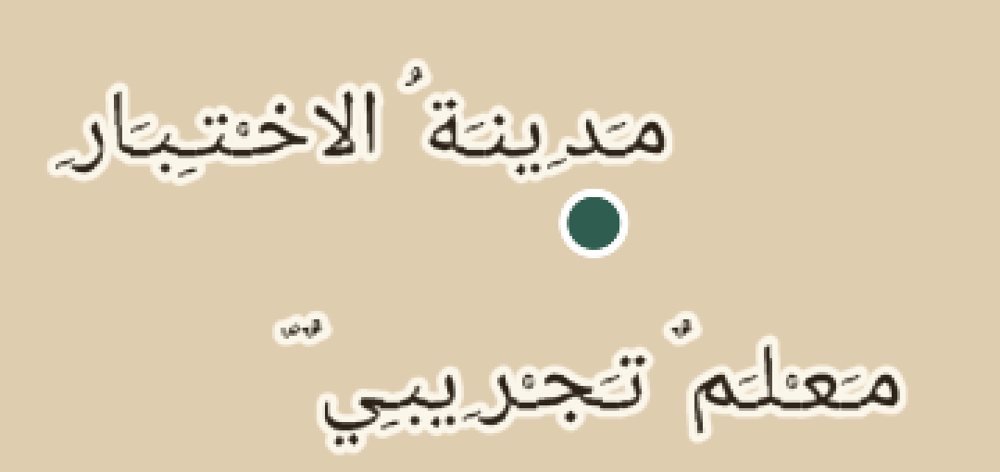
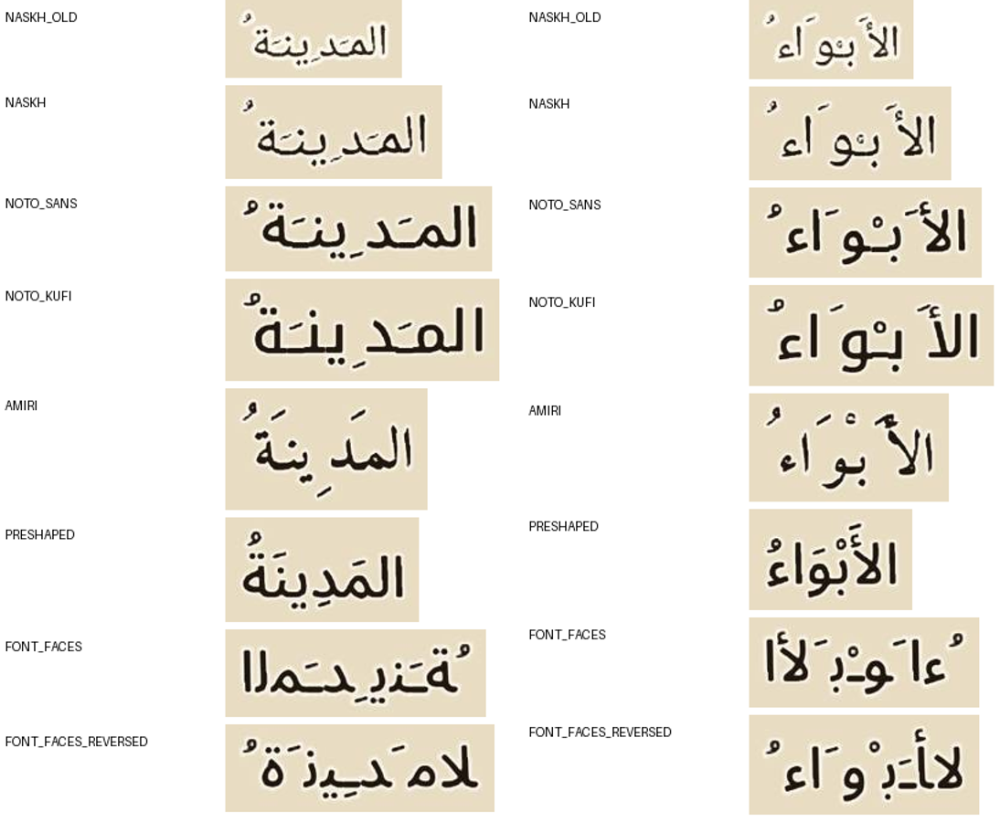
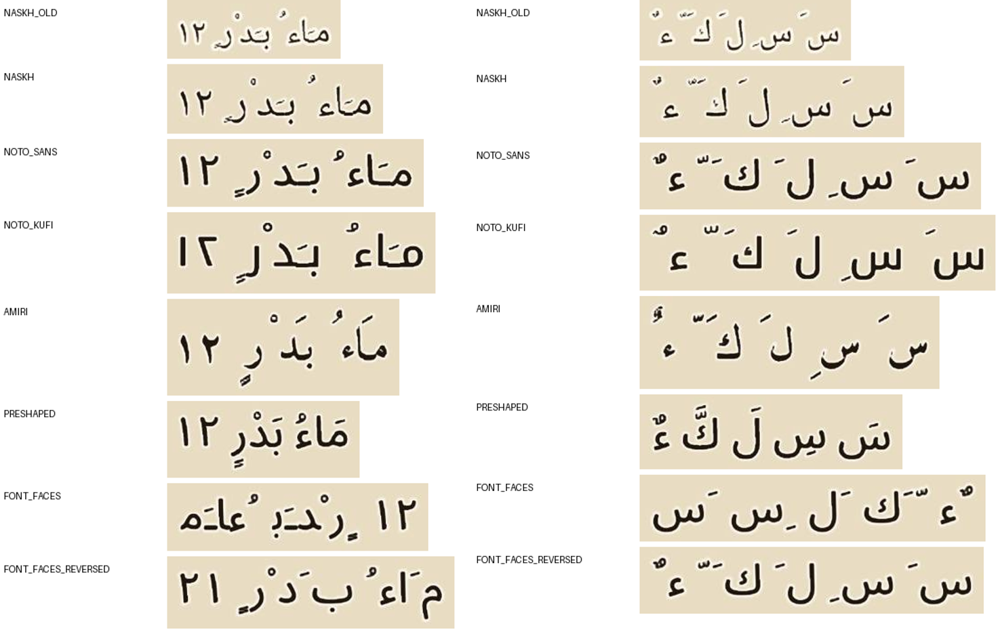
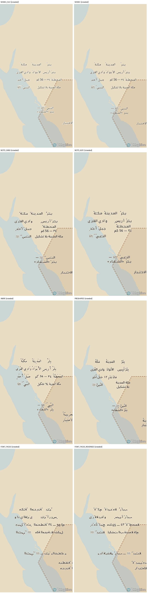

# التجربة التقنية — السيرة

تجربة للتحقق من الاختيارات التقنية المرشحة قبل بناء التطبيق: **Kotlin + Jetpack Compose**، و**MapLibre Native Android 13.7.1**، و**Room/SQLite**، و**PMTiles**.

> **كل البيانات هنا بيانات اختبار**: أسماء خيالية، و«سنوات اختبار» من ١ إلى ٦ وليست تواريخ، وأشكال هندسية واضحة، ونصوص تجريبية بمصادر وهمية. والواجهة مؤقتة لخدمة التجربة، وليست قرارًا تصميميًا.
>
> **حجم العينة ليس تقديرًا لحجم الحزمة النهائية.**

## تجربة خطوط أسماء الخريطة (Android)

آخر تشغيلة ناجحة بكل المراحل والـAPK: [CI run 12](https://github.com/MohdFarag/seerah/actions/runs/42275483277). صور المقارنة من [run 9](https://github.com/MohdFarag/seerah/actions/runs/42266127494) على محاكي Android 14 (pixel_6)، ومجمعة في [`docs/fonts/`](docs/fonts/).

### التشخيص: من أين يأتي سوء التشكيل في glyph PBF؟

| المصدر المحتمل | الدليل | الحكم |
| --- | --- | --- |
| توليد الحروف وقياساتها | قياسات مولدي (العرض، الارتفاع، left، top، advance) طابقت مولدًا مرجعيًا مستقلًا (`build_pbf_glyphs` من Stadia Maps) بفارق تقريب ±١ بكسل | **ليس السبب الرئيسي** |
| تموضع الحركات في المحرك | في مسار PBF يحوّل المحرك الحروف إلى أشكال العرض (ICU) ويضع كل حرف وحركة بالـ advance فقط، **دون GPOS** (لا ربط للحركة بمرساة حرفها). على الجهاز، مع **كل** الخطوط: الضمة والتنوين على الحرف الأخير تنزاح يسارًا خارج الكلمة («المدينةُ»، «الأبواءُ»، «ءٌ»)، والفتحة تقع بين حرفين، والشدة مع الفتحة متجاورتان لا مركبتان («كَّ») | **السبب الأساسي**: حد في المحرك لا يصلحه تغيير الخط |
| إعدادات الخط والحجم والإطار | حركات Noto Naskh نحو ٥×٤ بكسل عند الحجم الأساسي ٢٤ (أقل من ٤ بكسل عند حجم ١٧)، وإطار (halo) بعرض ١٫٦ كان يغمرها | **عامل مضاعف**: يُحسَّن بالإعدادات |



### المقارنة (نفس المشهد والأسماء والتشكيل ومستوى التكبير)

ثلاثة خطوط بترخيص SIL OFL 1.1 (يسمح بالتضمين والتوزيع داخل التطبيق دون إنترنت؛ نص الترخيص داخل الحزمة):

- **Noto Sans Arabic** (Medium): حديث بلا زوائد.
- **Noto Kufi Arabic** (Medium): كوفي هندسي.
- **Amiri** (Bold): نسخ كلاسيكي.

ومعها **Noto Naskh** خطًا أساسًا للمقارنة، بالإعدادات السابقة وبالمضبوطة.

الإعدادات المضبوطة لكل المتغيرات:

- حجم يكبر مع التقريب: من ١٥ عند z4 إلى ٢٢ عند z8.
- إطار أرق وناعم: عرض ١٫١ مع blur ٠٫٤.
- لون أغمق.
- ارتفاع سطر ١٫٣٥.




| المتغير | ما تحسن | ما بقي معيبًا |
| --- | --- | --- |
| Noto Naskh مضبوط | أكبر وأوضح من السابق، والإطار لا يغمر الحركات | الحركات منزاحة كما هي؛ حروفه رفيعة على الخريطة |
| Noto Sans Arabic | حروف واضحة وقوية | الحركات منفصلة عن حروفها وتنزاح عند الحرف الأخير |
| Noto Kufi Arabic | أوضح الحروف قراءة عند الإبعاد | الحركات متباعدة عن حروفها |
| Amiri | **أفضل متغيرات PBF**: حركاته كبيرة، وأغلبها قريب من موضعه | تنوين/ضمة الحرف الأخير ما زالت تنزاح، والشدة المركبة غير سليمة |
| **مُشكَّل مسبقًا (HarfBuzz)** | **كل الحركات في مواضعها الصحيحة**: الشدة والفتحة مركبتان، والهمزة والتنوين صحيحان، والأرقام بترتيب صحيح، والسطران بترتيب صحيح | انظر الحدود أدناه |
| font-faces (HarfBuzz في المحرك) | — | **معكوس ومنفصل الحروف** |
| font-faces بنص معكوس (تشخيص) | الترتيب يصح | **الحروف تبقى منفصلة**، ولام-ألف مكسورة |

**ما يكشفه متغير التشخيص**: مسار `font-faces` في MapLibre Native 13.7.1 يعكس النص (bidi) **قبل** HarfBuzz، ثم لا يطبق تشكيل العربية. هذا عطل في المحرك، لا في الخط أو البيانات.

التزاحم والتقريب والإبعاد: كل المتغيرات تُخفي الأسماء المتصادمة بالطريقة نفسها، والتسمية الطويلة تنقسم سطرين بالترتيب الصحيح.



### البديل الذي يعرض العربية صحيحة: تشكيل مسبق عند بناء الحزمة

- **الفكرة:** عند بناء الحزمة تُشكَّل كل كلمة من أسماء الخريطة بـ HarfBuzz بالخط نفسه، بـ GSUB وGPOS أي بمراسي الحركات الحقيقية. وتُخزّن الكلمة حرفًا واحدًا (SDF) في منطقة الاستخدام الخاص (PUA) داخل ملفات glyph PBF نفسها. المحرك يضع كلمات كاملة، ولا يضع حركات.
- **المحفوظ كما هو:** دون إنترنت، وتغيّر الأسماء بحسب الزمن (فلاتر الطبقات نفسها)، والتزاحم، والإطار، والتحجيم.
- **الاسم الأصلي يبقى في البيانات** (`name`) للبحث والوصول وTalkBack. ما يُعرض هو `name_ps`.
- **ليس تحويلًا للأسماء إلى صور تسميات:** هي حروف SDF كلمةً كلمة، يرسمها المحرك ويُخفيها عند التصادم كالنص العادي.
- **التكلفة في العينة:** نحو ١٫٨ ك.ب لكل كلمة فريدة (٥٤ كلمة = ٩٦ ك.ب)، مقابل نحو ١ م.ب لمجموعة حروف خط كامل. **العينة ليست تقديرًا للحجم النهائي.**
- **حدوده:**
  - يحتاج كل اسم معروفًا وقت بناء الحزمة. هذا متحقق هنا، فالأسماء جزء من الحزمة وتحديثاتها.
  - تقسيم الأسطر يتم وقت البناء.
  - لا تباعد حروف (letter-spacing) داخل الكلمة.
  - منطقة PUA الأساسية تتسع لـ ٦٤٠٠ كلمة فريدة، وبعدها PUA-A.

أخطاء وجدتها وأصلحتها في الطريق:

- **تكبير الخريطة في MapLibre بوحدات dp:** أول مشاهد التجربة كانت أضيق مما حسبت.
- **لقطات قديمة:** أول لقطات «المُشكَّل مسبقًا» كانت إطارًا قديمًا مطابقًا لـ Amiri بكسلًا بكسلًا. الاختبار الآن ينتظر إطارًا مكتمل الرسم جديدًا.
- **ذاكرة حروف المحرك بعد التحديث:** المحرك يحفظ الحروف باسم مجموعة الخط، والتشكيل المسبق يعيد ترقيم الكلمات حين يتغير المحتوى. فصار اسم مجموعة الحروف المشكَّلة مسبقًا يتضمن بصمة جدول الكلمات، وتقرؤه التطبيق من `labels.json` في الحزمة. كشفه اختبار التحديث على المحاكي.
- **ترميز حروف المسافة والترقيم:** حروف المسافة والترقيم في المتغير المُشكَّل مسبقًا كانت مرمّزة خطأً. أضفت فحصًا لكل ملفات glyph عند البناء.

### الترشيح

1. **للعرض الصحيح: المُشكَّل مسبقًا.** هو الوحيد الذي تظهر فيه الحركات في مواضعها على Android. والتجربة استخدمت Noto Sans Arabic، ويمكن بناؤه بأي خط مختار (Amiri أو Kufi) دون تغيير في التطبيق.
2. **إن بقينا على PBF العادي: Amiri.** أقل الخطوط تضررًا من غياب GPOS. لكن العيب الأساسي يبقى.
3. **`font-faces` غير صالح للعربية في 13.7.1.** يستحق بلاغًا لمشروع MapLibre Native.

الاختيار البصري النهائي لك. التطبيق يفتح على «مُشكَّل مسبقًا»، وكل المتغيرات قابلة للتبديل من زر «خط أسماء الخريطة».

## أين تجري التجربة

يبني [`.github/workflows/android-spike.yml`](../.github/workflows/android-spike.yml) على GitHub Actions كل ما يلي عند كل دفع (push):

- حزمة الاختبار.
- اختبارات `core`.
- ملفات APK: debug، وrelease لكل معمارية، وrelease عامة.
- اختبارات الجهاز، على **محاكيي Android 14 (API 34، x86_64)**: هاتف `pixel_6` وتابلت `pixel_tablet`.

النتائج والصور ترفع كـartifacts.

اختبارات الجهاز مقسمة على مراحل بسكربت [`android/ci/device-tests.sh`](android/ci/device-tests.sh). كل مرحلة تعمل في **عملية (process) جديدة** للتطبيق، وبيانات التطبيق تبقى بين المراحل.

| المرحلة | ما تتحقق منه | الهاتف | التابلت |
| --- | --- | --- | --- |
| 1-flow | PMTiles محلي، الأسماء العربية بمساري الخطوط، الزمن، فتح الحدث | ✅ | ✅ |
| 2-restart-offline-v1 | إيقاف قسري ثم **وضع الطيران** وتشغيل جديد: الخريطة والمحتوى والمتابعة | ✅ | ✅ |
| 3a-update-corrupt | حزمة تالفة: تُرفض وتبقى النسخة العاملة | ✅ | ✅ |
| 3b-update-cut-resume | خادم يقطع التنزيل، ثم استكمال، ثم تثبيت 1.1.0 مع **حفظ التقدم** | ✅ | ✅ |
| 4-restart-offline-v2 | وضع الطيران بعد التحديث: النسخة الجديدة والتقدم | ✅ | ✅ |
| 5-perf | تحريك وتقريب مبرمج لمدة ٢٠ ثانية، مع قياس | ✅ | ✅ |

الأدوات والإصدارات: MapLibre Android **13.7.1** (2026-10-15)، وAGP 8.13.0، وKotlin 2.2.20، وCompose BOM 2025.09.00، وRoom 2.8.0، وcompileSdk 36، وminSdk 26 (اختيار للتجربة فقط).

## النتائج

### 1. العربية على الخريطة: نتيجة Android

في MapLibre Native مساران مختلفان لرسم الأسماء:

| المسار | الآلية | النتيجة على Android (13.7.1) |
| --- | --- | --- |
| **glyph PBF** (`glyphs` في النمط) | حروف SDF مولّدة مسبقًا لكل نطاق Unicode؛ يحوّل المحرك العربية إلى أشكال العرض عبر ICU ويرتب الاتجاه بـ `ubidi` | ✅ **الحروف متصلة وبالترتيب الصحيح، والتشكيل يظهر في مواضع مقبولة**، ومعه ﷺ والأرقام والنص اللاتيني بين الأقواس |
| **font-faces** (خاصية `font-faces` في النمط، Android منذ 11.13.0) | ملف خط حقيقي (TTF) يقرؤه FreeType ويشكّله HarfBuzz | ❌ **النص العربي يظهر معكوسًا وحروفه منفصلة** ("ﺔﻨﻳﺪﻣ" بدل "مدينة") |

**تصحيح لما كتبته سابقًا**: قلت إن MapLibre لا يستخدم HarfBuzz، وهذا غير دقيق. المكتبة تضم HarfBuzz وFreeType، وتستخدمهما عند تعريف `font-faces`. أما مسار glyph PBF الذي جربته أولًا فلا يستخدمهما.

الملاحظة الثانية: `font-faces` غير مدعوم في GL JS أصلًا، فاختبار المتصفح السابق لم يكن يمثل هذا المسار.

**ما يعنيه ذلك:**

- المسار الصالح حاليًا هو **glyph PBF**، وأصبح الافتراضي في التطبيق. ويبقى زر في الواجهة للتبديل للمقارنة.
- **لم أحذف التشكيل ولم أحوّل الأسماء إلى صور.** نتيجة PBF على المحاكي مقبولة، ويبقى الحكم البصري النهائي لك على جهاز فعلي.
- عطل `font-faces` مع العربية يستحق بلاغًا لمشروع MapLibre Native بمثال صغير. لم أفتح البلاغ، والقرار لك.

> **ثغرة في الاختبارات الآلية**: اختبارات الأسماء تقرأ قيمة الاسم من المحرك (`queryRenderedFeatures`)، لا شكله المرسوم، فمرّ النص المعكوس دون أن تكتشفه. الحكم على الشكل الآن بالصور. اختبار بصري آلي (مقارنة بصورة مرجعية) مقترح للمرحلة التالية.

### 2. PMTiles محليًا

يُقرأ الأساس الجغرافي من ملف `pmtiles://file://…` داخل مجلد الحزمة على الجهاز، دون أي خادم. والاختبار يتحقق من أن طبقة اليابسة رُسمت فعلًا، وأن ذلك يحدث في وضع الطيران أيضًا.

### 3. التغيرات الزمنية

تُتحقق من الحالة التي **رسمها المحرك فعلًا**، لا من منطق التطبيق وحده:

- **السنة ٢**: «قرية الاختبار»، والحدود مستطيل، ولا معلم.
- **نهاية السنة ٣**: «مدينة الاختبار»، والحدود سداسي، والمعلم ظاهر.

زمن تطبيق تغيير الزمن (فلاتر الطبقات) بين **٦ و٨٦ م.ث** على المحاكي.

### 4. فتح الحدث بدقة تاريخه (لا نهاية السنة)

كل تغير في الخريطة وكل حدث لهما **مدى زمني بحسب دقتهما**: «السنة ٣» تعني كل السنة، و«الشهر ٧ من السنة ٣» تعني ذلك الشهر.

- **العرض السنوي** يمثل نهاية السنة.
- **فتح حدث** يضبط الخريطة على مدى الحدث نفسه.
- يُعد التغير قد حدث فقط إذا انتهى مداه قبل بداية مدى العرض.
- إذا تداخل المديان، فترتيبهما مجهول. تُعرض الحالة السابقة، ويظهر تنبيه بالاسم، ولا يُخمَّن شيء.

ما تحقق على المحاكي، بالحدث ٢ (الشهر ٧ من السنة ٣):

- **المعلم المبني في الشهر ٩ من السنة نفسها لا يظهر**، ويظهر عند إغلاق الحدث والعودة إلى العرض السنوي.
- **إعادة تسمية مؤرخة بـ«السنة ٣» فقط** ترتيبها بالنسبة للحدث مجهول، فيُعرض الاسم السابق مع تنبيه.
- الخريطة تنتقل إلى منطقة الحدث، ولا تظهر علامة نقطية، لأن الموضع الدقيق غير معلوم.
- **الحدث ١** (مكان معلوم): علامته ظاهرة.
- **الحدث ٣** (مكان مجهول): لا تتحرك الخريطة.

### 5. إعادة التشغيل دون إنترنت

بعد إيقاف قسري وتفعيل وضع الطيران، والاختبار يتأكد أن الجهاز بلا شبكة:

- يبدأ التطبيق في عملية جديدة.
- يستعيد الحدث المفتوح ونقطة المتابعة.
- تُرسم الخريطة والأسماء من الملفات المحلية.

نجح ذلك قبل التحديث وبعده. الزمن من التشغيل حتى جاهزية المحتوى بين **٥٢٩ و٧٨٧ م.ث**.

### 6. تحديث الحزمة دون تحديث التطبيق

- **حزمة تالفة**: رُفضت وبقيت 1.0.0.
- **تنزيل مقطوع عند ٣٠٠ ألف بايت**: لم يتغير شيء، ثم استُكمل من حيث توقف، وثُبّتت 1.1.0 في **٣٤٥–٤٦٩ م.ث**.
- بعد التحديث:
  - **نقطة المتابعة بقيت** كما هي.
  - الحدث ٤ الجديد موجود.
  - **اسم المعلم المصحح يظهر على الخريطة**.

### 7. الحجم والسلاسة والذاكرة

| القياس | القيمة | الملاحظة |
| --- | --- | --- |
| حزمة الاختبار مضغوطة / مفكوكة | 0.91 / 1.63 م.ب | عينة فقط، **ليست تقديرًا للحزمة النهائية** |
| APK release عام (٤ معماريات) | 52 م.ب | معظمه مكتبة MapLibre الأصلية؛ الإصدار النهائي يُنشر App Bundle مقسّمًا |
| APK release لـarm64 وحدها | انظر `apk-sizes.txt` في artifact | هذا ما يُثبّت على هاتف حديث |
| الذاكرة (PSS) أثناء التحريك | ~150 م.ب (Native ~60 م.ب) | محاكٍ |
| الإطارات | ~16 إطارًا/ثانية | **محاكٍ برسم برمجي (SwiftShader)؛ لا يمثل جهازًا حقيقيًا** |

`renderingTime` من MapLibre يعطي صفرًا مع الرسم البرمجي، فاستبدلته بقياس الفاصل بين الإطارات.

## ما يحتاج منك جهازًا فعليًا

1. **الحكم البصري على العربية** بمسار PBF، على هاتف وتابلت بكثافة شاشة حقيقية. وكذلك مقارنة مسار `font-faces` بزر التبديل لتأكيد العطل على عتاد حقيقي.
2. **السلاسة والذاكرة والحرارة والبطارية**: أرقام المحاكي لا تصلح أساسًا للأهداف.
3. **وضع الطيران الحقيقي** بعد إغلاق التطبيق من قائمة التطبيقات الأخيرة، وإعادة تشغيل الجهاز.
4. **قارئ الشاشة (TalkBack) وتكبير النص.**
5. **تحديث عبر شبكة حقيقية**: شغّل `python3 spike/pack/serve.py --cut-after 300000` ثم `adb reverse tcp:8765 tcp:8765`.

خطوات التثبيت: نزّل `app-arm64-v8a-release.apk` من artifact باسم `seerah-spike-apk` (أو من الملف المرفق)، ثم:

```sh
adb install app-arm64-v8a-release.apk
```

أو انسخ الملف إلى الهاتف وثبّته مع السماح بالتثبيت من مصادر غير معروفة. وفي التطبيق، زر «خطوط الخريطة» يبدّل بين المسارين.

## التشغيل محليًا

```sh
cd spike/pack && pip install -r requirements.txt && ./prepare_sources.sh && python3 build.py
cd ../android
./gradlew :core:test               # لا يحتاج Android SDK
./gradlew :app:assembleRelease     # يحتاج SDK (local.properties: sdk.dir=...)
OUT=results ./ci/device-tests.sh   # بعد assembleDebug assembleDebugAndroidTest، مع جهاز أو محاكٍ متصل
```

## البنية

```text
spike/
  pack/          بناء حزمة الاختبار (PMTiles + خطوط PBF + TTF + GeoJSON زمني + محتوى + manifest) وخادم التحديث
  android/
    core/        منطق مستقل عن Android: المحتوى، والزمن بحسب الدقة، وتثبيت الحزم وتحديثها، والتنزيل، والتقدم
    app/         تطبيق Compose + MapLibre + Room، واختبارات الجهاز (androidTest)
    ci/          سكربت المراحل على الجهاز
  docs/          لقطات
```
