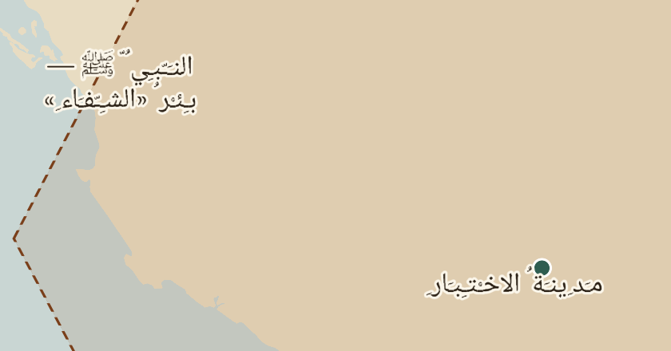

# التجربة التقنية — السيرة

تجربة صغيرة للتحقق من الاختيارات التقنية المرشحة قبل بناء التطبيق: **Kotlin + Jetpack Compose**، و**MapLibre Native Android**، و**Room/SQLite**، و**PMTiles**.

> **كل البيانات هنا بيانات اختبار**: أسماء خيالية، و«سنوات اختبار» من ١ إلى ٦ وليست تواريخ، وأشكال هندسية واضحة، ونصوص تجريبية بمصادر وهمية. لا شيء منها محتوى للسيرة أو ادعاء تاريخي. والواجهة بسيطة لخدمة التجربة فقط، وليست قرارًا تصميميًا.

## الخلاصة

| # | المطلوب | الحالة | الدليل |
| --- | --- | --- | --- |
| 1 | خريطة بأساس جغرافي مبسط وبيانات محلية | ✅ البيانات جاهزة ومُتحقق منها؛ ⏳ العرض على Android | PMTiles مولّد ومعروض في متصفح (لقطات أدناه) |
| 2 | سلامة الأسماء العربية | ⚠️ الاتصال سليم؛ التشكيل يظهر بدقة موضع محدودة | لقطات GL JS؛ مكتبة Native فيها ICU للتشكيل (`u_shapeArabic`) |
| 3 | تغيير الاسم والحدود وظهور المعلم بحسب الزمن | ✅ المنطق والبيانات (اختبارات)؛ ⏳ على الجهاز | `TimeStatesTest` + لقطات سنة ١ مقابل ٣ |
| 4 | فتح حدث بنصه ومصدره وضبط زمنه ومكانه | ✅ المنطق؛ ⏳ الواجهة على الجهاز | `ContentTest`؛ الحدث مجهول المكان لا يحرك الخريطة |
| 5 | الاستمرار بعد إعادة التشغيل في وضع الطيران | ⏳ يحتاج جهازًا | لا مصادر شبكية في النمط (اختبار يرفض أي `http`) |
| 6 | تحديث الحزمة دون تحديث التطبيق مع حفظ التقدم | ✅ المنطق كاملًا (اختبارات)؛ ⏳ على الجهاز | `PackStoreTest`، `UpdaterTest` (انقطاع واستكمال)، `ProgressTest` |
| 7 | الحجم والسلاسة والذاكرة | ✅ الحجم؛ ⏳ السلاسة والذاكرة | الحجم أدناه؛ أداة القياس مدمجة في التطبيق |

✅ تحقق هنا · ⚠️ تحقق جزئي مع ملاحظة · ⏳ لم يُختبر بعد، ويحتاج جهاز Android

### لماذا لم يُختبر شيء على Android بعد

بيئة العمل السحابية التي نفذت فيها التجربة:

- تمنع الوصول إلى `dl.google.com`، و`maven.google.com` يحيل إليه. لذلك لا يتوفر Android SDK ولا Android Gradle Plugin ولا مكتبات AndroidX (Compose وRoom)، ولم يُبنَ ملف APK.
- لا تدعم المحاكاة المسرّعة (لا KVM)، فلا يوجد محاكٍ.

المتاح كان Maven Central وnpm وPyPI. فبُني كل ما لا يحتاج SDK واختُبر، وكُتب تطبيق Android كاملًا جاهزًا للتشغيل على جهازك. **لم يُترجم كود التطبيق نفسه** بعد، لكن كل استدعاءات MapLibre فيه طوبقت مع مكتبة 13.7.1 الفعلية (فحص `javap`).

## النتائج والملاحظات

### الحزمة دون اتصال

| المكون | الحجم |
| --- | --- |
| الأساس الجغرافي `basemap.pmtiles` (العالم z0–4، والتفاصيل z5–8 للجزيرة والشام ومصر والحبشة والعراق) | 462 ك.ب |
| خطوط الخريطة (Noto Naskh Arabic + Noto Sans، ٩ نطاقات، ١٧٣٧ حرفًا) | 948 ك.ب |
| الطبقات التاريخية والمحتوى التجريبي | 7 ك.ب |
| **الحزمة مضغوطة / مفكوكة** | **812 ك.ب / 1.42 م.ب** |
| مكتبة MapLibre الأصلية في التطبيق (لكل معمارية، غير مضغوطة) | ~13 م.ب لـ arm64 |

- **الحجم ليس عائقًا في هذا المستوى**. الخطوط هي الأكبر، ويمكن تقليصها بحذف النطاقات غير المستخدمة. الحجم الحقيقي يتحدد بالمحتوى الفعلي ومستوى التكبير الأقصى، وهو قرار مؤجل. كل مستوى تكبير إضافي يضاعف عدد البلاطات تقريبًا ×٤ في منطقة التفاصيل.
- بناء الحزمة **App Bundle مقسّم بالمعمارية** ضروري، حتى لا يحمل المستخدم مكتبات المعماريات الأربع (~48 م.ب غير مضغوطة).

### العربية على الخريطة (أهم ملاحظة)

 

اللقطتان من MapLibre **GL JS** في متصفح، وهي ليست MapLibre Native، لكنها تستخدم الحزمة والخطوط والنمط نفسها:

- **اتصال الحروف سليم**، وكذلك ﷺ، والأرقام العربية والغربية، والنص اللاتيني بين الأقواس، وتقسيم الأسطر.
- **التشكيل يظهر، لكن مواضعه تقريبية**. محركات خرائط MapLibre لا تطبق تموضع الحركات (لا تستخدم HarfBuzz/GPOS)، بل تحوّل الحروف إلى أشكال العرض العربية عبر ICU. لذلك قد تنزاح الحركات قليلًا أو تتباعد.
- **لا يُعمم هذا على Android تلقائيًا**. مكتبة Native تضم ICU (`u_shapeArabic` و`ubidi`)، فالمتوقع سلوك مشابه، ويلزم تأكيده على الجهاز.
- **نصوص الأحداث والروايات تعرض في Compose** (خارج الخريطة)، وهي تستخدم محرك النصوص في Android، فيكون التشكيل الكامل فيها صحيحًا.

**اقتراح:** أسماء الخريطة بلا تشكيل أو بتشكيل أدنى عند الحاجة، والتشكيل الكامل في نصوص الحدث. إذا ثبت على الجهاز أن التشكيل على الخريطة غير مقبول ويلزم، فالبديل رسم أسماء الأماكن المهمة كصور/رموز مولدة مسبقًا. وهذا مكلف في التحديث والتعديل، فلا أنصح به إلا عند الضرورة.

### الزمن

- كل كيان (مكان، منطقة حكم، معلم) له **هوية ثابتة وحالات زمنية** (`from`/`to`). التطبيق يختار الحالة، والمحرك يرسمها. لا تُولَّد حدود وسيطة.
- العرض السنوي يمثل **حالة نهاية السنة**، فالتغيير خلال السنة ٣ يظهر عند اختيار ٣.
- التنفيذ بتغيير فلاتر الطبقات (`setFilter`) دون إعادة تحميل النمط، والمتوقع أن يكون فوريًا. يسجل التطبيق زمنه في Logcat.
- اختبار آلي يمنع تداخل حالات الكيان الواحد، ويضمن حالة واحدة لكل كيان في كل سنة.

### الحدث

- الحدث معلوم المكان: علامة على الخريطة، والخريطة تنتقل إليه.
- المنطقة معلومة والموضع مجهول: لا علامة نقطية، والخريطة تنتقل إلى المنطقة مع تنبيه «الموضع الدقيق غير معروف».
- المكان مجهول: لا علامة، ولا تتحرك الخريطة، ويبقى الحدث في الفهرس.
- التاريخ يعرض بدقته فقط («الشهر ٧ من سنة اختبار ٣ (تقريبي)»). والتحقق يرفض بيانات فيها شهر مع دقة «سنة».

### التحديث وحفظ التقدم

- الحزمة لا تُفعّل إلا بعد التحقق من **مجموع SHA-256 للحزمة ولكل ملف**، ومن صحة المحتوى، وأن الإصدار أحدث. التبديل خطوة ذرية واحدة (`rename`)، فأي انقطاع قبلها يترك النسخة العاملة.
- **ثُبّت بالاختبارات**:
  - رفض حزمة تالفة مع بقاء v1.
  - رفض مجموع معلن خاطئ.
  - رفض نسخة أقدم.
  - الرجوع إلى النسخة السابقة إذا تلفت النشطة.
  - تنظيف بقايا تثبيت منقطع.
  - **استكمال تنزيل منقطع** من حيث توقف (HTTP Range).
- تقدم المستخدم في قاعدة Room **منفصلة** عن ملفات المحتوى، ومعرفات الأحداث ثابتة، فيبقى التقدم بعد التحديث. إذا حُذف الحدث المتابَع، تُمسح نقطة المتابعة مع إشعار، ولا تُستبدل بشيء دون علم المستخدم.
- **ثغرة اكتُشفت وعولجت**: ملف zip فيه اسم مكرر قد يخفي ملفًا بعد التحقق، فالفك الآن يرفض الأسماء المكررة ومسارات الخروج من المجلد.

### أخطاء وجدتها التجربة في البيانات

1. **الحروف الفارغة (مثل المسافة) يجب ألا تحمل صورة.** صورة فارغة تجعل المحرك يرفض النطاق كله، فتختفي كل الأسماء.
2. **مضلعات اليابسة العابرة لخط الطول 180** ظهرت أشرطة أفقية عبر العالم. عولج ذلك بتوحيد الإحداثيات ثم القص.

كلاهما كان سيظهر في Native أيضًا، ولهذا فائدة فحص الحزمة في GL JS قبل الجهاز.

## التعديلات المقترحة على الاختيارات

| الاختيار | التوصية | السبب |
| --- | --- | --- |
| Kotlin + Compose | **الاستمرار** | لا مانع ظهر؛ والنصوص الطويلة بالتشكيل تعرض في Compose بمحرك Android الكامل |
| MapLibre Native | **الاستمرار مشروطًا** بنتيجة التشكيل على الجهاز | يدعم PMTiles وملفات محلية وICU؛ تموضع التشكيل نقطة الخطر الوحيدة المعروفة |
| PMTiles | **اعتماده للأساس الجغرافي** | ملف واحد، يقرأ محليًا دون خادم، صغير الحجم، ومولّد بأدوات مفتوحة |
| الطبقات التاريخية | **GeoJSON محلي** في هذه المرحلة، وتحويلها إلى PMTiles إذا كبرت | تعديلها ومراجعتها أسهل، وحجمها الحالي صغير جدًا |
| Room | **للتقدم والإعدادات**. والمحتوى **JSON في الحزمة** حاليًا، ثم SQLite جاهزة داخل الحزمة عند كبر المحتوى | فصل حالة المستخدم عن المحتوى القابل للاستبدال؛ Room مع قاعدة محتوى مستبدلة يتطلب تطابق المخطط بدقة |
| إصدار MapLibre | **13.7.1** | آخر إصدار مستقر بترقيم معتاد (2026-10-15)؛ إصدارات `2026.x-globe` الأحدث فرع مختلف يحتاج مراجعة |
| خطوط الخريطة | **أداة رسمية** (`maplibre/font-maker`) للإنتاج بدل مولد التجربة | مولد التجربة مكتوب بسرعة، ونتيجته جيدة لكنه غير مختبر على نطاق واسع |

## التشغيل على جهازك

المتطلبات: Android Studio (أو SDK 36)، وPython 3.11+، وNode.js، وجهاز Android أو محاكٍ.

```sh
# 1. بناء الحزمة
cd spike/pack
pip install -r requirements.txt
./prepare_sources.sh
python3 build.py              # dist/pack-*.zip + dist/assets/seed-pack.zip

# 2. اختبارات المنطق (لا تحتاج SDK)
cd ../android
./gradlew :core:test

# 3. التطبيق (يحتاج SDK؛ عرّفه في local.properties: sdk.dir=...)
./gradlew :app:installRelease
```

### قائمة الاختبار على الجهاز

نفّذها على **هاتف وتابلت**، وسجل النتائج من شريط القياس أو من Logcat (`adb logcat -s SeerahSpike`).

1. **الخريطة**: افتح التطبيق، وحرك الخريطة وقرّبها من مستوى العالم حتى منطقة التفاصيل.
2. **العربية**: قرّب على المنطقة التجريبية، وقارن «بئر بلا تشكيل» بالأسماء المشكولة، وافحص ﷺ والأرقام وسطر `Test-Lab`. صوّر الشاشة.
3. **الزمن**: انتقل بين السنة ٢ والسنة ٣، فيجب أن يتغير الاسم، ويتبدل المستطيل إلى سداسي، ويظهر المعلم. واختر السنة ٦ لترى رسالة «لا توجد أحداث» مع زر الحدث السابق.
4. **الحدث**: افتح الأحداث ١ و٢ و٣، وتحقق من النص والمصدر والدقة. الحدث ٣ يجب ألا يحرك الخريطة.
5. **وضع الطيران**: اجعل الحدث ٢ نقطة المتابعة، وحرك الخريطة، ثم أغلق التطبيق كليًا (من قائمة التطبيقات الأخيرة). فعّل وضع الطيران وافتحه: يجب أن تعود الخريطة والزمن والمتابعة، ويعمل كل شيء.
6. **التحديث**:
   - على الحاسوب: شغّل `python3 spike/pack/serve.py --cut-after 300000` ثم `adb reverse tcp:8765 tcp:8765`.
   - في التطبيق: تحقق من التحديث، ثم نزّل. سينقطع التنزيل، فاضغط تنزيل مرة أخرى ليستكمل.
   - تحقق من: الحزمة 1.1.0، والحدث ٤ في السنة ٥، والمعلم باسمه المصحح، وأن المتابعة لم تتغير.
   - أعد التجربة مع `--offer corrupt` على جهاز جديد أو بعد مسح البيانات: يجب رفض الحزمة.
7. **القياس**: بنسخة `release`، حرك الخريطة بسرعة ٣٠ ثانية، ثم اضغط «تسجيل القياس». سجّل fps وزمن الرسم p50/p95 وPSS وحجم التطبيق، على جهاز متوسط وجهاز ضعيف إن توفر.

## ما لم يُختبر بعد

- عرض MapLibre Native الفعلي للخريطة والعربية على Android.
- ترجمة كود التطبيق نفسه (`:app`). كُتب ولم يُترجم لغياب SDK.
- العمل دون اتصال بعد إعادة التشغيل، والسلاسة، والذاكرة، والحرارة، والبطارية.
- الهاتف مقابل التابلت.
- قارئ الشاشة وتكبير النص.
- حجم المحتوى الحقيقي.

## البنية

```text
spike/
  pack/      بناء حزمة الاختبار (PMTiles + خطوط + GeoJSON + محتوى + manifest) وخادم التحديث المحلي
  android/
    core/    منطق مستقل عن Android: المحتوى، الحالات الزمنية، تثبيت الحزم وتحديثها، التنزيل، التقدم (مع اختبارات)
    app/     تطبيق Compose + MapLibre + Room
  docs/      لقطات التحقق من الحزمة
```
